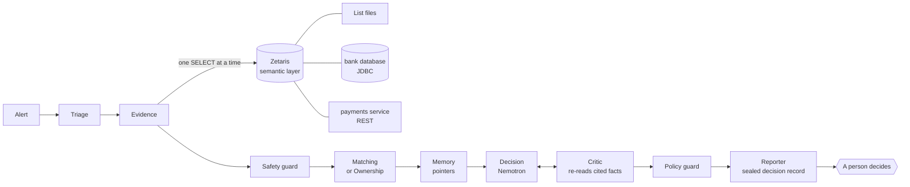

# sanctions-desk

An AI review desk for bank sanctions-screening alerts. For every alert it reads the evidence from the bank's data, compares the customer (or payment party, or owner) with the listed party under approved definitions, asks Nemotron models for a recommendation, has a second step re-read every cited fact, applies a written policy, and hands a **recommendation with its evidence** to a person. **A human always makes the final call**: the desk never blocks, never writes to a source system and never messages a customer.

Built for the Open Agent Hackathon 2026, Track 03 (Reasoning Architecture).

<!-- headline:start -->
**Headline result** (full system on the 68-alert exam, one run): 31% of alerts closed with cited evidence, 69% escalated; about 401 analyst minutes saved per 100 alerts (assuming 15 minutes per alert and 2 to confirm a close); false closes on cases that carry real risk: 0 of 42. Details, assumptions and the comparison with plain name matching: [eval/REPORT.md](eval/REPORT.md).
<!-- headline:end -->

## Contents

- [What it does](#what-it-does)
- [Try it in two minutes](#try-it-in-two-minutes)
- [How it works](#how-it-works)
- [How sponsor technology is used](#how-sponsor-technology-is-used)
- [The decision trace](#the-decision-trace)
- [Review desk interface](#review-desk-interface)
- [Evaluation](#evaluation)
- [Edge cases handled](#edge-cases-handled)
- [Guardrails](#guardrails)
- [Failure handling](#failure-handling)
- [Responsible AI](#responsible-ai)
- [Data sources and licences](#data-sources-and-licences)
- [Run it live](#run-it-live)
- [Configuration](#configuration)
- [API](#api)
- [Policy](#policy)
- [Development](#development)
- [Limits](#limits)
- [AI and Model Usage](#ai-and-model-usage)
- [Third-party code and licence](#third-party-code-and-licence)

## What it does

Name matching raises far more alerts than there are real matches. The desk works the way a careful analyst does:

| Alert                                                    | What the desk checks                                                                                              | Typical outcome                                                                                                                                     |
| -------------------------------------------------------- | ----------------------------------------------------------------------------------------------------------------- | --------------------------------------------------------------------------------------------------------------------------------------------------- |
| A customer's name resembles a listed party               | Date of birth, nationality, document numbers, aliases in other scripts, look-alike letters, earlier decisions     | Close a clear false positive with cited evidence; escalate a true match; ask for more information when data is missing                              |
| A payment counterparty resembles a listed party          | Counterparty name and country, watched jurisdictions                                                              | Escalate a match; refuse to clear a payment with no usable country                                                                                  |
| A listed party appears on a company's ownership register | Effective ownership through chains and several owners, exactly at the 50 percent line, loops, missing percentages | Escalate at or above the threshold; close below it; ask when a percentage is missing                                                                |
| The sanctions list changes                               | Every earlier decision against the entry as it is now                                                             | Re-open cleared cases whose entry changed; offer delisted parties for release by a person; say how many customers and pending payments are affected |
| Text in the data tries to instruct the reviewer          | A safety guard with a written policy and fixed patterns                                                           | Flag it, treat it as data, never close because of it                                                                                                |

## Try it in two minutes

Needs Docker, nothing else: no Zetaris, no model service, no credentials.

```bash
git clone https://github.com/rahulmahadik/sanctions-desk.git && cd sanctions-desk
SAMPLE_MODE=true docker compose up --build        # the API on http://localhost:8000, the review desk on http://localhost:3001

curl -s localhost:8000/run -H 'content-type: application/json' \
  -d '{"alert_id":"ALR-0004"}' | jq '{decision, confidence, rationale, critic, record_hash, sample_notice}'
curl -s localhost:8000/cases/ALR-0004/trace | jq '.definitions, .access, .cost.totals'
curl -s localhost:8000/list-change/replay -X POST -H 'content-type: application/json' -d '{}' | jq '.impact, (.reopen | length), (.release | length)'
```

Open http://localhost:3001 for the review desk: pick an alert, press **Review this alert** and watch the steps light up as the real events arrive. See [Review desk interface](#review-desk-interface). Sample mode runs the real agents on saved answers from real Zetaris queries, with a labelled rules-based stand-in for the language model. See [docs/SAMPLE_MODE.md](docs/SAMPLE_MODE.md). Example inputs are in `input_examples/` and real outputs saved from live runs are in `output_examples/`.

## How it works



| Step         | What it does                                                                                                                                                                                                              | Uses a model                                      |
| ------------ | ------------------------------------------------------------------------------------------------------------------------------------------------------------------------------------------------------------------------- | ------------------------------------------------- |
| Triage       | Chooses the path, judges whether the case is clear or contested                                                                                                                                                           | No                                                |
| Evidence     | Reads the semantic layer's own description, then builds one read-only tool per table and reads the alert, customer, list entry, aliases, dates, countries, identifiers, data-quality results and the approved definitions | No                                                |
| Safety guard | Screens text from the data for instructions aimed at the reviewer                                                                                                                                                         | Yes (fast, local)                                 |
| Matching     | Field-by-field comparison with the approved definitions applied by code (true match, false positive, counterparty match)                                                                                                  | No                                                |
| Ownership    | Reads the register level by level; the ownership engine works out effective ownership                                                                                                                                     | No                                                |
| Memory       | Recalls earlier decisions as pointers (table, row key, content hash) and checks them against the entry now                                                                                                                | No                                                |
| Decision     | Recommends one of four outcomes with cited facts                                                                                                                                                                          | Yes (Nemotron; brief reasoning budget of our own) |
| Critic       | Re-reads every cited fact from the data, checks the recommendation against the definitions, asks a model for unsupported claims; may send it back, up to the policy's limit                                               | Yes                                               |
| Policy guard | Applies the hard rules. It can make a recommendation more cautious, never less                                                                                                                                            | No                                                |
| Reporter     | Seals a hash-protected decision record and returns the answer                                                                                                                                                             | No                                                |

The outcomes are `CLOSE_FALSE_POSITIVE`, `ESCALATE_L2`, `RECOMMEND_BLOCK` (needs two human approvals) and `NEED_MORE_INFO`.

**Approved business definitions** are data in the semantic layer, versioned and cited by id and version in every decision: `true_match`, `false_positive`, `counterparty_match`, `strong_identifier`, `effective_ownership_threshold`. If the approved wording changes and the code has not been reviewed for it, the guard stops automatic closes.

## How sponsor technology is used

### Meterless build: the engines

Three engines from the Meterless specifications are implemented in TypeScript (Apache-2.0, a "derived from the Meterless reference" header on every file) and each does real work in the product:

| Engine                          | What it does in the product                                                                                                                                                                                                                                                                                          | Where in the code                                                               | Used by                                                                               |
| ------------------------------- | -------------------------------------------------------------------------------------------------------------------------------------------------------------------------------------------------------------------------------------------------------------------------------------------------------------------- | ------------------------------------------------------------------------------- | ------------------------------------------------------------------------------------- |
| **H-MEM** (hierarchical memory) | Remembers each earlier decision as its outcome, reason codes and a pointer to the row it rested on (table, key, content hash, list snapshot), never as personal data. On recall the pointer is re-checked: a changed hash makes the memory stale. A person's override beats memory and is written to a trust ledger. | `packages/engines/src/hmem/`, `packages/engines/src/domain/pointer-memory.ts`   | the memory step (`packages/agents/src/memory.ts`)                                     |
| **World Model**                 | Holds each company's ownership picture with provenance and validity dates. The 50 percent rule runs on it: chains multiply, listed owners add up, exactly the threshold counts, a missing percentage is unknown, loops end and a depth limit escalates.                                                              | `packages/engines/src/world-model/`, `packages/engines/src/domain/ownership.ts` | the ownership step (`packages/agents/src/ownership.ts`)                               |
| **Markovian**                   | Re-screens earlier decisions after a list update, in bounded batches with a carried cursor: entries that changed are re-opened, removed ones are offered to a person for release.                                                                                                                                    | `packages/engines/src/markovian/`, `packages/engines/src/domain/rescreen.ts`    | list-change replay (`packages/agents/src/list-change.ts`, `POST /list-change/replay`) |

```bash
npm run test:engines     # the official conformance runners against our code
```

Result of the last run: **H-MEM 13/13, World Model 8/8, Markovian 8/8** checks passed. The official conformance suites are vendored in `packages/engines/conformance/` (copied without change, Apache-2.0, see `NOTICE`), so no other checkout is needed. They run against our engines in `npm test` and in CI, which prints these scorecards on every push. Set `METERLESS_ENGINES_DIR` to run against a newer upstream copy. The engines also have their own unit tests in `packages/engines/test/`.

### Meterless power: Nightshift runs every model call

Nightshift, an OpenAI-compatible runtime, is the AI provider for all model calls. Nothing in the code names a model provider: one injected `generator` function asks Nightshift for a **pinned mode** (`meterless/fast`, `meterless/deep`, `meterless/judge`; `meterless/auto` is rejected), falls back to the Ollama backup only if Nightshift cannot answer, and a labelled rules stand-in exists for sample mode only.

| Step         | Mode we ask for | Reasoning budget (ours) | What it does                                                                                                       |
| ------------ | --------------- | ----------------------- | ------------------------------------------------------------------------------------------------------------------ |
| Safety guard | `fast`          | none                    | Reads text that came out of the data for instructions aimed at the reviewer; checks drafts for tipping off         |
| Decision     | `deep`          | 500 tokens              | Recommends one of four outcomes with cited facts                                                                   |
| Critic       | `judge`         | 400 tokens              | Checks the recommendation against the evidence the code re-read                                                    |
| Challenger   | `deep`          | 500 tokens              | Argues against a close that could slip through (low confidence, a very close name, or a failing data-quality rule) |

The **reasoning budget** is our own token limit plus an instruction to put brief reasoning in the answer's `analysis` field; it is not a model parameter and nothing is sent to Nightshift to switch thinking on. Triage, evidence, matching, ownership, memory, the policy guard and the reporter are code and call no model.

**Which model serves a mode is Nightshift's decision, not ours.** Its learned router chooses: in every receipt the mode served is the runtime's own `auto` under the routing policy `learned-router` (for `fast` and `deep` the receipt marks the request as replaced, `mode_coerced` true; `judge` already resolves to `auto`). We do not route by difficulty and we do not pin the cloud. What we do is record, for every call, the mode asked for, the model that answered (`routed_model`), reasoning budget, latency, tokens, the signed receipt and the cost under the configured unit costs (tokens served by the local model are priced at zero). Answers are requested as schema-constrained JSON, with the reasoning in a field of the answer. See [docs/MODELS.md](docs/MODELS.md).

### Zetaris

Zetaris is the only data path. Three kinds of source meet in one Unified Semantic Layer (`lightning.metastore.sanctions.screening_usl`, 14 tables):
- **list files** in the Zetaris file store (OFAC and UN sample, business definitions),
- a **Postgres bank database** over JDBC with a read-only login (customers, ownership, alerts, earlier decisions),
- a **payments service** read as a cached REST table.

The agents read the model's own description at run time and build their read-only tools from it; each agent is limited by our SQL guard to its own tables and columns; failing data-quality records can never support a close; every query id is matched to Zetaris's own statement history. Zetaris checklist, item by item (sources and queries 1a to 1c, comparison with hand-coding 2a, benefit 2b, requirement and mock 2c): [docs/ZETARIS.md](docs/ZETARIS.md#zetaris-checklist). Runnable proofs: `npm run zetaris:queries`, `npm run zetaris:usl`, `npm run compare:hand-coded`, `npm run usl:policy -- --demo`. Access control and the problems met: [Access control](docs/ZETARIS.md#access-control) and [docs/KNOWN_ISSUES.md](docs/KNOWN_ISSUES.md). Query plans: [docs/QUERY_PLANS.md](docs/QUERY_PLANS.md).

### NVIDIA Nemotron

The language work is done by Nemotron models through Nightshift: **Nemotron 3 Ultra 550B** (served in the cloud) and **Nemotron 3.5 Lightning 30B** (served on a local laptop). Which of them answers a call is decided by Nightshift's router, so the split below is a measurement, not a setting:

<!-- routing:start -->
Measured in the full exam run of 2026-10-23, from the signed receipts (the model that served each call; Nightshift's learned router decides this, we only ask for a pinned mode):

| Step         | Calls | Nemotron 3.5 Lightning 30B (local) | Nemotron 3 Ultra 550B (cloud) |
| ------------ | ----: | ---------------------------------: | ----------------------------: |
| Safety guard |    70 |                         97.1% (68) |                      2.9% (2) |
| Decision     |   111 |                                  0 |                  100.0% (111) |
| Critic       |   109 |                           6.4% (7) |                   93.6% (102) |
| Challenger   |    30 |                                  0 |                   100.0% (30) |
<!-- routing:end -->

The **model ledger** of every recommendation lists, per step, the mode asked for, the model that answered, reasoning budget, tokens, latency and the signed receipt with its verification status (`GET /cases/:alertId/trace`, `npm run ledger -- --case <alert id>`, the routing panel of the review desk, and the saved decision records in `output_examples/`).

### What is distinctive

- Every recommendation can answer four questions from its sealed record: which approved definition was applied, what data it rested on, who was allowed to see what, and what it cost to produce.
- The critic does not trust the decision: it re-reads each cited fact from the data, and a claim that does not match is never approved, whatever any model says.
- Memory holds pointers, not copies, and goes stale the moment the listed entry changes.
- The policy guard can only add caution; a block needs a strong match and an approving critic, and always needs two people.

## The decision trace

`GET /cases/:alertId/trace` (or `/runs/:runId/trace`) answers four questions from the sealed record, and says if the record no longer verifies:

| Question                               | Answer in the trace                                                                                                                                                                           |
| -------------------------------------- | --------------------------------------------------------------------------------------------------------------------------------------------------------------------------------------------- |
| Which approved definition was applied? | `definitions`: id, version and a hash of the wording                                                                                                                                          |
| What data is it based on?              | `data`: model version, list snapshots, every query (id, statement hash, rows, latency, cache hit), row hashes                                                                                 |
| Who was allowed to see what?           | `access`: the role of each query, whether it ran under its own token or the labelled fallback, the masked columns, the policy version and hash                                                |
| What did it cost to produce?           | `cost`: per call the mode asked for, the model that answered, reasoning budget, tokens, latency, receipt status; Zetaris query time and rows; totals and cost under the configured unit costs |

## Review desk interface

A small Next.js application (`apps/web`) on http://localhost:3001. It works in sample mode and live, and reads everything from the API.

| Screen                          | What it shows                                                                                                                                                                                                                       |
| ------------------------------- | ----------------------------------------------------------------------------------------------------------------------------------------------------------------------------------------------------------------------------------- |
| Alert queue                     | Every alert read through the semantic layer, with the latest recommendation and record hash; filter by type and by reviewed or not                                                                                                  |
| Case: live run                  | The nine review steps lighting up from the real run events (a server-sent stream, not a timer), the critic's round count against the three allowed, retries on each step, and which model answered each model step and where it ran |
| Case: evidence                  | The customer, the listed party, the payment route and the data-quality results. Identifier numbers are drawn as `••••`; the API names the masked columns                                                                            |
| Case: model routing and cost    | Per step: the mode asked for and the model that answered (cloud or local), reasoning budget, time, tokens, signed-receipt status and cost under the configured unit costs, with the measured split of the latest full exam          |
| Case: decision trace and replay | The four questions answered from the sealed record, and a slider that replays the run as of any recorded event                                                                                                                      |
| Exam results                    | Variants compared from the saved result files, with false closes and results by case group                                                                                                                                          |

The interface shows a recommendation only. It has no button that blocks, approves or contacts anyone. It respects the visitor's reduced-motion setting (the working step is marked with a double border instead of a pulse) and follows the light or dark theme of the system.

```bash
npm install
SAMPLE_MODE=true npm run dev                  # the API on :8000
npm run dev -w @sanctions-desk/web            # the interface on :3001
npm run build -w @sanctions-desk/web          # production build
```

The browser calls the API directly, so the API lists the interface's origin (`WEB_ORIGINS`); set `NEXT_PUBLIC_API_URL` when the API is not on `localhost:8000`.

### People, roles and the decision step

A person decides every alert unless the policy has switched on automatic closing for the certain cases. The roles are `analyst`, `approver` (a sanctions officer), `policy_admin` and `viewer`:

| Rule                                                                                                                                                                                                                                                          | Where it is enforced                                         |
| ------------------------------------------------------------------------------------------------------------------------------------------------------------------------------------------------------------------------------------------------------------- | ------------------------------------------------------------ |
| Every route except `/health` needs a person's bearer token once sign-in is on (the default live); tokens are stored only as SHA-256 hashes in a users file outside the repository (`npm run users:add`)                                                       | `apps/api/src/app.ts`, `packages/shared/src/auth.ts`         |
| A viewer is read-only; only an analyst or approver decides; only an approver gives the second approval of a block or overrides towards a less cautious outcome; only a policy admin publishes                                                                 | `PERMISSIONS` in `packages/shared/src/auth.ts`               |
| A decision needs a reason and names the sealed record it is about; an override names a different outcome                                                                                                                                                      | `packages/agents/src/human-decision.ts`                      |
| A recommended block needs a second, different approver and is only ever a recommendation for the sanctions officer                                                                                                                                            | the same file; the `block approval pending` ticket           |
| A policy change is a draft, previewed on the exam, then published by a different policy admin than the author; the author and approver come from the token, not from the request body                                                                         | `apps/api/src/routes/policy.ts`                              |
| The next action (closure note, escalation ticket, request-for-information draft, hold instruction) is prepared only after a decision, signed with an Ed25519 key kept outside the repository if one is set and otherwise labelled hash-sealed, and never sent | `packages/agents/src/actions.ts`                             |
| Every action, accepted or refused, is logged under the person's id; tokens never appear in logs                                                                                                                                                               | `logs/decisions/audit.jsonl`, `apps/api/test/people.test.ts` |

In sample mode, with no setup, three **demo users** (`analyst_demo`, `approver_demo`, `admin_demo`) can be chosen from a labelled switcher in the desk so a visitor can try the four-eyes rules; they never work against a live deployment. The user guide ([docs/USER_GUIDE.md](docs/USER_GUIDE.md)) walks through the decision flow, autonomy and the case file.

**Autonomy** (`autonomy` in the policy): level 0, the default, has a person approve every alert. Level 1 closes a close automatically only when code, the decision agent, the critic and the challenger agree, the evidence standard is met, no data-quality rule fails and confidence is at least the policy's line; at least 5% of those go to a person at random, there is a daily cap, and a kill switch forces level 0 at once. Escalations, requests for information and blocks always go to a person; that is fixed in the policy schema. The headline exam runs at level 0; level 1 is previewed on the exam in Policy Studio.

## Evaluation

The exam has 65 cases built from real public list entries and synthetic customers, payments and owners, in eleven groups (false positives, true matches, transliteration, missing data, hidden ownership at and above 50 percent, ownership below 50 percent, earlier clearances that still hold, earlier clearances that no longer hold, injection, tipping-off drafts, payment routes through watched jurisdictions). Each case has one right answer, acceptable alternatives, and answers that must never be given. The most important number is the **false-close rate**: how often a case that carries real risk is recommended for closing. The target is zero.

```bash
npm run exam -- --variant routed      # the full system, live
npm run exam -- --variant single      # one recommendation, no critic, no memory
npm run exam -- --variant local       # fast mode only, no reasoning budget
npm run exam -- --variant rules       # rules stand-in, no language model
npm run exam -- --variant fuzzy       # baseline: a name-score threshold
npm run exam:report                   # builds eval/REPORT.md from the saved results
```

Results from real runs are in `eval/results/` and summarised in [eval/REPORT.md](eval/REPORT.md). Nothing in them is edited by hand.

### Check which model served each call

The final runs are exported to `eval/runs/<run-id>/`: `results.json`, `run-meta.json`, `trace.jsonl.gz` (the decision events, with local paths, addresses, e-mail addresses and tokens removed) and `receipts.jsonl.gz` (the runtime's signed receipts, untouched). Anyone can check them from a fresh clone:

```bash
npm ci
npm run evidence:verify                      # every signature, every call has a receipt, trace model = receipt model
npm run evidence:verify -- eval/runs/<run-id>   # one run: the share of calls each model served, per step
```

The third command, `gunzip -c eval/runs/<run-id>/receipts.jsonl.gz | head -1`, shows one signed receipt: `winning_route.model` is the model that served the call and `routing` records whether the runtime coerced the requested mode. `npm run evidence:export` rebuilds the folder from `logs/` and `eval/results/` and refuses to write anything that still matches a redaction pattern.

### Benchmark command

One command runs the exam unattended, once or many times, or on random batches of alert cases, and writes a results file and a summary:

```bash
npm run bench -- --variant routed                        # the full exam once
npm run bench -- --variant routed --runs 3               # the full exam three times
npm run bench -- --variant routed --batch 20 --runs 5   # five random batches of 20 alert cases
npm run bench -- --variant routed,single --runs 2        # several variants, one after another
```

`--seed N` repeats the random batches exactly, `--name` labels the output, and `--dry-run` prints what would run. Each run is a separate `npm run exam`, so one failing run does not stop the rest. The summary (`eval/results/bench-*.md` and `.json`) gives the mean and range of accuracy, false-close rate and median time over the runs, the model calls by the model that served them, and the model cost: cloud tokens are priced under the unit costs in `config/default.json`, and tokens served by the local model are counted and cost nothing. `npm run json:rate` reports how often a model answer could not be used as JSON, from the traces of the runs.

## Edge cases handled

34 edge cases (names, ownership, lists and memory, data and systems, security) each have an expected outcome and a check: [docs/EDGE_CASES.md](docs/EDGE_CASES.md). Highlights: exactly 50 percent counts; 49.9 does not; 25 plus 25 from two listed owners does; circular ownership ends; a missing percentage is unknown, not zero; look-alike Cyrillic letters in a Latin name are seen through; a customer note that says "ignore previous instructions" is data; a draft that tells a customer they are being screened is refused.

## Guardrails

- Read-only by schema and by policy; no write to any source system; no customer message; no automatic block (locked off in the policy schema).
- A recommendation needs a person. `RECOMMEND_BLOCK` needs two approvals.
- The policy guard only raises caution. It stops a close on a strong match, an identifier match, a missing date of birth with a matching name, an unresolved possible match, low confidence, a watched jurisdiction, instruction-like text in the data, a failing data-quality rule, a changed approved definition, an ownership at or above the threshold, a missing ownership percentage, and an unresolved critic.
- Every model, query and external call has a timeout; loops are capped (the critic gets at most three rounds).
- Secrets come only from the environment and are scrubbed from every log line and trace event.
- Text that comes from the data is quoted as data; long fields are cut to a fixed length in prompts.

## Data sources and licences

| Data                                                                                       | Source                                     | Licence / note                                                                                                                   |
| ------------------------------------------------------------------------------------------ | ------------------------------------------ | -------------------------------------------------------------------------------------------------------------------------------- |
| OFAC SDN and consolidated list (`data/sample/`: 366-entry subset)                          | US Treasury OFAC, public download          | Public-domain US government data                                                                                                 |
| UN Security Council consolidated list (subset)                                             | scsanctions.un.org, public download        | Public; no explicit licence stated                                                                                               |
| GLEIF LEI records and parent relationships (`data/reference/gleif/`: 74 records, 48 links) | GLEIF public API                           | CC0 1.0, https://www.gleif.org/en/meta/lei-data-terms-of-use                                                                     |
| Customers, accounts, owners, payments, alerts, earlier decisions                           | Built by `npm run data:synthetic` (seeded) | **Synthetic**; every table says so. The list update used for re-opening cases is a labelled synthetic edit of a few real entries |

`npm run data:fetch`, `data:normalise` and `data:sample` rebuild the list data from the public sources.

## Run it live

Needs Zetaris running locally, the Nightshift runtime, and optionally Ollama.

```bash
npm install
cp .env.example .env                       # then add your own values; never commit .env
docker compose --env-file .env.data --profile data up -d --build bankdb payments-api   # synthetic bank + payments (see below)
npm run zetaris:rebuild                    # create everything in Zetaris from the committed scripts
npm run dev                                # the API on http://localhost:8000
npm run exam -- --variant routed           # the 60-case exam against live services
```

The `data` profile needs `BANKDB_ADMIN_PASSWORD`, `BANKDB_READER_PASSWORD` and `PAYMENTS_API_KEY` (any random values; keep them in a git-ignored file such as `.env.data`). The two containers join the Zetaris network only and publish no ports; `npm run check:isolation` proves that Zetaris can reach them and nothing else can.

Create the three non-admin Zetaris users and tokens as described in [docs/ZETARIS.md](docs/ZETARIS.md#roles-identities-and-tokens).

## Configuration

No URL, model name or timeout is written in the source. Configuration is layered, lowest priority first: `config/default.json` (committed defaults), `config/local.json` (git-ignored, this machine's non-secret settings such as a pinned receipt key), the file named by `CONFIG_FILE`, then environment variables, which are the only place secrets may come from. Invalid configuration stops the process at start-up. Secrets print as `[REDACTED]`.

| Variable                                                              | Overrides                      | Notes                                                                                                                                          |
| --------------------------------------------------------------------- | ------------------------------ | ---------------------------------------------------------------------------------------------------------------------------------------------- |
| `HOST`, `PORT`                                                        | `server.*`                     | Defaults `0.0.0.0`, `8000`.                                                                                                                    |
| `WEB_ORIGINS`                                                         | `server.webOrigins`            | Browser origins allowed to call the API (the review desk interface). Comma separated.                                                          |
| `DOCS_ENABLED`                                                        | `server.docs`                  | Serve the OpenAPI description and Swagger UI at `/docs`. On by default.                                                                        |
| `METERLESS_APP_REASONING`                                             | `nightshift.apps.reasoning`    | App identity for the decision, critic and challenger calls; bind it to `deep` in the Nightshift cockpit.                                       |
| `METERLESS_APP_GUARD`                                                 | `nightshift.apps.guard`        | App identity for the safety guard calls; bind it to `local` in the Nightshift cockpit.                                                         |
| `AUTH_MODE`                                                           | `server.auth`                  | `auto` (tokens required live, demo users in sample mode), `on`, `demo` or `off` (tests only).                                                  |
| `DESK_USERS_FILE`                                                     | `server.usersFile`             | File with users, roles and the SHA-256 of each token, outside the repository.                                                                  |
| `DESK_OUTBOX_DIR`                                                     | `actions.outboxDir`            | Folder for the records written after an approval. Nothing in it is sent anywhere.                                                              |
| `DESK_SIGNING_KEY_FILE`                                               | `actions.signingKeyFile`       | Ed25519 private key (PEM) outside the repository. Without it, records are hash-sealed, not signed.                                             |
| `DESK_SIGNING_PUBLIC_KEY`                                             | `actions.publicKey`            | Ed25519 public key (base64) that signed records are checked against.                                                                           |
| `NEXT_PUBLIC_API_URL`                                                 | none                           | Where the browser reaches the API (the review desk interface, `apps/web`). Default `http://localhost:8000`. Fixed when the interface is built. |
| `LOG_LEVEL`, `LOG_DIR`                                                | `logging.*`                    | A relative `LOG_DIR` is resolved from the project root.                                                                                        |
| `SAMPLE_MODE`                                                         | `sampleMode`                   | `true` runs on saved answers and the labelled stand-in.                                                                                        |
| `ZETARIS_REST_URL`, `ZETARIS_ORG_ID`                                  | `zetaris.*`                    |                                                                                                                                                |
| `ZETARIS_UI_URL`                                                      | none                           | The Zetaris web interface, used only by `npm run zetaris:agents` to issue the runtime tokens. Default `http://localhost:3000`.                 |
| `ZETARIS_API_KEY`                                                     | `zetaris.apiKey`               | Secret. Setup tooling and the labelled fallback only.                                                                                          |
| `ZETARIS_TOKEN_EVIDENCE`, `_REVIEWER`, `_EVAL`                        | `zetaris.tokens.*`             | Secrets. One per runtime identity.                                                                                                             |
| `METERLESS_BASE_URL`, `METERLESS_APP_ID`, `METERLESS_EVAL_APP_ID`     | `nightshift.*`                 | The evaluation app id keeps the runtime's answer cache separate from live use.                                                                 |
| `METERLESS_RUNTIME_TOKEN`                                             | `nightshift.runtimeToken`      | Secret.                                                                                                                                        |
| `METERLESS_MODEL_FAST`, `_DEEP`, `_JUDGE`                             | `nightshift.models.*`          | Must be pinned modes.                                                                                                                          |
| `METERLESS_RECEIPT_PUBLIC_KEY`                                        | `nightshift.receiptPublicKeys` | Comma separated base64 Ed25519 keys; marks receipts `valid_pinned`.                                                                            |
| `OLLAMA_BASE_URL`, `OLLAMA_MODEL`                                     | `ollama.*`                     | Backup provider.                                                                                                                               |
| `METERLESS_ENGINES_DIR`                                               | none                           | Folder with the engine conformance runners for `npm run test:engines`. Default `../meterless-engines`.                                         |
| `BANKDB_ADMIN_PASSWORD`, `BANKDB_READER_PASSWORD`, `PAYMENTS_API_KEY` | none                           | Used by the `data` Docker profile (synthetic bank and payments service). Secrets.                                                              |
| `PAYMENTS_FILE`                                                       | none                           | Payments service data file when run outside Docker. Default `data/synthetic/payment.json`.                                                     |
| `LIVE_TESTS`                                                          | none                           | Set to `1` to run the live model checks (`npm run test:live`).                                                                                 |
| `ZETARIS_CHECK_CONTAINER`                                             | none                           | Container used by `npm run check:isolation`. Default `zetaris-driver-1`.                                                                       |

## API

Interactive description at `http://localhost:8000/docs` (Swagger UI), and worked examples in [docs/API.md](docs/API.md).

Errors have one shape: `{ "status": "error", "request_id": "...", "error": { "type", "message", "recoverable" } }`.

| Method and path                                                                                    | Purpose                                                                                                                                                                                                                |
| -------------------------------------------------------------------------------------------------- | ---------------------------------------------------------------------------------------------------------------------------------------------------------------------------------------------------------------------- |
| `GET /health`, `GET /health/dependencies`                                                          | Liveness; readiness of Nightshift and Ollama.                                                                                                                                                                          |
| `POST /run`                                                                                        | Review one alert by `alert_id` (customer name, ownership or payment alert). Returns the recommendation, rationale, citations, `what_would_change`, agents, model ledger, guard verdicts, critic result, `record_hash`. |
| `GET /cases/:alertId/trace`, `GET /runs/:runId/trace`                                              | The decision trace; add `?audit=true` to match queries with Zetaris's history.                                                                                                                                         |
| `GET /runs/:runId/events`                                                                          | The recorded events of a run.                                                                                                                                                                                          |
| `POST /list-change/replay`                                                                         | Earlier decisions against the list as it is now: cases to re-open, parties to release, portfolio impact.                                                                                                               |
| `POST /guard/outbound`                                                                             | Check a draft meant for a customer; refuses anything that reveals screening or an investigation.                                                                                                                       |
| `GET /policy`, `/policy/versions`, `/policy/versions/:v`, `/policy/audit`                          | The versioned policy.                                                                                                                                                                                                  |
| `POST /policy/drafts`, `/policy/reload`, `/policy/rollback`                                        | Propose a policy change: a full policy, the policy file read again, or an earlier version. Validated against the policy schema, which fixes the hard limits.                                                           |
| `POST /policy/drafts/:version/publish`, `/discard`                                                 | A second person publishes a draft (four-eyes); the next run uses it without a restart, and a run in progress keeps the version it started with.                                                                        |
| `POST /policy/whatif`                                                                              | Review exam cases under the active policy and under a draft, and list what changes, including any case the draft would newly close that the exam says must never be closed. Saves nothing.                             |
| `GET /alerts`, `GET /runs/:id/stream`, `GET /cases/:id/record`, `/cases/:id/evidence`, `GET /exam` | What the review desk interface reads: the queue, a live event stream, the sealed record, the masked facts, the exam results.                                                                                           |

A review writes `logs/trace-<run>.jsonl` (one JSON event per step), the sealed `logs/records/<record>.json` and the signed receipts under `logs/receipts/`.

## Policy

`config/policy.default.json` is the initial policy: lists and weights, name threshold, ownership threshold and depth, watched jurisdictions (a configurable example, to be checked against current sanctions programmes before use; each has place names that count when found in a payment reference), automation limits, the critic's round limit and confidence floor, the mode and reasoning budget per step, the Zetaris role per step, the guard texts and patterns.

The hard limits are fixed in the policy schema, so no draft can lift them: no automatic block, no customer messages, read-only data access. The policy also holds the **documentary evidence standard**: a customer note or payment reference counts as documentary evidence only when it carries a check reference, a document number and a date (and, for a payment, a named counterparty). Anything less is a claim: it is shown to the reviewer but cannot clear a match, and a close that rests on it is raised to NEED_MORE_INFO by the policy guard. A note that meets the standard and states a date of birth supplies it when the customer has none on record. The standard was added in policy version 2, before the held-out run; see [docs/EVALUATION.md](docs/EVALUATION.md#definition-changes).

A change is a draft, then a publish by a different person (four-eyes). A published version applies to the next run without a restart, every sealed decision record names the policy version it used, and `POST /policy/whatif` shows what a draft would change on the exam before anyone publishes it. Versions and the audit log are kept in memory; a restart returns to the policy file.

## Development

| Command                             | What it does                                                                                                                  |
| ----------------------------------- | ----------------------------------------------------------------------------------------------------------------------------- |
| `npm run ci`                        | Typecheck, lint, voice lint and all tests with coverage gates (90 percent lines, functions, statements; 80 percent branches). |
| `npm test`, `npm run test:coverage` | Unit tests.                                                                                                                   |
| `npm run test:engines`              | Official Meterless conformance runners against our engines.                                                                   |
| `npm run test:live`                 | Live checks against Nightshift and Ollama.                                                                                    |
| `npm run verify`                    | Whole-environment check (containers, Zetaris, Nightshift, Ollama, repository hygiene).                                        |
| `npm run check:isolation`           | Proves the data containers are reachable by Zetaris only.                                                                     |
| `npm run data:synthetic`            | Rebuild the seeded synthetic bank and the exam from the committed list sample.                                                |
| `npm run sample:record`             | Record the sample-mode cache from live Zetaris.                                                                               |

Layout: `apps/api` (HTTP), `apps/web` (review desk interface), `apps/payments-api` (synthetic payments service), `packages/shared` (configuration, model seam, policy, events, records, receipts), `packages/data` (list parsers, matching, synthetic bank, exam), `packages/zetaris` (client, SQL guard, semantic-layer specification and scripts), `packages/agents` (the review steps), `packages/engines` (the three Meterless engines), `tools/`, `zetaris/sql/`, `docker/`, `eval/`, `docs/`.

The governance view, mapped to the headings of the Monetary Authority of Singapore's proposed AI risk management guidelines (a mapping, not a compliance claim), is in [docs/GOVERNANCE.md](docs/GOVERNANCE.md) and on the Governance page of the review desk.

## Failure handling

| What fails                                                                                  | What the system does                                                                                                                                                     | What the user sees                                                                                                          |
| ------------------------------------------------------------------------------------------- | ------------------------------------------------------------------------------------------------------------------------------------------------------------------------ | --------------------------------------------------------------------------------------------------------------------------- |
| The model service is down, or a step gets no answer at all                                  | Tries the next mode, then the Ollama backup, with a short pause after a provider failure. If every try fails, the decision step escalates the case; it never closes one. | An escalation with the reason "model decision unavailable"; the report counts provider failures apart from unusable answers |
| A model answer cannot be used (cut off, no JSON, an unknown decision word, a wrong type)    | Answers are requested as schema-constrained JSON; known spellings of the four decisions are read as the same decision; a bad answer is retried on the next mode          | The same escalation if every try fails, with the cause (service failure or unusable answer)                                 |
| The critic finds a cited fact that is not true, or does not exist                           | The recommendation goes back to the decision step with notes, up to three rounds; if the critic still cannot approve, the policy guard escalates                         | "critic: escalated after 3 rounds" and the critic's reasons                                                                 |
| The challenger cannot answer, or finds a credible true-match argument                       | A close does not stand either way: it becomes an escalation                                                                                                              | The escalation, with the argument or "the close could not be challenged"                                                    |
| A data-quality rule fails on the customer's or payment's record                             | No close; the outcome becomes "need more information" and confidence is capped                                                                                           | The rule's name and the capped confidence with its reason                                                                   |
| An ownership percentage is missing, the chain loops, or it is longer than the policy allows | The percentage is "unknown", never zero; a loop ends; a chain over the limit escalates                                                                                   | "Need more information" or an escalation with the ownership step's reason                                                   |
| Text in the data tries to instruct the reviewer                                             | It is treated as data, flagged, and never closes a case                                                                                                                  | A flagged check on the case, and an escalation                                                                              |
| A draft message to a customer would reveal screening or an investigation                    | The draft is refused                                                                                                                                                     | The refusal and the reason                                                                                                  |
| A role's Zetaris token is refused, or access was emptied by a rebuild                       | A live API refuses to start and prints the fix steps; with the admin fallback switched on, the retry is labelled                                                         | The start-up message; every query record names the credential used                                                          |
| A query is outside an agent's tables or columns, or is not a single read-only statement     | It is blocked before anything is sent                                                                                                                                    | A recorded block (`agent_scope` or the guard's code)                                                                        |
| A policy change lifts a hard limit or has no second approver                                | It is rejected                                                                                                                                                           | The validation error naming the field, or the four-eyes refusal                                                             |
| A model receipt does not verify                                                             | The call is kept, with its status                                                                                                                                        | `valid_pinned`, `valid_unpinned` or `invalid` in the model ledger                                                           |
| No live services are available                                                              | Sample mode replays saved answers with a labelled rules stand-in                                                                                                         | A notice on every answer saying so                                                                                          |

## Responsible AI

- **A person decides.** The desk recommends. It never blocks an account, never writes to a source system and never contacts a customer; those limits are fixed in the policy schema and cannot be lifted by a policy change. A recommended block needs two approvals.
- **Evidence you can check.** Every cited fact is re-read from the data by code before the critic's model sees it; a claim that does not match is never approved. Each recommendation has a sealed decision record and a trace that answers four questions: which approved definition applied, what data it rested on, who could see what, and what it cost.
- **Synthetic data only.** Customers, accounts, owners and payments are generated; only the listed parties are real public entries.
- **Memory without personal data.** Earlier decisions are remembered as an outcome, reason codes and a pointer to the row (table, key, content hash). The pointer is re-checked each time and goes stale when the listed entry changes; a memory can inform a decision but cannot close an alert on its own.
- **Least privilege.** Each agent can read only its own tables and columns; identifier numbers are masked; the model service never receives them.
- **Fairness in name matching across languages.** What was measured: six transliteration cases across Cyrillic, Arabic and Han scripts, look-alike letters, accents, name order and spelling variants, and every one of those that carried real risk was escalated, none closed. What was not measured: other scripts and naming conventions, and how often common names in any one culture are escalated without cause. Name matching tends to raise more alerts for people whose names are common or transliterated in many ways, and the cost of that falls on those customers as extra review. Before any real use, measure the escalation rate by name origin and set the thresholds with that in mind.
- **Where the models run.** Most decision and critic calls are answered by a cloud model through Nightshift. That is acceptable for synthetic data; with real customer data it needs an explicit decision about what may leave the machine.

## Limits

- The customers, accounts, owners and payments are **synthetic**; only the listed parties are real public entries. The exam measures behaviour on planted situations, not performance on a bank's real alert volume.
- The approved definitions are written in this repository for the exam, and the exam's labels follow the same definitions. A high score shows consistency with them, not that they are the right ones for a given bank.
- Each variant in the report is one run. Model answers vary between runs and the runtime may answer a repeated prompt from its cache.
- Speed: the full system takes a median of about 50 seconds a case, because it uses a large cloud model, a critic and sometimes a challenger.
- Cost figures use illustrative unit costs, and the minutes-saved figure rests on stated assumptions, not measurement.
- Sanctions law and list programmes change; the jurisdiction list is an example.
- Embeddings are not used: this Nightshift build serves no embedding route.
- Zetaris model access is set in its interface and is emptied by a rebuild; the column policy on identifier numbers is not enforced on this instance, so the application masks them itself. See `docs/ZETARIS.md`.
- Model answers vary between runs, and cloud routing is decided by the runtime.

## AI and Model Usage

Disclosure under section 6 of the event's AI Usage Policy.

**Models, through Meterless Nightshift.** Every model call in the product goes through Nightshift, an OpenAI-compatible runtime, as the primary provider. The models are NVIDIA Nemotron: **Nemotron 3.5 Lightning 30B** (on a local laptop) and **Nemotron 3 Ultra 550B** (cloud). Nightshift's router decides which of them answers a call unless the cockpit binds the app; the table under [NVIDIA Nemotron](#nvidia-nemotron) is the split measured from the signed receipts, and [docs/MODELS.md](docs/MODELS.md) explains each step.

| Step                                | Model                             | What it does                                                                                                                                   |
| ----------------------------------- | --------------------------------- | ---------------------------------------------------------------------------------------------------------------------------------------------- |
| Safety guard (inbound and outbound) | Nemotron 3.5 Lightning 30B, local | Reads free text that came out of the data for instructions aimed at the reviewer; checks a draft for a customer against the tipping-off policy |
| Decision                            | Nemotron 3 Ultra 550B, cloud      | Reads the evidence and the approved definitions; recommends one of four outcomes with cited facts                                              |
| Critic                              | Nemotron 3 Ultra 550B, cloud      | Looks for claims the evidence does not support (cited facts are re-read from the data by code first)                                           |
| Challenger                          | Nemotron 3 Ultra 550B, cloud      | Argues the case against a close that could slip through                                                                                        |

The Ollama backup (`nemotron-3.5-lightning:30b`) answers only if Nightshift cannot. In sample mode a labelled rules-based stand-in answers instead. No other model provider is named anywhere in the code.

**Agent frameworks.** None. The agents are our own orchestration: plain TypeScript functions in `packages/agents`, one injected `generator` function for model calls, a bounded loop (at most 3 critic rounds) and a sealed, hash-chained decision record. There is no LangChain, LlamaIndex, AutoGen or similar.

**Sponsor technology.**
- **Zetaris** serves all the data the agents use. The agents never open a file or a database: each sends one read-only SQL statement at a time to the Zetaris REST API and reads the Unified Semantic Layer (14 tables over lists, a bank database and a payments service), under per-agent roles and with data-quality rules. See [docs/ZETARIS.md](docs/ZETARIS.md#zetaris-checklist).
- **Meterless engines**: H-MEM (agent and analyst memory), World Model (ownership and the 50 percent rule) and Markovian (re-screening after a list change). Each runs in a working feature and has a passing test, and the official conformance suites run in `npm test` (H-MEM 13/13, World Model 8/8, Markovian 8/8). See [docs/SPONSORS.md](docs/SPONSORS.md#2-meterless-engines-three-each-in-a-working-feature-each-with-a-passing-test).
- **Meterless Nightshift** is the primary model provider. The app connects with `METERLESS_BASE_URL`, a bearer key and the `meterless-app` header, asks for a pinned mode per step, and stores each call's signed receipt.
- **NVIDIA Nemotron** is the only family of language models used, in the steps above.

**Development tools.** Built with Claude Code. AI-assisted coding was used for scaffolding, tests, debugging and documentation. All generated code was reviewed and tested.

**External tools and libraries.** Node.js, TypeScript, Fastify, Zod, Pino, Next.js and React, Vitest and Biome, and `tsx`; Postgres for the synthetic bank database; Docker for packaging. Security checks used npm audit, Semgrep, Trivy, Gitleaks and ZAP. Versions are in `package-lock.json`.

**Data.** The lists are real public data: OFAC SDN and consolidated list, the UN consolidated list and GLEIF, with licences in [Data sources and licences](#data-sources-and-licences). **All customer, account, ownership and payment data is synthetic**, produced by a seeded script; nothing comes from a real bank, client or employer.

**Open-source code adapted.** The three Meterless engines in `packages/engines/src` are derived from the Meterless reference implementations, and the official conformance suites in `packages/engines/conformance` are copied without change (Apache-2.0). Attribution is in `NOTICE` and `THIRD_PARTY_NOTICES.md`.

**Known limitations.** A person makes every decision by default; the desk only recommends. The exam labels follow the same definitions as the rules, so a high score on the 70 rule-defined cases shows consistency, not that the definitions are right; the held-out set is the test of reasoning beyond them. Model answers vary between runs and cloud routing is decided by the runtime. Cost and time-saved figures rest on stated assumptions. The column policy on identifier numbers is not enforced on the Zetaris instance used, so the application masks them as well. The full list is under [Limits](#limits).

**Sample mode.** With `SAMPLE_MODE=true` the desk runs without Zetaris or Nightshift. It replays saved answers recorded from real Zetaris runs, runs the real agent logic on them, and uses a rules-based stand-in in place of the language models. The interface says so in a banner on every page, and every record made this way carries a sample notice. Sample mode never presents the stand-in's output as a Nemotron answer.

## Third-party code and licence

Apache-2.0. See `LICENSE` and `THIRD_PARTY_NOTICES.md` (Meterless engine specifications and reference implementations, GLEIF data).
