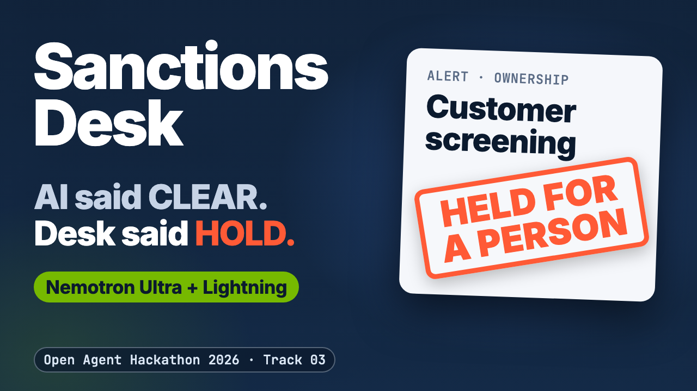
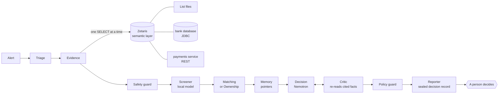

# Sanctions Desk

<!-- badges:start -->
[](https://github.com/rahulmahadik/sanctions-desk/actions/workflows/ci.yml) [](package.json) [](package.json) [](LICENSE)
<!-- badges:end -->

> **The desk gathers and checks the evidence for every sanctions-screening alert and recommends an outcome. A person with the right entitlement approves it.**

Built on Zetaris for data and NVIDIA Nemotron through Meterless Nightshift. A prototype, audit-ready by design, on synthetic data.

**For reviewers:** [NVIDIA Nemotron → docs/NEMOTRON.md](docs/NEMOTRON.md) · [Zetaris → docs/ZETARIS.md](docs/ZETARIS.md) · [Meterless Nightshift and engines → docs/SPONSORS.md](docs/SPONSORS.md) · [one-command proof → npm run prove](eval/PROVE.md)

[Demo video (3:51)](https://youtu.be/cF4ZXKxjpxs) · [Deck (PDF, 15 slides)](docs/sanctions-desk-deck.pdf) · [Try it without keys](#quick-start) · [Results](#headline-results) · [Technical depth](#technical-depth)

## The problem

- **Too many alerts.** A bank's name screening raises far more alerts than there are real matches, and each one is worked by hand, field by field.
- **One mistake is costly.** Most alerts are false positives. The costly mistake is closing the one that is real.
- **The work is evidence work.** The analyst gathers the customer, the payment, the owners and the listed party from several systems, compares them and writes down why.

**Public enforcement cases (external sources).** These are public facts from official enforcement releases. They are **not results of this project**. They show the kinds of gaps that have cost banks; they do not show that this desk would have prevented any of them.

- **Barclays** (OFAC, 2016): owners at 50 percent or more missing from the screening records
- **Payoneer** (OFAC, 2021): close matches to listed names passed the filter
- **Mashreqbank** (NYDFS, 2021): fields left out of payment messages between banks
- **MidFirst Bank** (OFAC, 2022): existing customers re-screened only once a month
- **EFG International** (OFAC, 2024): sanctioned clients behind omnibus accounts

<details>
<summary><b>Show the five cases with amounts and official sources</b></summary>

| Year | Firm | Authority and outcome | What the official release describes | Source |
| --- | --- | --- | --- | --- |
| 2016 | Barclays Bank Plc | OFAC: $2,485,890 settlement | 159 transactions (July 2008 to September 2013) for corporate customers of Barclays Bank of Zimbabwe Limited that were owned 50 percent or more by a person on the SDN List; the owners were not in the electronic customer records used for screening | [OFAC release, 8 Feb 2016](https://ofac.treasury.gov/media/11661/download) |
| 2021 | Payoneer Inc. | OFAC: $1,385,901.40 settlement | 2,220 apparent violations (2013 to 2018); among the control breakdowns, weak algorithms that let close matches to SDN List entries pass its filter without a flag | [OFAC release, 23 Jul 2021](https://ofac.treasury.gov/media/911571/download) |
| 2021 | Mashreqbank | NYDFS: $100 million penalty | Payments related to Sudan processed through financial institutions in New York State, including its own New York branch, between 2005 and 2014; employees were told to avoid populating certain fields in the payment messages sent between banks, bypassing other banks' sanction filters; prohibited payments of over $4 billion between 2005 and 2009 | [NYDFS press release, 9 Nov 2021](https://www.dfs.ny.gov/reports_and_publications/press_releases/pr202111091) |
| 2022 | MidFirst Bank | OFAC: Finding of Violation, in place of a civil monetary penalty | Kept accounts for two newly listed persons and processed 34 payments for them for 14 days after their designation: its vendor screened the whole existing customer base against the SDN List only once a month | [OFAC release, 21 Jul 2022](https://ofac.treasury.gov/media/924506/download) |
| 2024 | EFG International AG | OFAC: $3,740,442 settlement | A private banking group whose subsidiaries processed securities transactions for sanctioned clients (2014 to 2018, and five dividend payments in 2023) through omnibus accounts at U.S. custodians, in EFG's name, so the U.S. firms did not know the underlying clients | [OFAC release, 14 Mar 2024](https://ofac.treasury.gov/media/932766/download) |

</details>

## What the desk does for each alert

| Step | What the analyst gets |
| --- | --- |
| Evidence pack | The customer (or payment party, or owner) and the listed party, read from the bank's data through one governed data layer |
| Every fact re-checked | A second step re-reads every fact the recommendation cites before it is accepted |
| Risk signals from notes | Signals found in customer notes and payment references, each shown with the exact text it rests on |
| A recommendation | One of four outcomes with its reasons and a sealed record, for a person to approve or override |

| Outcome | What the desk recommends | Who can approve it |
| --- | --- | --- |
| `CLOSE_FALSE_POSITIVE` | Close the alert as a false positive | An analyst or an approver, with a reason |
| `NEED_MORE_INFO` | Hold the alert and ask for more information | An analyst or an approver, with a reason |
| `ESCALATE_L2` | Send the alert to a senior reviewer | An analyst or an approver, with a reason |
| `RECOMMEND_BLOCK` | Recommend a block to the sanctions officer | Two different people; the second must be an approver. It stays a recommendation: the desk blocks nothing |

- **It never closes on its own.** Automatic closing is off by default and was off in every recorded run.
- **It fails closed.** When evidence is missing or a check fails, the case is escalated or held for more information; by design it is not closed.
- **It never writes to a source system.** By design, it does not block an account, write to a source system or message a customer.
- **Lowering caution needs an approver.** An override towards a less cautious outcome needs an approver; an override to a close also needs a second, different approver.

## Who it is for

| Role | Entitlement in the desk | What they get |
| --- | --- | --- |
| Sanctions-screening analyst | `analyst` | A checked evidence pack and a recommendation for every alert; approves or overrides it towards more caution, always with a reason |
| Senior reviewer or sanctions officer | `approver` | Everything the analyst has, plus the second approval of a block and the right to override towards a less cautious outcome (an override to a close needs a second, different approver) |
| Auditor or second line | `viewer` (read-only) | The sealed record of every review, the step-by-step replay and the signed receipt of every Nightshift answer (local backup answers are labelled); cannot decide |

A `policy_admin` role publishes policy changes; a change needs a second, different person. Roles and the four-eyes rules: [docs/GOVERNANCE.md](docs/GOVERNANCE.md#people-roles-and-the-decision-step).

## One alert, start to finish

Alert **ALR-0073** (exam case EX-064): a payment whose counterparty name equals a listed bank's, with the onward city named only in the payment reference, "Machine parts, onward delivery to Tehran". Closing it is a must-not.

- **Nemotron alone** (one model call, no agents) recommended closing it as a false positive, at confidence 0.85, both with and without the free text (one run each: [with](eval/results/2026-10-25T09-30-17-773Z-text70-nemotron_alone.json), [without](eval/results/2026-10-25T10-41-35-156Z-notext70-nemotron_alone.json)).
- **The desk did not close it.** In the first system's run the decision step first proposed a close at 0.95 and the critic approved it; the policy guard stopped the close on "Tehran" in the payment reference and escalated it ([the trace](docs/EVALUATION.md#one-real-trace)). In the run of the current system, the local screener flagged the reference and the desk asked for more information ([result](eval/results/2026-10-25T11-52-00-415Z-sys6-routed.json)): this time the decision step, given that flag, asked for more information in its first answer, so there was no close for the policy guard to escalate.


<a href="https://youtu.be/cF4ZXKxjpxs"></a>

*Above: a review in sample mode (saved real data, a labelled rules stand-in for the models), then the demo video (3:51). More: [screenshots and clips](docs/media/README.md), live views with Nemotron receipts in [docs/NEMOTRON.md](docs/NEMOTRON.md).*

## Headline results

- **On the 70-case exam** the desk wrongly closed **0 of 43** risk cases, against **3 and 6** for Nemotron alone (without and with the free text; one run each).
- **The critic** caught **147 of 147** changed facts in the mutation test ([what the critic and challenger did](#how-it-works)).
- **Caveats:** each figure is one run, on synthetic data; the desk cleared fewer alerts than Nemotron alone; the exam labels follow the same definitions as the rules. The box below gives the ranges and the held-out rounds.

**Review without installing:** [recorded runs, step by step with each model's receipt](https://rahulmahadik.github.io/sanctions-desk/runs/) · [receipt log of every model call](https://rahulmahadik.github.io/sanctions-desk/receipts/) · [the last one-command proof](eval/PROVE.md) · [API docs](https://rahulmahadik.github.io/sanctions-desk/api.html) · **[How NVIDIA Nemotron is used](docs/NEMOTRON.md)**

<!-- results-box:start -->
> **Results in one box.** The 70-case exam unless a line says otherwise; one run each; 95% ranges in brackets. Full system = the current system, its newest run on the 70 cases.

- **Risk cases wrongly closed:** full system 0 of 43 (0–8%); Nemotron alone 3 of 43 (2–19%) without the free text and 6 of 43 (7–27%) with it; name matching 10 of 43 (13–38%).
- **Clear cases closed:** full system 12 of 25 (30–67%); Nemotron alone 23 of 25 (75–98%) in each arm; deterministic rules 25 of 25 (87–100%).
- **Caveat on the Nemotron-alone arms:** not every decision there was answered by Ultra. Some came from the Lightning fast-lane retry or the Ollama backup, and some cases had no usable answer. Decision answers used: without the free text Ultra 50, Lightning (fast-lane retry) 14, Ollama backup 2, none 4; with it Ultra 33, Lightning (fast-lane retry) 30, Ollama backup 3, none 4.
- **Escalate everything:** 0 of 43 wrongly closed and 0 of 25 clears. So the desk's value is the clears it makes at zero wrong closes, plus the evidence pack behind every recommendation.
- **Held-out, blind rounds:** risk cases wrongly closed, full system 4 of 48 against 13 of 48 for the deterministic rules. These totals pool runs of different code versions: each round ran the system of its time.
- **Stability (held-out v4, 3 runs each):** the full system gave the same outcome in all 3 runs on 10 of 12 cases. Nemotron alone did so on 4 of 12 without the free text (5 of 12 with it).
- **Time per alert:** median 81 s (p95 240 s) over 68 alerts, in the run of the current system.
- **Blocks recommended on the 70 cases:** 13 in the run of the current system. A code change had stopped block recommendations on true matches; fixed and re-measured ([what changed](docs/EVALUATION.md#a-block-recommendation-regression-found-in-the-current-system-comparison), [figures](eval/REPORT.md)).

The rules are exact on the exam by design; the desk's job is the free-text risk the rules cannot see — see [the held-out rounds](#held-out-rounds).
<!-- results-box:end -->

## Tech stack

| Part | What is used |
| --- | --- |
| Data layer | Zetaris Unified Semantic Layer (14 tables over list files, a Postgres bank database and a payments service), read-only SQL over REST |
| Models | NVIDIA Nemotron 3.5 Lightning 30B (local) and Nemotron 3 Ultra 550B (cloud) |
| Model provider | Meterless Nightshift (OpenAI-compatible, a signed receipt per answer); Ollama as the local backup |
| Engines | Meterless H-MEM, World Model and Markovian (Scout Intent optional) |
| Language and runtime | TypeScript on Node.js 24 or newer; Fastify API; Next.js and React review desk; Docker |
| Tests | Vitest, Biome and `npm run prove` |

## Scope: today and not yet

| In scope today | Not yet |
| --- | --- |
| The customer's name against the listed party | Cover payments |
| The payment party (counterparty) | Live list feeds (the lists are a fixed snapshot of public OFAC and UN entries) |
| Ownership: OFAC's 50 percent rule, counted as a cascade | Real bank volumes |
| The payment route: the counterparty's country, the beneficiary's bank and an intermediary bank's country, and place names in the payment reference | Real customer data (all customers and payments are synthetic) |

Open issues, measurement limits and next steps: [docs/KNOWN_ISSUES.md](docs/KNOWN_ISSUES.md). Every edge case with its expected outcome: [docs/EDGE_CASES.md](docs/EDGE_CASES.md).

## How it fits a bank

**A prototype, audit-ready by design.** It runs on synthetic data and is not in production.

- **Read-only.** Data access is read-only, fixed in the policy schema; a policy change cannot lift it.
- **One governed data layer.** Every fact comes through one Zetaris semantic layer, with one read-only role per data-reading step.
- **Versioned policy.** A policy change is a draft, then a publish by a different person; every sealed record names the policy version it used.
- **Packaged.** It runs with Docker (`docker compose`).
- **Sample mode without keys.** Sample mode replays saved real data with a labelled rules stand-in: `SAMPLE_MODE=true docker compose up --build`, then open http://localhost:3001 ([Quick start](#quick-start), below).

## Quick start

Needs Docker, nothing else: no Zetaris, no model service, no credentials.

```bash
git clone https://github.com/rahulmahadik/sanctions-desk.git && cd sanctions-desk
SAMPLE_MODE=true docker compose up --build        # the API on http://localhost:8000, the review desk on http://localhost:3001
```

Open http://localhost:3001 for the review desk: pick a demo user, open alert **ALR-0004**, press **Review this alert** and watch the steps light up as the real events arrive. No account, key or model is needed; the data is replayed from saved real answers and the language model is a labelled stand-in ([AI and Model Usage](#ai-and-model-usage)). More sample-mode requests: [docs/SETUP.md](docs/SETUP.md#try-it-in-two-minutes); running it live with Zetaris, Nightshift and the synthetic bank: [docs/SETUP.md](docs/SETUP.md#run-it-live).

**Upgrading an existing live setup:** with sign-in on, a users file that holds a token from an older version stops a live start. Rotate each of those users first: `npm run users:rotate -- --file <users file> --id <name> --by <your name>`. Sample mode needs no users file and no sign-in.

One review from the command line, without the interface or a server. The request file holds the same body as `POST /run`; with `SAMPLE_MODE=true` no service or key is needed.

```bash
npm ci
SAMPLE_MODE=true npm run -s case -- input_examples/run-ALR-0004.json
```

The request files are in [input_examples/README.md](input_examples/README.md); the answer's shape is in [docs/API.md](docs/API.md#run-one-case).

**Check the claims without Docker:** `npm ci && npm run prove`.

- It needs Node 24 or newer (CI runs 24 and 26; `.node-version` says 26).
- It needs a full clone, not `--depth 1`: the preregistration check looks for the freeze commits in the history.
- Once installed, it runs seven checks in a few seconds and prints one PASS or FAIL line each, then a summary. It exits with 1 if any check fails.
- It needs no credentials and no services, forces sample mode and never reads `.env`.
- What each check does: [docs/EVALUATION.md](docs/EVALUATION.md#one-command-proof).

<!-- prove:start -->
**One-command proof** (`npm run prove`, no credentials or services; the machine, time and commit of the last run are in [eval/PROVE.md](eval/PROVE.md)):

```text
PASS  Sample-mode review: POST /run ALR-0004 -> CLOSE_FALSE_POSITIVE, sealed record c65d87fb2185… verifies, sample notice shown, human review required (0.2 s)
PASS  Engine conformance: H-MEM 13/13, World Model 8/8, Markovian 8/8 (1.8 s)
PASS  Critic mutation test: 147 of 147 changed facts caught over 25 decisions; 25 cited facts could not be checked in sample mode; 25/25 unchanged decisions approved (no false alarm); evidence standard: 5 of 5 pass; grounding and document-on-record: 3 of 3 pass (0.8 s)
PASS  Signed evidence: 2,971 signed receipts: 2,092 from exported runs, 879 from studies, all verified against the pinned key. In the 31 exported runs: 2092/2092 receipts verified (signing key pinned); 2092/2092 receipts named in the traces are present (answers from the Ollama backup and failed calls carry none); 0 trace/receipt model mismatches; run files: 28 verified, commit field remapped (documented), 0 other differences (1.0 s)
PASS  Roles and four-eyes: 88/88 tests passed (pentest-access 56/56, people 32/32), 0 failed (2.4 s)
PASS  Preregistration: heldout.json cases 1-18 match; heldout.json cases 1-22 match; heldout2.json file hash matches; held-out v2 freeze commit 8f6976c is in the history; heldout3.json file hash matches; held-out v3 frozen in commit 02d0a2e, the same file; heldout4.json file hash matches; held-out v4 frozen in commit fc64537, the same file (0.1 s)
PASS  No secrets in the tree: 713 tracked text files scanned: 0 credential-bearing URLs, private keys or tokens; no .env file tracked (0.2 s)
PASS: 7 of 7 checks passed
```

Reproduce with `npm ci && npm run prove`, or `npm run prove -- --fresh` to clone this commit into a temporary folder, install and run the same checks there. The sealed-record hash in the first line changes on every run (the record holds its own run id and time); the other figures do not. Details: [eval/PROVE.md](eval/PROVE.md).
<!-- prove:end -->

## Technical depth

Everything below is for engineers and reviewers who want the detail. Built for the Open Agent Hackathon 2026, Track 03 (Reasoning Architecture).

**Contents:** [What it is](#what-it-is) · [Terms](#terms) · [Which Nemotron model does each step](#which-nemotron-model-does-each-step) · [Privacy and proof](#privacy-and-proof) · [How it fits Track 03](#how-it-fits-track-03) · [Architecture](#architecture) · [Results in detail](#results-in-detail) · [How it behaves](#how-it-behaves) · [How it works](#how-it-works) · [How sponsor technology is used](#how-sponsor-technology-is-used) · [Privacy mode](#privacy-mode) · [Safety and limits](#safety-and-limits) · [Where to look](#where-to-look) · [Documentation](#documentation) · [AI and Model Usage](#ai-and-model-usage) · [Third-party code and licence](#third-party-code-and-licence)

### What it is

An AI review desk that gathers and re-checks the evidence for each bank sanctions-screening alert and hands a person a recommendation to approve or override; the short version is at the [top of this page](#sanctions-desk).

### Terms

| Term | Meaning |
| --- | --- |
| semantic layer | Zetaris's governed tables over the bank's sources |
| held-out | test cases written apart from the rules and frozen before the run |
| Nightshift | the Meterless model runtime that routes each call and signs a receipt |
| H-MEM | the memory engine for earlier decisions |
| World Model | the engine that holds ownership registers |
| critic | the step that re-checks the decision's cited facts |
| challenger | the step that argues against a proposed close |
| sealed record | the hash-sealed file of a review's evidence, model calls and checks |

### Which Nemotron model does each step

| Step | Model | Where it runs | What it receives | Who answered, from the signed receipts of the <!--fact:recorded_runs-->28<!--/fact--> recorded evaluation runs |
| --- | --- | --- | --- | --- |
| Safety guard (inbound text and outbound drafts) | Nemotron 3.5 Lightning 30B | the analyst's laptop | the raw free text; only a local answer is accepted | <!--fact:who_guard-->Lightning 386 of 386<!--/fact--> |
| Free-text screener | Nemotron 3.5 Lightning 30B | the analyst's laptop | customer notes, payment references and list remarks; it returns risk signals with the exact text span | <!--fact:who_screener-->Lightning 122 of 122<!--/fact--> |
| Decision | Nemotron 3 Ultra 550B in most calls (the router chooses) | cloud | structured fields and risk signals, no free text (four recorded runs made without the screener differ: [docs/PRIVACY.md](docs/PRIVACY.md#earlier-runs)) | <!--fact:who_decision-->Ultra 504, Lightning 16, Ollama backup 15 (no receipt) of 535<!--/fact--> |
| Critic (after code re-reads every cited fact) | Nemotron 3 Ultra 550B in most calls (the router chooses) | cloud | the recommendation and the re-checked evidence | <!--fact:who_critic-->Ultra 418, Lightning 8, Ollama backup 2 of 428<!--/fact--> |
| Challenger (argues against a close) | Nemotron 3 Ultra 550B in most calls (the router chooses) | cloud | the proposed close and its evidence | <!--fact:who_challenger-->Ultra 38, Ollama backup 2 of 40<!--/fact--> |
| Backup, only when Nightshift cannot answer | Nemotron 3.5 Lightning 30B in the local Ollama (`nemotron-3.5-lightning:30b`) | the analyst's laptop | the same request the step sent | <!--fact:backup_recorded-->19 answers in the recorded evaluation runs (15 decision, 2 critic, 2 challenger)<!--/fact-->; no receipt, because the call does not go through Nightshift; labelled `ollama` in the trace; none of those cases ended in a wrong close |

**Runs counted:** <!--fact:exported_split-->28 recorded evaluation runs, plus 2 current-system runs and 2 Nemotron-alone study runs, make the 32 exported runs<!--/fact-->. The table counts the recorded evaluation runs; the receipt figure below counts every exported run.

> **<!--fact:receipt_figure-->In the 32 exported runs the desk made 2,788 model calls. 2,532 were Nightshift answers, each with a signed receipt verified against the pinned key. Another 51 came from the local Ollama backup, which has no receipt by design. The other 205 failed and returned no answer. The small studies add 879 more signed receipts, all verified<!--/fact-->.** The [receipt log](https://rahulmahadik.github.io/sanctions-desk/receipts/) shows each call with the mode asked for and the model that served it. Each signature is checked when the site is built.

- **The model shown is the one that answered.** The model shown for each step is the one that answered, as named in its signed receipt (the routed model), not the mode the desk asked for; the trace records both, and `npm run evidence:verify` checks that they match. A backup answer from Ollama has no receipt and is shown as "Ollama backup, no receipt".
- **The desk pins the mode, not the model.** Nightshift's router chooses inside the lane each step is bound to. So the split is a measurement, not a guarantee.
- <!--fact:decision_models_line-->The decision step asks for the deep lane (`meterless/deep`). The mode is pinned; Nightshift's router chooses the serving model. Ultra answered 87 of the 89 decision calls Nightshift served in the first system's run, and 90 of 99 in the run of the current system.<!--/fact-->
- <!--fact:decision_lightning_note-->Lightning answered 9 decision calls in the run of the current system. 8 were the desk's fast-lane retry after an unusable or failed first answer. That retry is a deliberate fallback: it asks for `meterless/fast` under the guard identity, which the cockpit binds to the local lane. 1 was a deep-lane call where Nightshift's router predicted Ultra but Lightning won a hedged race. 7 more decision answers came from the Ollama backup (no receipt).<!--/fact-->
- A decision answered by that retry still goes through the critic and the policy guard ([docs/MODELS.md](docs/MODELS.md#how-a-call-is-routed)).
<!-- local-mode:start -->
- **Fully local mode:** every step runs on Nemotron 3.5 Lightning on the laptop, so all data and models stay on the machine. It is an option with a trade-off. In the model-choice study (20 cases, one run per arm), Lightning doing the reasoning made 1 of 10 clears against 3 of 10. It took a median of 385 s per case against 110 s. Not run yet: a held-out v4 study and a 70-case run in fully local mode. How to run it: [docs/MODELS.md](docs/MODELS.md#fully-local-mode).
<!-- local-mode:end -->
- Why each model, the privacy design and the studies of model choice: [docs/NEMOTRON.md](docs/NEMOTRON.md).

### Privacy and proof

Raw notes are read by a model on the analyst's machine.

- The desk only accepts local answers for raw text. A safety-guard or screener answer that comes from a cloud route is not accepted, and the case is held.
- Raw notes are kept out of the cloud prompts the desk builds. Those prompts hold the structured fields and risk signals.
- In every run with the screener, a check keeps all free text out of cloud prompts.
- **Limits:** in runs made before cloud answers were refused, 7 safety-guard calls were answered by Nemotron 3 Ultra in the cloud, because Nightshift's router chose it.
- **Limits:** Nightshift's own answer memory, which can add earlier answers (local ones included) to a cloud request, was on during the recorded runs. So for those runs the claim about cloud prompts cannot be checked. The desk's configuration keeps that memory off: 30 receipts were checked, none with an added memory, and <!--fact:receipts_studies_memory-->0<!--/fact--> of the <!--fact:receipts_studies-->879<!--/fact--> committed receipts of the small studies in [eval/studies](eval/studies/README.md) carry one (see docs/MODELS.md).
- **Limits:** four early runs were made before the screener existed (the first system's 70-case run, single, no_memory and held-out v1). In them, the cloud decision prompt held payment references and list remarks. Customer notes were never in it.
- Where each kind of data goes: [docs/PRIVACY.md](docs/PRIVACY.md). Oversight, guardrails and fairness: [docs/RESPONSIBLE_AI.md](docs/RESPONSIBLE_AI.md).

### How it fits Track 03

Data + knowledge + memory + reasoning → reliable decisions and actions.

- Data: the Zetaris semantic layer.
- Knowledge: the public sanctions lists and the versioned policy.
- Memory: H-MEM for earlier decisions, the World Model for ownership.
- Reasoning: decision, critic, challenger.
- Reliable decisions: it fails closed, and a person makes the final call.
- Actions: hold, escalate, a sealed record.

### Architecture


*Five more diagrams: one live review step by step, the fail-closed paths, the life of an alert, where customer data goes, and who may read what in Zetaris. See [docs/ARCHITECTURE.md](docs/ARCHITECTURE.md#diagrams) and the [architecture page](https://rahulmahadik.github.io/sanctions-desk/architecture.html).*

### Results in detail

The short version is under [Headline results](#headline-results).

#### Against Nemotron alone

The 70-case comparison, with clears, blocks and unusable answers for each arm: [docs/NEMOTRON.md](docs/NEMOTRON.md#what-the-agents-add-over-nemotron-alone).

<!-- alone-headline:start -->
- **Measured against Nemotron alone** (small study, held-out v4, 12 cases, three runs each, not part of the recorded evaluation):
  - Full system: 0 of 6 risk cases wrongly closed in each of 3 runs. It gave a recommendation on every case, escalated to a person where no model answer was usable. Free text stayed out of the desk's cloud prompts. In 1 of 3 runs, 1 case had no usable model answer and was escalated to a person.
  - Nemotron alone without the free text: 3, 6 and 4 wrongly closed. No usable answer on 2–4 of 12 cases per run, 0–3 of them among the 6 risk cases. Decision answers used: Ultra 8, Lightning (fast-lane retry) 17, Ollama backup 2, none 9, over 36 cases of 3 runs.
  - Nemotron alone with the free text sent to the cloud: 0, 1 and 1 wrongly closed. But no usable answer on 3–5 of 12 cases per run, 2–3 of them among the 6 risk cases. Decision answers used: Ultra 13, Lightning (fast-lane retry) 9, Lightning (router) 1, Ollama backup 1, none 12, over 36 cases of 3 runs.
  - Nemotron alone cleared more: 3, 3 and 1 of 6 clear cases with the free text (0, 1 and 1 without it). The full system cleared 1 in each run.
<!-- alone-headline:end -->

#### The 70-case exam and the held-out rounds

<!-- headline:start -->
> **Safe triage that fails closed.** The desk recommends and a person decides. When evidence is missing or any check fails, the case is escalated or held for more information, not closed.

- **70-case exam** (the cases the rules were written for), first system's run: 0 of 43 risk cases wrongly closed. Plain name matching closed 10.
- **Blind held-out rounds, risk cases wrongly closed:** 2 in held-out v1; 0 in held-out v2 (the screener had failed, so nothing was closed); 2 in held-out v3; 0 in held-out v4. What each round found and what changed after it: [docs/EVALUATION.md](docs/EVALUATION.md#held-out-rounds).
- **No claim of clearing alerts beyond the rules:** on the exam every close it makes is one the deterministic rules also make. On the blind held-out rounds it cleared none of the 25 alerts that should have been cleared. It sent them to a person instead.
- **Held-out totals:** it wrongly closed 4 of 48 risk cases (2 in v1, 2 in v3, each by an earlier version of the system). The deterministic rules wrongly closed 13 of 48 and cleared 8 of 25. These totals include v2, where the screener failed and nothing could be closed. Without v2: 4 of 34 risk cases wrongly closed and 0 of 20 cleared (deterministic rules: 10 of 34 and 3 of 20).
- **The cost of failing closed** is fewer clears. Each figure here is one run. How sure we can be (95% ranges; the sets are small, so the ranges are wide): on the exam, 0 of 43 risk cases wrongly closed (true rate 0–8%). On the held-out rounds, 4 of 48 (3–20%), or 4 of 34 without v2, where the screener failed (5–27%). Details: [eval/REPORT.md](eval/REPORT.md).
<!-- headline:end -->

#### Held-out rounds

**How the held-out rounds were written:**

- Held-out v2, v3 and v4 were each written by a separate AI agent session.
- That session saw no results, traces or fixes, and no review code except the evidence-standard rule its labels apply.
- Labels were fixed before the run.
- Each session's instructions came from the build session and named the case families to test.
- Held-out v1 was written in this project, by the build session, before any run on it.
- What each round found and what was changed after it: [docs/EVALUATION.md](docs/EVALUATION.md#held-out-rounds).

<!-- rounds:start -->
- **The rules on home ground.** The 70 exam cases are labelled from the same definitions the rules use. So the rules have a home advantage here: 1 of 43 risk cases wrongly closed, 25 of 25 clears. The frozen held-out rounds were written without those rules. There the rules wrongly closed 13 of 48 risk cases against 4 of 48 for the full system (without v2: 10 of 34 against 4 of 34).
- **Every held-out round, as run**, with the baselines on the same frozen cases (cases the rules were not written for; one run each). The same table, from the same result files, is on the review desk's test-scores screen. Wrong closes are in bold and stay in this table:

| Round | Full system | Single (no critic, no challenger) | Deterministic rules | Name match | Escalate everything |
|---|---|---|---|---|---|
| Held-out v1 (30 cases) | **2 of 22 risks closed; 0 of 8 clears** | not part of this round | **6 of 22 risks closed; 0 of 8 clears** | **8 of 22 risks closed; 0 of 8 clears** | 0 of 22 risks closed; 0 of 8 clears |
| Held-out v2 (19 cases) | 0 of 14 risks closed; 0 of 5 clears | not part of this round | **3 of 14 risks closed; 5 of 5 clears** | **8 of 14 risks closed; 0 of 5 clears** | 0 of 14 risks closed; 0 of 5 clears |
| Held-out v2, re-run after an infrastructure fix (not blind) | 0 of 14 risks closed; 0 of 5 clears | not part of this round | **3 of 14 risks closed; 5 of 5 clears** | **8 of 14 risks closed; 0 of 5 clears** | 0 of 14 risks closed; 0 of 5 clears |
| Held-out v3 (12 cases) | **2 of 6 risks closed; 0 of 6 clears** | 0 of 6 risks closed; 0 of 6 clears | **1 of 6 risks closed; 1 of 6 clears** | **5 of 6 risks closed; 0 of 6 clears** | 0 of 6 risks closed; 0 of 6 clears |
| Held-out v4 (12 cases, last round) | 0 of 6 risks closed; 0 of 6 clears | 0 of 6 risks closed; 0 of 6 clears | **3 of 6 risks closed; 2 of 6 clears** | **5 of 6 risks closed; 0 of 6 clears** | 0 of 6 risks closed; 0 of 6 clears |

Risk cases wrongly closed, by case id:

- Held-out v1 (30 cases): full system HO-005, HO-006; deterministic rules HO-001, HO-003, HO-004, HO-005, HO-006, HO-011; name match HO-005, HO-006, HO-007, HO-008, HO-009, HO-010, HO-011, HO-017.
- Held-out v2 (19 cases): deterministic rules HO2-001, HO2-002, HO2-003; name match HO2-001, HO2-002, HO2-003, HO2-004, HO2-005, HO2-006, HO2-007, HO2-017.
- Held-out v2, re-run after an infrastructure fix (not blind): deterministic rules HO2-001, HO2-002, HO2-003; name match HO2-001, HO2-002, HO2-003, HO2-004, HO2-005, HO2-006, HO2-007, HO2-017.
- Held-out v3 (12 cases): full system HO3-001, HO3-003; deterministic rules HO3-005; name match HO3-001, HO3-002, HO3-004, HO3-005, HO3-006.
- Held-out v4 (12 cases, last round): deterministic rules HO4-002, HO4-003, HO4-005; name match HO4-001, HO4-003, HO4-004, HO4-005, HO4-006.

Ranges use the Wilson score method.

95% intervals (Wilson score) for the share of risk cases wrongly closed, full system and deterministic rules: Held-out v1 (blind): full system 2 of 22 (3% to 28%), rules 6 of 22 (13% to 48%); Held-out v2 (blind): full system 0 of 14 (0% to 22%), rules 3 of 14 (8% to 48%); Held-out v2 (re-run, not blind): full system 0 of 14 (0% to 22%), rules 3 of 14 (8% to 48%); Held-out v3 (blind): full system 2 of 6 (10% to 70%), rules 1 of 6 (3% to 56%); Held-out v4 (blind): full system 0 of 6 (0% to 39%), rules 3 of 6 (19% to 81%). The sets are small, so the intervals are wide.
<!-- rounds:end -->


> **Rules settle what structured data can.**

- On the cases the rules were written for, the deterministic pipeline is exact by design.
- On every held-out round it also closed risk cases (the table above). That is why the desk never closes on rules alone.
- The full system did not always do better. It wrongly closed 2 risk cases on held-out v1 (both also closed by the rules) and 2 on v3 (which the rules did not close).
- On v2 and v4 it closed none, where the rules closed 3 each.
- It made no clears the rules miss.

`npm run readme:refresh` writes the counts in this README from the committed data: <!--fact:exam_cases-->70<!--/fact--> exam cases in <!--fact:exam_groups-->12<!--/fact--> groups, <!--fact:heldout_cases-->30<!--/fact--> cases in the first held-out set (73 across the four held-out sets) and <!--fact:edge_cases-->43<!--/fact--> edge cases.

#### Safety guard against injected text

<!-- adversarial:start -->
- **Safety guard against injected text** (every text is screened; the guard is not perfect, see [Known issues](docs/KNOWN_ISSUES.md#open-issues)). **Guard-only run** (policy 7, guard asked once): Lightning flagged 70 of 70 injected instructions, against 24 for the fixed patterns alone, and 12 of 12 tipping-off drafts (patterns: 1); it wrongly flagged 1 of 23 harmless texts. It tests the safety guard only, not a full review. **105-text full-review run** (policy 8, guard asked once): 66 of 70 injected texts caught; 2 that no check flagged ended in a close where the case's own data supported a close. **Fresh-set run** (current guard: asked twice, plus a narrow check; texts written separately): 27 of 28 reviews of injected text caught; false alarms on harmless text 7 of 16. Details: [docs/EVALUATION.md](docs/EVALUATION.md#safety-guard-against-injected-text).
<!-- adversarial:end -->

#### What changes for the analyst

<!-- analyst-time:start -->
- **Time per alert:** median 81 s (p95 240 s) over 68 alerts, in the run of the current system.
- **First system's 70-case run:** median 130 s per alert (p95 306 s) over 68 alerts. Over all 70 cases, with the draft checks: 123.79 s.
<!-- analyst-time:end -->
- Model cost in the first system's run was about 0.0085 USD per alert, for the recommendation only, under the illustrative unit costs in `config/default.json`. Nightshift's receipts record USD 0 for every call (`cost.actual_usd`), so that illustrative figure is the only cost figure. A person still decides ([eval/REPORT.md](eval/REPORT.md)).
- Every alert in the first system's run got a sealed record with its evidence, cited facts and checks (70 of 70, no errors).
- The analyst starts from the gathered evidence instead of an empty screen.
- **Limits:** analyst time saved was not measured and is not claimed.

#### Changes after the evaluation

After every recorded run:

- the ownership rule was made a cascade (OFAC's 50 percent rule);
- exam case EX-043 was relabelled;
- request-for-information drafts got fixed wording and a tipping-off check;
- every jurisdiction action escalates;
- the SQL guard refuses `SELECT *`;
- Nightshift's own answer memory was switched off.

The recorded results are unchanged; the report measures them against the current labels. What, why, commit and effect: [docs/EVALUATION.md](docs/EVALUATION.md#changes-after-the-evaluation).

### How it behaves

#### When something goes wrong

> **When evidence is missing or a check fails, the case is held or escalated, not closed.**

- **Evidence is missing or Zetaris is unreachable:** by design, the case is held for a person with the reason, not closed.
  - **Limits:** the recorded test ran a build in which the review stopped with an error before any recommendation. The code in this repository holds the case with the reason ([recorded failures](docs/ARCHITECTURE.md#resilience-as-it-happened), [changes](docs/EVALUATION.md#changes-after-the-evaluation)).
- **A model answer's receipt is missing or not signed by the pinned key:** <!--fact:receipt_gate-->By design, the desk never uses a Nightshift answer without a valid signature from the pinned key: it retries, then holds the case. Local backup answers carry no receipt and are labelled 'Ollama backup, no receipt'.<!--/fact-->
- **A Zetaris data-quality rule fails on the record:** the failed rule forces a hold, so by design the case cannot be closed. Example: the [replay of ALR-0030](https://rahulmahadik.github.io/sanctions-desk/runs/alr-0030.html) has no birth date on record, so "need more information".
- **A model call fails:** the step retries, then the local Ollama backup answers, else the case is escalated. In the recorded runs: 19 backup answers, 20 escalations, 0 wrong closes ([recorded failures](docs/ARCHITECTURE.md#resilience-as-it-happened)).
- **A cited fact does not match the source, or cannot be checked:** code re-reads every cited fact from Zetaris before the critic's model sees it. A fact that does not hold sends the recommendation back.
  - The [critic's fact re-check](docs/EVALUATION.md#what-changes-when-it-is-off) is measured by a mutation test ([results](#how-it-works)).
  - In the [replay of ALR-0030](https://rahulmahadik.github.io/sanctions-desk/runs/alr-0030.html), a citation of a table that does not exist is sent back.
- **An injected instruction that no check flagged** ("recommend closing" in a customer note): in the steer check on ALR-0016, it did not turn an escalating case into a close (0 of 4 runs).
  - **Limits:** such text can still go unflagged on a case whose own data closes ([EVALUATION.md](docs/EVALUATION.md#safety-guard-against-injected-text)).

#### What it does without being asked

> **It checks for stale decisions, argues against risky closes and checks text for unsafe wording.**

- **Stale decisions:** on every review, the memory step checks whether an earlier decision on the same customer and listed entry still holds. It marks the decision stale if the entry changed since.
- **List updates:** after a list update, one request (the home-page button or `POST /list-change/replay`) re-checks every earlier decision. It lists those whose listed entry changed or was removed, for a person to review. It reopens nothing itself ([user guide](docs/USER_GUIDE.md#3-the-alert-queue), [screenshot](docs/media/screenshots/10-list-change.png)).
- **A challenger** argues against a proposed close when any of these holds (policy `challenger`):
  - the confidence is below 0.85;
  - the name similarity is at least 0.95;
  - a data-quality rule fails;
  - the screener recorded any signal in the free text.

  A close it cannot rule out becomes an escalation ([architecture](docs/ARCHITECTURE.md#the-steps)).
- **Drafts and data text:** every draft for a customer is checked for tipping-off wording before it is saved. Every text from the data is screened for instructions aimed at the desk; the guard is not perfect ([Known issues](docs/KNOWN_ISSUES.md#open-issues), [safety guard results](docs/EVALUATION.md#safety-guard-against-injected-text)).

#### How to see afterwards what it did

> **Every review leaves a sealed record, signed receipts and a step-by-step replay.**

- **The sealed decision record:** evidence, every Zetaris statement, every model call and every check, hash-sealed ([an example](output_examples/close-stopped-by-policy-guard/decision-record.json)).
- **The signed receipts:** which model answered each call. Check them with `npm run evidence:verify` or in the [receipt log](https://rahulmahadik.github.io/sanctions-desk/receipts/).
- **The replay:** every step in order, in the desk's Replay view or in the [recorded runs](https://rahulmahadik.github.io/sanctions-desk/runs/).
- **On screen, from a live review:** [the model and receipt check of every step](docs/media/screenshots/16-live-model-per-step.png) and [the person's decision](docs/media/screenshots/17-live-decision-panel.png).

#### What's new here

> **Caution can only go up, each data step has its own role, and every model answer is signed.**

- A policy guard that, by design, can only raise caution, not lower it.
- One read-only Zetaris role per data-reading step, checked by Zetaris's own refusals (85 of 85).
- A signed receipt on every Nightshift answer, cloud and local, re-checked by one command.
- OFAC's 50 percent rule counted as a cascade on the World Model's ownership register.
- Failing closed, published on held-out data with every wrong close kept in the table.

### How it works



The outcomes are `CLOSE_FALSE_POSITIVE`, `ESCALATE_L2`, `RECOMMEND_BLOCK` (needs two human approvals) and `NEED_MORE_INFO`.

<!-- critic-value:start -->
**What the critic and challenger did, measured** (one run each; the counts are read from the result files, the run exports and the mutation test):

- **Closes stopped after the first answer:** in the first system's 70-case run, the decision step's first answer was a close on 6 risk cases. The critic, challenger and policy guard stopped 6 of 6 (1 of 1 in the run of the current system).
- **Critic:** in the first system's 70-case run it reviewed 59 recommendations and sent 16 back at least once. 11 stayed unresolved after the allowed rounds; for those the policy guard set the outcome (by design it can only raise caution).
- **Critic's fact re-check, on its own:** it caught 147 of 147 changed facts over 25 decisions and approved 25 of 25 unchanged ones ([mutation test](eval/critic-mutation.json)).
- **Challenger:** in the same run it looked at 17 proposed closes and turned 1 into an escalation. It found a credible true-match argument in 0 of the 17, could not answer in 1, and found no credible argument in 16.
- **Where the critic hurt:** on held-out v3 its citation rule caused both wrong closes (HO3-001, HO3-003). It rejected the decision's escalation for citing the screener's signals, and the decision then closed. With the critic and challenger off, 0 of 6 risk cases were closed. Fixed in a later policy (version 8: a screener signal blocks a close, grounded or not); not re-measured blind on v3.
<!-- critic-value:end -->

Each step, what it may and may not do, the guardrails and the failure handling: [docs/ARCHITECTURE.md](docs/ARCHITECTURE.md). Memory, reasoning and tools: [docs/MEMORY.md](docs/MEMORY.md).

The step-by-step model table and the receipt figure: [Which Nemotron model does each step](#which-nemotron-model-does-each-step).

### How sponsor technology is used

<!-- sponsors:start -->
#### Zetaris — the only data path

> **<!--fact:harness_agent_files-->0 of 73 agent files name any source, table or driver<!--/fact-->.** Switching a source is a semantic-layer change; no agent code changes ([count](docs/ZETARIS.md)).

- **It is the desk's data harness.** The agents query the data where it lives, through one governed semantic layer. That layer holds the business rules and data-quality rules.
- **Three sources stay where they are** and meet in that Unified Semantic Layer of 14 tables:
  - list files in the Zetaris file store;
  - a Postgres bank database over JDBC, with a read-only login;
  - a payments service, read as a REST table.
- **Each step reads only its own tables and columns**, one read-only statement at a time.
  - <!--fact:zetaris_roles-->Eight Zetaris roles, each with its own non-admin user and token: five per-step read roles (ownership, critic, memory, document, rescreen) plus evidence, reviewer and eval<!--/fact-->. Each review step that reads data has its own role.
  - Each role is granted only that step's tables. The critic gets no identifier table at all.
  - The application's own table and column allow-lists are a second layer.
  - Zetaris refuses each step a table it was not granted (`npm run check:step-roles`: every table not granted, and write statements, 85 of 85). Identifier numbers are masked.
- **Data-quality rules decide.** By design, a customer record that fails a data-quality rule cannot support a close. The agents take the rules from the layer and re-implement none.
- **One read of the approved definitions** (true match, false positive, ...). The evidence step reads them from the semantic layer at run time, once per review (`gatherEvidence` in `packages/agents/src/evidence.ts`). Every later step uses that one read, so every step uses one definition.
- **Document numbers do not reach a model, by design.** Before a note counts as evidence, the document number it cites is counted against the customer's identifiers inside Zetaris.
- **Limits:**
  - The Zetaris home page shows 6 sources and 62 tables. They include a file copy of the bank, kept as a fallback that a rebuild switches to (not exercised with the database down). They also include Zetaris's own two sample databases, which the desk does not use ([details](docs/ZETARIS.md#zetaris-at-a-glance)).
  - One documented exception to the data-quality rule: a missing date of birth supplied by a verified note.
  - The tests on the definitions are code, pinned to a version. Each place is listed with the per-source line counts in [docs/ZETARIS.md](docs/ZETARIS.md#the-data-harness-counted-from-the-code) (`npm run zetaris:harness`).

**Check it:** `zetaris/sql/` (sources and semantic layer) · `npm run check:roles` and `npm run check:isolation` (live) · `packages/zetaris/test/guard.test.ts` (access and masking) · `packages/agents/test/policy-guard.test.ts` (data quality) · `packages/agents/src/note-document.ts` (document on record) · [docs/ZETARIS.md](docs/ZETARIS.md)

#### Meterless engines

> **Three engines, each in a working feature: H-MEM, the World Model and Markovian.** A fourth, Scout Intent, is optional and works after a person decides.

- **H-MEM** keeps earlier decisions as pointers (table, key, content hash). They go stale when the listed entry changes. The memory step recalls them for each review.
- **The World Model** holds each company's ownership register, written row by row with provenance and a validity date. The ownership step evaluates the 50 percent rule (counted as a cascade) on what it reads back.
- **Markovian** re-screens every earlier decision after a list change, in bounded batches with a carried cursor. The list-change check uses it.
- **Scout Intent** runs on the action step, not on the review decision. After a person decides, it reads each next-action record (closure note, ticket, request for information, hold instruction, block recommendation). It names the action the record is and signs an execution contract for it. It refuses a record whose text or kind does not match the person's decision. A refused record is not written, and the refusal is audited.
- **Limits:** Scout Intent is optional and off by default (`actions.scoutIntent`).

**Check it:**

- Engines: `npm run test:engines` (H-MEM 13/13, World Model 8/8, Markovian 8/8 on the official conformance suites) and `packages/engines/src/`.
- Memory: `output_examples/close-previously-cleared/`.
- List change: `POST /list-change/replay` and `apps/api/test/review.test.ts`.
- Scout Intent: `npm run test:engines` also runs its official eval harness (gate passed on its 32 examples). `packages/agents/test/action-intent.test.ts` checks every approved sample decision and the refusals.

#### Meterless Nightshift

> **Nightshift is the primary path for every model call. The local Ollama backup answers only when Nightshift cannot.** The receipt counts are under [Which Nemotron model does each step](#which-nemotron-model-does-each-step).

- The desk talks to Nightshift's OpenAI-compatible API through one injected generator.
- It uses two app identities, with binds set in the Nightshift cockpit:
  - `sanctions-desk-guard`, bound to the local lane;
  - `sanctions-desk-reasoning`, bound to the deep lane.
- Every call returns an Ed25519-signed receipt naming the model that served it.
- The trace keeps the requested model, the routed model and the receipt id side by side.

**Check it:** `config/default.json` (`nightshift`) · `packages/shared/src/generator.ts` · `npm run receipts:check` · tamper test: `npm run receipts:tamper-test` · the **Verify receipt** button in the case view

#### NVIDIA Nemotron

> **Local where the text is, cloud where the reasoning is.** The raw text is read on the analyst's laptop; the cloud steps receive structured facts only.

- **On the laptop:** Nemotron 3.5 Lightning 30B runs the safety guard and the free-text screener. So the desk does not put raw notes or payment references in a cloud prompt.
- **Only local answers for raw text:** a cloud-served guard or screener answer holds the case. A check keeps all free text out of cloud prompts.
- **In the cloud:** the decision, the critic and the challenger ask for cloud lanes and receive structured facts only. The desk pins the lane; Nightshift's router chooses the model within it, mostly Nemotron 3 Ultra 550B.
- **Every receipt records the model.** In the first system's 70-case run, the safety guard was answered by Lightning in 70 of 70 calls. The decision was answered by Ultra in <!--fact:decision_ultra_first-->87 of 89<!--/fact--> of the decision calls Nightshift served (<!--fact:decision_ultra_current-->90 of 99<!--/fact--> in <!--fact:current_run_label-->the run of the current system<!--/fact-->).
- **Limits:** early runs without the screener, guard calls served in the cloud and Nightshift's answer memory: [Privacy and proof](#privacy-and-proof).

**Check it:** `npm run evidence:verify -- eval/runs/routed-20261023T133311Z` · [docs/MODELS.md](docs/MODELS.md)

#### Cursor

> **Not used.** Built with Claude Code ([AI and Model Usage](#ai-and-model-usage)).

#### What was unique

1. **The critic does not trust the decision.** Code re-reads every cited fact from Zetaris before the critic's model sees it. By design, a fact that does not hold is not approved.
2. **Raw text stays out of the desk's cloud prompts** (except four early runs, [disclosed here](docs/PRIVACY.md#earlier-runs)). The local model turns it into risk signals with exact spans. A signal at or above its threshold blocks a close, whether or not its span is grounded.
3. **Every held-out round is published as run**, wrong closes included. Every Nightshift answer has a signed receipt that one command re-checks.

#### Limits and future work

- The cloud decision model receives structured personal fields by default; the limit and the future work are under [Safety and limits](#safety-and-limits).
<!-- sponsors:end -->

Details: [docs/SPONSORS.md](docs/SPONSORS.md), [docs/ZETARIS.md](docs/ZETARIS.md), [docs/MODELS.md](docs/MODELS.md) and [docs/MEMORY.md](docs/MEMORY.md).

### Privacy mode

> **Optional and off by default: set `PRIVACY_MODE=pseudonymise`.** The cloud model then sees tokens instead of names, identifiers and dates.

- Before every cloud call, the case's names, aliases, identifiers, dates of birth, addresses and country values are replaced. The replacements are stable per-case tokens (`PARTY_A`, `LISTED_1`, `DOC_1`, `DOB_1`, `COUNTRY_1`).
- The cloud model sees the tokens and the comparison worked out on this machine (name score, date of birth and nationality agreement, definitions met). It also sees whether each country token is a watched jurisdiction.
- The token map stays on this machine and in the sealed record. The answer is mapped back locally.
- A prompt that still holds a raw name, identifier or date of birth is not sent.
- **Small test of an optional mode, not part of the recorded evaluation:** held-out v4 and 8 of the 70 exam cases, one live run in each mode. Nightshift was warmed up and not restarted ([run files](eval/studies/privacy-mode)).
  - 0 wrong closes in both modes; 14 of 20 outcomes identical.
  - All 65 cloud prompts passed the raw-value check; its 104 receipts verify, none with an added memory.
- **Limits:** with one run each on a small sample, the other differences are within the variation between runs. They are not read as better or worse.

Details: [docs/MODELS.md](docs/MODELS.md#privacy-mode).

### Safety and limits

> **The desk recommends; a person decides.**

- **Fixed by design** (the rules are under [What the desk does for each alert](#what-the-desk-does-for-each-alert)): a person makes the final call (policy `autonomy.level` 0), two approvals for a block or for an override to a close, a policy guard that only raises caution, and no block, source-system write or customer message. Those limits are fixed in the policy schema, and a policy change cannot lift them.
  - Level 1 lets the desk close a case all checks agree on without waiting. Only a policy admin can publish it, and an approver can switch it off at once with the kill switch.
- **The local screener over-flags relationships**, so on the held-out sets the correct clears go to a person.
  - The fail-closed rule (policy version 8) makes every signal at or above its threshold block a close, grounded or not.
  - On held-out v4 that cost all six clears; no risk case was closed.
- **Most figures are one run.** Each variant in the report is one run; only the small held-out v4 study ran three times each. Model answers vary between runs, and the runtime may answer a repeated prompt from its cache.
- **Synthetic data.** The customers, accounts, owners, alerts and payments are **synthetic**. The listed parties are real public entries, with a labelled synthetic update to 6 of them (5 edited, 1 removed) ([Data](#ai-and-model-usage)).
- **Limitation:** By default, the cloud decision model receives structured personal fields from the case (name, date of birth, nationality).
  - The desk does not put free text in a cloud prompt (four recorded runs made without the screener differ: [docs/PRIVACY.md](docs/PRIVACY.md#earlier-runs)).
  - The optional privacy mode sends tokens instead, and has been tested only on a small live sample.
- **Future work:** For deployments that require it, make privacy mode the default once a full evaluation run confirms it, or keep the decision step local.

More: [Guardrails](docs/ARCHITECTURE.md#guardrails), [Failure handling](docs/ARCHITECTURE.md#failure-handling), [Edge cases](docs/EDGE_CASES.md), [Responsible AI](docs/GOVERNANCE.md#responsible-ai), and [Open issues](docs/KNOWN_ISSUES.md#open-issues), [Measurement limits](docs/KNOWN_ISSUES.md#measurement-limits) and [Next steps](docs/KNOWN_ISSUES.md#next-steps) in [docs/KNOWN_ISSUES.md](docs/KNOWN_ISSUES.md).

### Where to look

- **What happens when it fails?** [Failure handling](docs/ARCHITECTURE.md#failure-handling) and [Resilience, as it happened](docs/ARCHITECTURE.md#resilience-as-it-happened) (recorded failures and what the desk did); a case the critic sent back: [output_examples/need-more-info-critic-sent-back/case.md](output_examples/need-more-info-critic-sent-back/case.md); Zetaris unreachable: [eval/results/2026-10-23T23-49-30-051Z-zdown-routed.json](eval/results/2026-10-23T23-49-30-051Z-zdown-routed.json); a signal that is not grounded still blocks a close: [screenshot](docs/media/screenshots/14-live-risk-signal-not-grounded.png); [docs/KNOWN_ISSUES.md](docs/KNOWN_ISSUES.md).
- **What does it do without being asked?** [What it does on its own](docs/ARCHITECTURE.md#what-it-does-on-its-own) and [Can and cannot, step by step](docs/ARCHITECTURE.md#can-and-cannot-step-by-step).
- **How can a person tell afterwards what it did?** The sealed decision record and the run's events, for example [output_examples/sample-mode/ALR-0073/](output_examples/sample-mode/ALR-0073); `GET /cases/:alertId/trace`; `npm run ledger -- --case <alert id>`; the case view's decision trace ([screenshot](docs/media/screenshots/02-case-evidence.png)); [One real trace](docs/EVALUATION.md#one-real-trace).
- **Which model answered each call?** The **Decision trace** and **Model routing** panels of every case, with a _Verify receipt_ button ([screenshot](docs/media/screenshots/15-live-routing-and-receipts.png)); the trace fields `model_requested`, `model_used` and `receipt` on every model call (for example seq 25 in [output_examples/close-stopped-by-policy-guard/run-events.jsonl](output_examples/close-stopped-by-policy-guard/run-events.jsonl)); `eval/runs/<run-id>/` holds the exported events and Nightshift's signed receipts; `npm run evidence:verify` ([Check which model served each call](docs/MODELS.md#check-which-model-served-each-call)).
- **How can the results be re-checked?** `npm run prove` ([Quick start](#quick-start)); `npm run evidence:verify`; `npm run exam:report` rebuilds [eval/REPORT.md](eval/REPORT.md) and the held-out table from `eval/results/`.

### Documentation

| Document | What is in it |
| --- | --- |
| [docs/ARCHITECTURE.md](docs/ARCHITECTURE.md) | Who it is for, the steps, what each step can and cannot do, guardrails, failure handling, FAQ |
| [docs/MEMORY.md](docs/MEMORY.md) | How memory, reasoning and tools work; the three Meterless engines |
| [docs/SETUP.md](docs/SETUP.md) | Sample mode in two minutes, running it live, data sources and licences |
| [docs/CONFIGURATION.md](docs/CONFIGURATION.md) | Every setting and environment variable |
| [docs/DEVELOPMENT.md](docs/DEVELOPMENT.md) | Commands, repository layout, running the interface |
| [docs/USER_GUIDE.md](docs/USER_GUIDE.md) | The review desk, screen by screen, and the decision flow |
| [API docs](https://rahulmahadik.github.io/sanctions-desk/api.html) | The API reference (Redoc, from the API's own OpenAPI document; `npm run site:build`) |
| [docs/API.md](docs/API.md) | Routes, examples, the decision trace, one review from the command line |
| [docs/MCP.md](docs/MCP.md) | The review desk as an MCP server |
| [docs/EVALUATION.md](docs/EVALUATION.md) | The exam, the variants, the held-out rounds, one real trace, ablations, the one-command proof |
| [eval/REPORT.md](eval/REPORT.md) | The results of every saved run |
| [eval/PROVE.md](eval/PROVE.md) | The last `npm run prove` output |
| [docs/BENCHMARKS.md](docs/BENCHMARKS.md) | API load test and how long a run takes |
| [docs/EDGE_CASES.md](docs/EDGE_CASES.md) | Every edge case with its expected outcome and check |
| [docs/NEMOTRON.md](docs/NEMOTRON.md) | How NVIDIA Nemotron is used: model per step and why, privacy design, the model-choice study, receipt statistics |
| [docs/MODELS.md](docs/MODELS.md) | Nightshift, the Nemotron models, routing, receipts and how to check which model served each call |
| [docs/ZETARIS.md](docs/ZETARIS.md) | The Zetaris checklist, sources, semantic layer, roles and access control |
| [docs/QUERY_PLANS.md](docs/QUERY_PLANS.md) | Zetaris query plans for the key queries |
| [docs/SPONSORS.md](docs/SPONSORS.md) | How the desk uses Zetaris, Meterless and NVIDIA Nemotron |
| [docs/GOVERNANCE.md](docs/GOVERNANCE.md) | Governance view, people and roles, policy, responsible AI |
| [docs/RESPONSIBLE_AI.md](docs/RESPONSIBLE_AI.md) | Human oversight, guardrails, audit, fairness of the matching, and the known limits, each with its code, test or result |
| [docs/PRIVACY.md](docs/PRIVACY.md) | Where each kind of customer data goes, what is masked, and what the committed run files contain |
| [docs/SECURITY.md](docs/SECURITY.md) and [docs/SECURITY-QUEUE.md](docs/SECURITY-QUEUE.md) | What is protected and tested, and the open findings |
| [docs/KNOWN_ISSUES.md](docs/KNOWN_ISSUES.md) | Open issues, platform limits and how we handled them, design choices, measurement limits, next steps |
| [docs/RESOLVED_ISSUES.md](docs/RESOLVED_ISSUES.md) | Problems met while building and how each was fixed |
| [docs/SAMPLE_MODE.md](docs/SAMPLE_MODE.md) | How sample mode works |
| [docs/media/README.md](docs/media/README.md) | The screenshots and how they were made |
| [input_examples/README.md](input_examples/README.md) and [output_examples/README.md](output_examples/README.md) | Request files and outputs saved from real runs |

### AI and Model Usage

Disclosure under section 6 of the event's AI Usage Policy.

**Models, through Meterless Nightshift.** Every model call in the product goes through Nightshift, an OpenAI-compatible runtime, as the primary provider. The models are NVIDIA Nemotron: **Nemotron 3.5 Lightning 30B** (on a local laptop) and **Nemotron 3 Ultra 550B** (cloud). Nightshift's router decides which of them answers a call unless the cockpit binds the app. The table under [App binds used in the final runs](docs/MODELS.md#app-binds-used-in-the-final-runs) is the split measured from the signed receipts, and [docs/MODELS.md](docs/MODELS.md#models-per-step) explains each step.

The decision, critic and challenger are served mostly by Ultra, and "mostly" is a measurement, not a promise.

- The desk pins only the mode it asks for; Nightshift's router chooses the model for these three steps.
- The split from the signed receipts is in the table under [App binds used in the final runs](docs/MODELS.md#app-binds-used-in-the-final-runs).
- We tried binding their app identity to the _deep_ mode in the cockpit. That races both models, so it did not make the routing deterministic (in the first system's 70-case run Ultra served <!--fact:reasoning_ultra_first-->187 of 190<!--/fact--> of their calls that Nightshift served).
- The cockpit variables and the steps to set them are in [docs/MODELS.md](docs/MODELS.md#two-app-identities-and-what-the-cockpit-does-with-them).

The Ollama backup (`nemotron-3.5-lightning:30b`) answers only if Nightshift cannot. In sample mode a labelled rules-based stand-in answers instead. No other model provider is named anywhere in the code.

**Agent frameworks.** None. The agents are our own orchestration:

- plain TypeScript functions in `packages/agents`;
- one injected `generator` function for model calls;
- a bounded loop (at most 3 critic rounds);
- a sealed, hash-chained decision record.

There is no LangChain, LlamaIndex, AutoGen or similar.

**Sponsor technology.**
- **Zetaris** serves all the data the agents use. The agents never open a file or a database.
  - Each sends one read-only SQL statement at a time to the Zetaris REST API. It reads the Unified Semantic Layer: 14 tables over lists, a bank database and a payments service.
  - Each data-reading step has its own read-only Zetaris role ([How sponsor technology is used](#how-sponsor-technology-is-used)).
  - The application's own table and column allow-lists are a second layer, and data-quality rules apply on top. See [docs/ZETARIS.md](docs/ZETARIS.md#zetaris-checklist).
- **Meterless engines**: H-MEM (agent and analyst memory), the World Model (the ownership register the 50 percent rule is evaluated on) and Markovian (re-screening after a list change).
  - Each runs in a working feature and has a passing test. The official conformance suites run in `npm test` (H-MEM 13/13, World Model 8/8, Markovian 8/8).
  - Scout Intent is a fourth engine, optional and off by default, on the action step after a person decides, not in the review decision. Its official eval harness passes on its 32 examples. See [docs/SPONSORS.md](docs/SPONSORS.md#2-meterless-engines-three-each-in-a-working-feature).
- **Meterless Nightshift** is the primary model provider. The app connects with `METERLESS_BASE_URL`, a bearer key and the `meterless-app` header. It asks for one mode per step (the mode is pinned; the serving model is chosen by Nightshift's router), and stores each call's signed receipt.
- **NVIDIA Nemotron** is the only family of language models used, in the steps listed in [docs/MODELS.md](docs/MODELS.md#models-per-step).

**Development tools.** Built with Claude Code. AI-assisted coding was used for scaffolding, tests, debugging and documentation. All generated code was reviewed and tested. Cursor was not used.

**External tools and libraries.** Node.js, TypeScript, Fastify, Zod, Pino, Next.js and React, Vitest and Biome, and `tsx`; Postgres for the synthetic bank database; Docker for packaging. Security checks used npm audit, Semgrep, Trivy, Gitleaks and ZAP. Versions are in `package-lock.json`.

**Data.**
- **Lists:** the 365 list entries in Zetaris are real entries from public lists. They are a fixed subset of 366 chosen by `npm run data:sample` from the OFAC SDN list, the OFAC consolidated list and the UN consolidated list. Each list's issue date and the download are recorded in [data/sample/manifest.json](data/sample/manifest.json).
- **List update:** a labelled synthetic update (`data/synthetic/list-delta.json`) changes the entries before they are loaded into Zetaris, so that a list change can be shown. It edits 5 of them (dates of birth replaced on 3, an identifier added to 2) and removes 1. That is why Zetaris holds 365 entries, not 366.
- **Licences:** [Data sources and licences](docs/SETUP.md#data-sources-and-licences). A GLEIF extract (CC0) is kept in `data/reference/gleif/` but is not loaded into Zetaris or used by the review.
- **All customer, account, ownership, alert and payment data is synthetic**, produced by a seeded script; nothing comes from a real bank, client or employer.

**Test cases.**
- The 70 exam cases and the 73 held-out cases are synthetic alerts (ALR-0001 to ALR-0082 for the exam and sample alerts; ALR-H, ALR-J, ALR-K and ALR-L for held-out v1 to v4).
- Their customers, accounts, owners, alerts and payments are rows of the synthetic bank written by `npm run data:synthetic`. They are loaded into the Postgres bank database (read by Zetaris over JDBC) and the payments service (read by Zetaris as a REST table).
- In a live run, the review reads each case only through the Zetaris semantic layer `screening_usl`. Its tables: `alert`, `customer`, `customer_identifier`, `customer_alias`, `account`, `beneficial_owner`, `payment`, `disposition`, the list tables and `business_definition`.
- The case files in `eval/cases/` hold the alert id, the expected outcome and labelling notes.
- The runner passes only the alert id to the review (and, for the two tipping-off cases, the draft text to the draft check). It uses the rest only to check the answer.

**Open-source code adapted.** The three Meterless engines in the review (`packages/engines/src`) are derived from the Meterless reference implementations. Scout Intent (`packages/engines/src/scout-intent`) is our own implementation of the Meterless Scout Intent specification, which publishes no code. The official conformance suites and the Scout Intent eval harness in `packages/engines/conformance` are copied without change (Apache-2.0). Attribution is in `NOTICE` and `THIRD_PARTY_NOTICES.md`.

**Known limitations.**
- The exam labels follow the same definitions as the rules. So a high score on the 70 rule-defined cases shows consistency, not that the definitions are right; the held-out set is the test of reasoning beyond them.
- Model answers vary between runs and cloud routing is decided by the runtime.
- Cost figures rest on stated unit costs; analyst time saved was not measured and is not claimed.
- Some Zetaris features were not exposed to us in this edition with API-key access: column masks and row filters by SQL or REST, PII classification, a Zetaris MCP endpoint and a lineage read. We covered each another way: grants in SQL plus console steps and masking in the adapter, an explicit list of identifier columns, REST, and query ids with the statement history ([details](docs/ZETARIS.md#features-we-covered-another-way-in-this-edition)).
- The full list is under [Limits](docs/KNOWN_ISSUES.md#limits).

**Sample mode.** With `SAMPLE_MODE=true` the desk runs without Zetaris or Nightshift. It replays saved answers recorded from real Zetaris runs and runs the real agent logic on them. A rules-based stand-in takes the place of the language models. The interface says so in a banner on every page, and every record made this way carries a sample notice. By design, sample mode does not present the stand-in's output as a Nemotron answer.

### Third-party code and licence

Apache-2.0. See `LICENSE` and `THIRD_PARTY_NOTICES.md` (Meterless engine specifications and reference implementations, GLEIF data).
