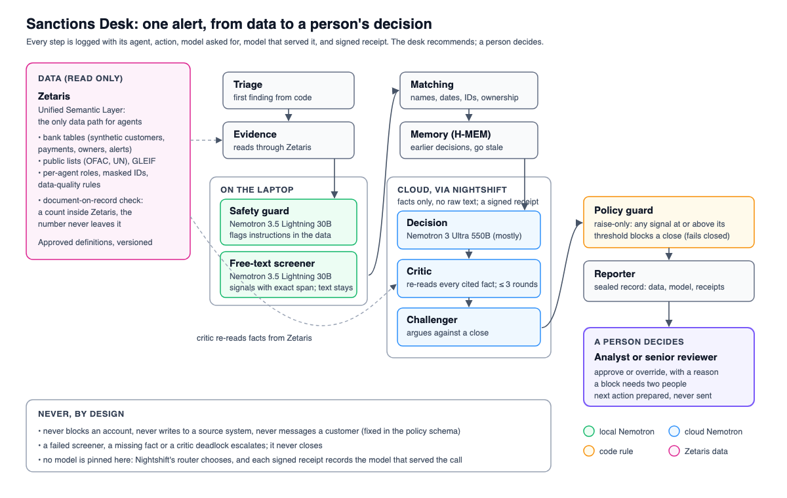
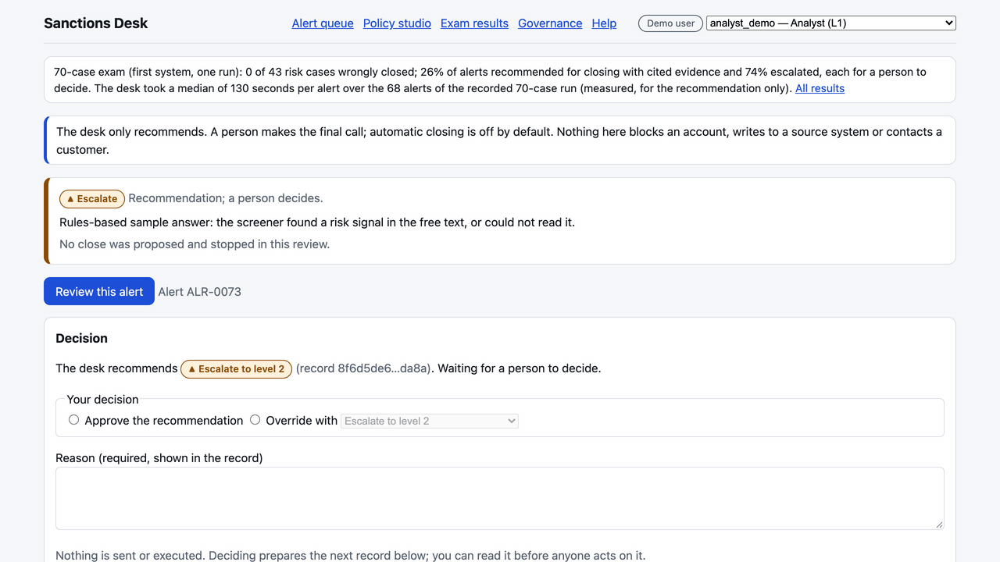
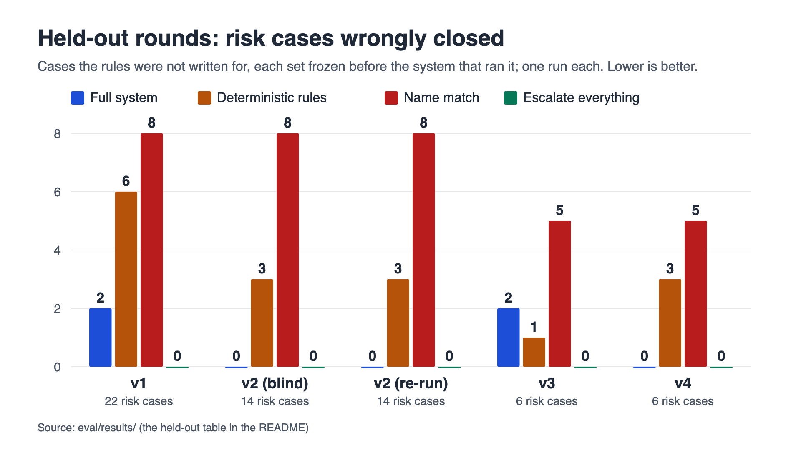
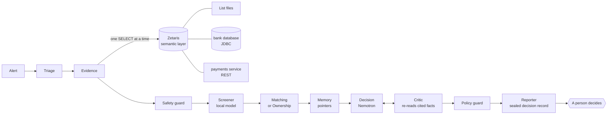

# Sanctions Desk

- **Who it is for:** sanctions screening analysts and their senior reviewers at a bank.
- **What goes wrong today:** name screening raises far more alerts than there are real matches; each one is worked by hand, field by field, and the costly mistake is closing the one that is real.
- **What it gives them:** for every alert, the evidence gathered through one data layer, every cited fact re-checked, risk signals from notes shown with the exact text they rest on, and a recommendation with its reasons.
- **How it stays safe:** it fails closed (when evidence is missing or a check fails, the case is escalated or held for more information, never closed), and a person decides every alert.
- **Privacy and proof:** raw notes are read by a model on the analyst's machine and kept out of every cloud prompt, which holds the structured fields and risk signals; every answer from Nightshift has a signed receipt.

<!-- badges:start -->
[](https://github.com/rahulmahadik/sanctions-desk/actions/workflows/ci.yml) [](package.json) [](package.json) [](LICENSE)
<!-- badges:end -->





*A review in sample mode (saved real data, a labelled rules stand-in for the models). More: [screenshots and clips](docs/media/README.md), live views with Nemotron receipts in [docs/NEMOTRON.md](docs/NEMOTRON.md).*

An AI review desk for bank sanctions-screening alerts. For every alert it reads the evidence from the bank's data, compares the customer (or payment party, or owner) with the listed party under approved definitions, asks Nemotron models for a recommendation, has a second step re-read every cited fact, applies a written policy, and hands a **recommendation with its evidence** to a person. **A human always makes the final call**: the desk never blocks, never writes to a source system and never messages a customer.

Built for the Open Agent Hackathon 2026, Track 03 (Reasoning Architecture).

**Review without installing:** [recorded runs, step by step with each model's receipt](https://rahulmahadik.github.io/sanctions-desk/runs/) · [the last one-command proof](eval/PROVE.md) · [API docs](https://rahulmahadik.github.io/sanctions-desk/api.html) · **[How NVIDIA Nemotron is used](docs/NEMOTRON.md)**

<!-- headline:start -->
**Safe triage that fails closed.** The desk recommends and a person decides; when evidence is missing or any check fails, the case is escalated or held for more information instead of closed. On the 70-case exam (the cases the rules were written for) the full system wrongly closed 0 of 43 risk cases, against 10 for plain name matching. On the blind held-out rounds, the risk cases it wrongly closed were: 2 in held-out v1; 0 in held-out v2 (the screener had failed, so nothing was closed); 2 in held-out v3; 0 in held-out v4. Each round, what it found and what was changed after it are in [docs/EVALUATION.md](docs/EVALUATION.md#held-out-rounds). **No claim of clearing alerts beyond the rules:** on the exam every close it makes is one the deterministic rules also make, and across the blind held-out rounds it made 0 correct clears, against 8 for the deterministic rules (which also close risk cases there). Every figure is one run. Details: [eval/REPORT.md](eval/REPORT.md).
<!-- headline:end -->

## Start here

|                             |                                                                                                                                                                                                                                                                                                                                 |
| --------------------------- | ------------------------------------------------------------------------------------------------------------------------------------------------------------------------------------------------------------------------------------------------------------------------------------------------------------------------------- |
| **Two-minute sample path**  | `SAMPLE_MODE=true docker compose up --build`, open http://localhost:3001, pick a demo user, open alert **ALR-0004** and press **Review this alert**. No account, key or model is needed; the data is replayed from saved real answers and the language model is a labelled stand-in ([AI and Model Usage](#ai-and-model-usage)) |
| **Live path**               | Zetaris, Nightshift and the synthetic bank running locally: [Run it live](docs/SETUP.md#run-it-live)                                                                                                                                                                                                                                         |
| **Traces and receipts**     | the **Decision trace** and **Model routing** panels of every case (with a _Verify receipt_ button); `eval/runs/<run-id>/` holds the exported events and Nightshift's signed receipts; check them with `npm run evidence:verify` ([Check which model served each call](docs/MODELS.md#check-which-model-served-each-call))                     |
| **Evidence for the claims** | [eval/REPORT.md](eval/REPORT.md), [docs/EVALUATION.md](docs/EVALUATION.md), [docs/SPONSORS.md](docs/SPONSORS.md), [docs/ZETARIS.md](docs/ZETARIS.md#zetaris-checklist)                                                                                                                                                          |

**Where to look**

| Question | Where it is answered |
| --- | --- |
| What happens when it fails? | [Failure handling](docs/ARCHITECTURE.md#failure-handling); a case the critic sent back: [output_examples/need-more-info-critic-sent-back/case.md](output_examples/need-more-info-critic-sent-back/case.md); Zetaris unreachable: `eval/results/2026-10-23T23-49-30-051Z-zdown-routed.json`; a signal that is not grounded still blocks a close: [screenshot](docs/media/screenshots/14-live-risk-signal-not-grounded.png); [docs/KNOWN_ISSUES.md](docs/KNOWN_ISSUES.md) |
| What does it do without being asked? | [What it does on its own](docs/ARCHITECTURE.md#what-it-does-on-its-own) and [Can and cannot, step by step](docs/ARCHITECTURE.md#can-and-cannot-step-by-step) |
| How can a person tell afterwards what it did? | The sealed decision record and the run's events, for example [output_examples/sample-mode/ALR-0073/](output_examples/sample-mode/ALR-0073); `GET /cases/:alertId/trace`; `npm run ledger -- --case <alert id>`; the case view's decision trace ([screenshot](docs/media/screenshots/02-case-evidence.png)); [One real trace](docs/EVALUATION.md#one-real-trace) |
| Which model answered each call? | The routing panel ([screenshot](docs/media/screenshots/15-live-routing-and-receipts.png)); the trace fields `model_requested`, `model_used` and `receipt` on every model call (for example seq 25 in [output_examples/close-stopped-by-policy-guard/run-events.jsonl](output_examples/close-stopped-by-policy-guard/run-events.jsonl)); `npm run evidence:verify` ([Check which model served each call](docs/MODELS.md#check-which-model-served-each-call)) |
| How can the results be re-checked? | `npm run prove` (below); `npm run evidence:verify`; `npm run exam:report` rebuilds [eval/REPORT.md](eval/REPORT.md) and the held-out table from `eval/results/` |

## Quick start

Needs Docker, nothing else: no Zetaris, no model service, no credentials.

```bash
git clone https://github.com/rahulmahadik/sanctions-desk.git && cd sanctions-desk
SAMPLE_MODE=true docker compose up --build        # the API on http://localhost:8000, the review desk on http://localhost:3001
```

Open http://localhost:3001 for the review desk: pick an alert, press **Review this alert** and watch the steps light up as the real events arrive. More sample-mode requests: [docs/SETUP.md](docs/SETUP.md#try-it-in-two-minutes); running it live: [docs/SETUP.md](docs/SETUP.md#run-it-live).

One review from the command line, without the interface or a server. The request file holds the same body as `POST /run`; with `SAMPLE_MODE=true` no service or key is needed.

```bash
npm install
SAMPLE_MODE=true npm run -s case -- input_examples/run-ALR-0004.json
```

The request files are in [input_examples/README.md](input_examples/README.md); the answer's shape is in [docs/API.md](docs/API.md#run-one-case).

**Check the claims without Docker.** With Node 24, `npm ci && npm run prove` runs seven checks in a few seconds once installed and prints one PASS or FAIL line each, then a summary; it exits with 1 if any check fails. It needs no credentials and no services, forces sample mode and never reads `.env`. What each check does: [docs/EVALUATION.md](docs/EVALUATION.md#one-command-proof).

<!-- prove:start -->
**One-command proof** (`npm run prove`, no credentials or services; last run 2026-10-24T15:19:32.807Z on commit 5e09e20):

```text
PASS  Sample-mode review: POST /run ALR-0004 -> CLOSE_FALSE_POSITIVE, sealed record 799e63538368… verifies, sample notice shown, human review required (0.1 s)
PASS  Engine conformance: H-MEM 13/13, World Model 8/8, Markovian 8/8 (1.1 s)
PASS  Critic mutation test: 147/147 false cited facts caught over 25 decisions; 25/25 unchanged decisions approved (no false alarm); evidence standard: 5 of 5 pass; grounding and document-on-record: 3 of 3 pass (0.6 s)
PASS  Signed evidence: 28 runs: 1492/1492 receipts verified (signing key taken from each receipt, not pinned); 1492/1492 model calls have a receipt; 0 trace/receipt model mismatches; run files: 28 verified, commit field remapped (documented), 0 other differences (0.3 s)
PASS  Roles and four-eyes: 82/82 tests passed (pentest-access 56/56, people 26/26), 0 failed (1.5 s)
PASS  Preregistration: heldout.json cases 1-18 match; heldout.json cases 1-22 match; heldout2.json file hash matches; held-out v2 freeze commit 8f6976c is in the history; heldout3.json file hash matches; held-out v3 frozen in commit 02d0a2e, the same file; heldout4.json file hash matches; held-out v4 frozen in commit fc64537, the same file (0.0 s)
PASS  No secrets in the tree: 589 tracked text files scanned: 0 credential-bearing URLs, private keys or tokens; no .env file tracked (0.1 s)
PASS: 7 of 7 checks passed
```

Reproduce with `npm ci && npm run prove`, or `npm run prove -- --fresh` to clone this commit into a temporary folder, install and run the same checks there. Details: [eval/PROVE.md](eval/PROVE.md).
<!-- prove:end -->

## Key results

**Headline numbers** (from the saved runs; refreshed by `npm run exam:report`):

<!-- rounds:start -->
- **Wrongly closed on the 43 risk cases of the exam:** full system **0**, plain name matching 10.
- **Every held-out round, as run**, with the baselines on the same frozen cases (cases the rules were not written for; one run each). The same table, from the same result files, is on the review desk's test-scores screen. Wrong closes are in bold and stay in this table:

| Round | Full system | Single (no critic, no challenger) | Deterministic rules | Name match | Escalate everything |
|---|---|---|---|---|---|
| Held-out v1 (30 cases) | **2 of 22 risks closed (HO-005, HO-006); 0 of 8 clears** | not run | **6 of 22 risks closed (HO-001, HO-003, HO-004, HO-005, HO-006, HO-011); 0 of 8 clears** | **8 of 22 risks closed (HO-005, HO-006, HO-007, HO-008, HO-009, HO-010, HO-011, HO-017); 0 of 8 clears** | 0 of 22 risks closed; 0 of 8 clears |
| Held-out v2 (19 cases) | 0 of 14 risks closed; 0 of 5 clears | not run | **3 of 14 risks closed (HO2-001, HO2-002, HO2-003); 5 of 5 clears** | **8 of 14 risks closed (HO2-001, HO2-002, HO2-003, HO2-004, HO2-005, HO2-006, HO2-007, HO2-017); 0 of 5 clears** | 0 of 14 risks closed; 0 of 5 clears |
| Held-out v2, re-run after an infrastructure fix (not blind) | 0 of 14 risks closed; 0 of 5 clears | not run | **3 of 14 risks closed (HO2-001, HO2-002, HO2-003); 5 of 5 clears** | **8 of 14 risks closed (HO2-001, HO2-002, HO2-003, HO2-004, HO2-005, HO2-006, HO2-007, HO2-017); 0 of 5 clears** | 0 of 14 risks closed; 0 of 5 clears |
| Held-out v3 (12 cases) | **2 of 6 risks closed (HO3-001, HO3-003); 0 of 6 clears** | 0 of 6 risks closed; 0 of 6 clears | **1 of 6 risks closed (HO3-005); 1 of 6 clears** | **5 of 6 risks closed (HO3-001, HO3-002, HO3-004, HO3-005, HO3-006); 0 of 6 clears** | 0 of 6 risks closed; 0 of 6 clears |
| Held-out v4 (12 cases, last round) | 0 of 6 risks closed; 0 of 6 clears | 0 of 6 risks closed; 0 of 6 clears | **3 of 6 risks closed (HO4-002, HO4-003, HO4-005); 2 of 6 clears** | **5 of 6 risks closed (HO4-001, HO4-003, HO4-004, HO4-005, HO4-006); 0 of 6 clears** | 0 of 6 risks closed; 0 of 6 clears |
<!-- rounds:end -->

Held-out v2, v3 and v4 were each written by a separate AI agent session that saw no results, traces, code or fixes; labels fixed before the run (the session read the written definitions and the case and data builders, no review code); held-out v1 was written in this project before any run on it. What each round found and what was changed after it: [docs/EVALUATION.md](docs/EVALUATION.md#held-out-rounds).



Rules settle what structured data can. On the cases the rules were written for, the deterministic pipeline is exact by design; on every held-out round it also closed risk cases (the table above), which is why the desk never closes on rules alone. The full system did not always do better: it wrongly closed 2 risk cases on held-out v1 (both also closed by the rules) and 2 on v3 (which the rules did not close); on v2 and v4 it closed none, where the rules closed 3 each. It made no clears the rules miss.

Counts in this README (<!--fact:exam_cases-->70<!--/fact--> exam cases in <!--fact:exam_groups-->12<!--/fact--> groups, <!--fact:heldout_cases-->30<!--/fact--> cases in the first held-out set (73 across the four held-out sets), <!--fact:edge_cases-->43<!--/fact--> edge cases) are written by `npm run readme:refresh` from the committed data.

<!-- adversarial:start -->
- **Safety guard against injected text (one run, 2026-10-23, policy 7):** Lightning flagged 70 of 70 injected instructions, against 24 for the fixed patterns alone, and 12 of 12 tipping-off drafts (patterns: 1); it wrongly flagged 1 of 23 harmless texts. It tests the safety guard only, not a full review. Details: [docs/EVALUATION.md](docs/EVALUATION.md#safety-guard-against-injected-text).
<!-- adversarial:end -->

**Changes after the evaluation.** After every recorded run, the ownership rule was made a cascade (OFAC's 50 percent rule), exam case EX-043 was relabelled, request-for-information drafts got fixed wording and a tipping-off check, every jurisdiction action now escalates, the SQL guard refuses `SELECT *`, and Nightshift's own answer memory was switched off. What, why, commit and effect: [docs/EVALUATION.md](docs/EVALUATION.md#changes-after-the-evaluation). The recorded results are unchanged; the report scores them against the current labels.

## How it works



The outcomes are `CLOSE_FALSE_POSITIVE`, `ESCALATE_L2`, `RECOMMEND_BLOCK` (needs two human approvals) and `NEED_MORE_INFO`.

Each step, what it may and may not do, the guardrails and the failure handling: [docs/ARCHITECTURE.md](docs/ARCHITECTURE.md). Memory, reasoning and tools: [docs/MEMORY.md](docs/MEMORY.md).

### Which Nemotron model does each step

| Step | Model | Where it runs | What it receives | Who answered, from the signed receipts of the 28 recorded runs |
| --- | --- | --- | --- | --- |
| Safety guard (inbound text and outbound drafts) | Nemotron 3.5 Lightning 30B | the analyst's laptop | the raw free text, which stays on the machine | Lightning 386 of 386 |
| Free-text screener | Nemotron 3.5 Lightning 30B | the analyst's laptop | customer notes, payment references and list remarks; it returns risk signals with the exact text span | Lightning 122 of 122 |
| Decision | Nemotron 3 Ultra 550B | cloud | structured fields and risk signals, never free text | Ultra 504, Lightning 16, Ollama backup 15 (no receipt) of 535 |
| Critic (after code re-reads every cited fact) | Nemotron 3 Ultra 550B | cloud | the recommendation and the re-checked evidence | Ultra 418, Lightning 8, Ollama backup 2 of 428 |
| Challenger (argues against a close) | Nemotron 3 Ultra 550B | cloud | the proposed close and its evidence | Ultra 38, Ollama backup 2 of 40 |

Why each model, the privacy design and the studies of model choice: [docs/NEMOTRON.md](docs/NEMOTRON.md). Nightshift's router chooses inside the lane each step is bound to, so the split is a measurement, not a guarantee.

## How sponsor technology is used

<!-- sponsors:start -->
**Zetaris: the only data path.** Three sources stay where they are and meet in one Unified Semantic Layer of 14 tables: list files in the Zetaris file store, a Postgres bank database over JDBC with a read-only login, and a payments service read as a REST table. Each agent reads only its own tables and columns, one read-only statement at a time, under a read-only Zetaris role; identifier numbers are masked. A customer record that fails a data-quality rule cannot support a close (one documented exception: a missing date of birth supplied by a verified note). Before a note counts as evidence, the document number it cites is counted against the customer's identifiers inside Zetaris, so the number never reaches a model. *Check it:* `zetaris/sql/` (sources and semantic layer), `npm run check:roles` and `npm run check:isolation` (live), `packages/zetaris/test/guard.test.ts` (access and masking), `packages/agents/test/policy-guard.test.ts` (data quality), `packages/agents/src/note-document.ts` (document on record), [docs/ZETARIS.md](docs/ZETARIS.md).

**Meterless engines: three, each in a working feature.** H-MEM keeps earlier decisions as pointers (table, key, content hash) that go stale when the listed entry changes; the memory step recalls them for each review. The World Model holds each company's ownership register, written row by row with provenance and a validity date; the ownership step evaluates the 50 percent rule (counted as a cascade) on what it reads back. Markovian re-screens every earlier decision after a list change in bounded batches with a carried cursor; the list-change check uses it. *Check it:* `npm run test:engines` (H-MEM 13/13, World Model 8/8, Markovian 8/8 on the official conformance suites), `packages/engines/src/`, `output_examples/close-previously-cleared/` (memory), `POST /list-change/replay` and `apps/api/test/review.test.ts` (list change).

**Meterless Nightshift: every model call.** The desk talks to Nightshift's OpenAI-compatible API through one injected generator, under two app identities: `sanctions-desk-guard`, bound to the local lane, and `sanctions-desk-reasoning`, bound to the deep lane (binds set in the Nightshift cockpit). Ollama is a backup only. Every call returns an Ed25519-signed receipt naming the model that served it; the trace keeps the requested model, the routed model and the receipt id side by side. *Check it:* `config/default.json` (`nightshift`), `packages/shared/src/generator.ts`, `npm run evidence:verify` (1,492 receipts across 28 exported runs, all valid), the **Verify receipt** button in the case view.

**NVIDIA Nemotron: local where the text is, cloud where the reasoning is.** Nemotron 3.5 Lightning 30B runs on the analyst's laptop for the safety guard and the free-text screener, so the desk never puts raw notes or payment references in a cloud prompt. Nightshift's own answer memory can add earlier answers, local ones included, to a cloud request; it was on during the recorded runs, so whether text read on the laptop reached the cloud that way cannot be checked for them, and it has been off since 24 Oct 2026 (30 receipts checked, none with an added memory; see docs/MODELS.md). Nemotron 3 Ultra 550B in the cloud handles the decision, the critic and the challenger, and receives structured facts only. Nightshift's router chooses within each lane and every receipt records the model: in the headline run the safety guard was answered by Lightning in 70 of 70 calls and the decision by Ultra in 87 of 89. *Check it:* `npm run evidence:verify -- eval/runs/routed-20261023T133311Z`, [docs/MODELS.md](docs/MODELS.md).

**Cursor: not used.** Built with Claude Code ([AI and Model Usage](#ai-and-model-usage)).

**What was unique**
1. The critic does not trust the decision: code re-reads every cited fact from Zetaris before the critic's model sees it, and a fact that does not hold is never approved.
2. Raw text stays out of the desk's cloud prompts: the local model turns it into risk signals with exact spans, and a signal at or above its threshold blocks a close whether or not its span is grounded.
3. Every held-out round is published as run, wrong closes included, and every Nightshift answer has a signed receipt that one command re-checks.

**Limitation:** By default the cloud decision model receives structured personal fields from the case (name, date of birth, nationality); the desk never puts free text in a cloud prompt. The optional privacy mode sends tokens instead, and has been tested only on a small live sample. **Future work:** For deployments that require it, make privacy mode the default once a full evaluation run confirms it, or keep the decision step local.
<!-- sponsors:end -->

Details: [docs/SPONSORS.md](docs/SPONSORS.md), [docs/ZETARIS.md](docs/ZETARIS.md), [docs/MODELS.md](docs/MODELS.md) and [docs/MEMORY.md](docs/MEMORY.md).

## Privacy mode

Optional and off by default: set `PRIVACY_MODE=pseudonymise`. Before every cloud call the case's names, aliases, identifiers, dates of birth, addresses and country values are replaced by stable per-case tokens (`PARTY_A`, `LISTED_1`, `DOC_1`, `DOB_1`, `COUNTRY_1`); the cloud model sees the tokens, the comparison worked out on this machine (name score, date of birth and nationality agreement, definitions met) and whether each country token is a watched jurisdiction. The token map stays on this machine and in the sealed record, the answer is mapped back locally, and a prompt that still holds a raw name, identifier or date of birth is not sent. Small test of an optional mode, not part of the recorded evaluation (24 Oct 2026, held-out v4 and 8 of the 70 exam cases, one live run in each mode, Nightshift warmed up and not restarted): 0 wrong closes in both modes; 14 of 20 outcomes identical; all 65 cloud prompts passed the raw-value check; its 104 receipts verify, none with an added memory. With one run each on a small sample, the other differences are within the variation between runs and are not read as better or worse. Details: [docs/MODELS.md](docs/MODELS.md#privacy-mode).

## Safety and limits

- **A person decides.** The desk recommends. It never blocks an account, never writes to a source system and never contacts a customer; those limits are fixed in the policy schema and cannot be lifted by a policy change. A recommended block needs two approvals.
- **The policy guard only raises caution.** It can make a recommendation more cautious, never less.
- **The local screener over-flags relationships**, so on the held-out sets the correct clears go to a person: the fail-closed rule (policy version 8) makes every signal at or above its threshold block a close, grounded or not. On held-out v4 that cost all six clears; no risk case was closed.
- Each variant in the report is one run. Model answers vary between runs and the runtime may answer a repeated prompt from its cache.
- The customers, accounts, owners and payments are **synthetic**; only the listed parties are real public entries.
- **Limitation:** By default the cloud decision model receives structured personal fields from the case (name, date of birth, nationality); the desk never puts free text in a cloud prompt. The optional privacy mode sends tokens instead, and has been tested only on a small live sample.
- **Future work:** For deployments that require it, make privacy mode the default once a full evaluation run confirms it, or keep the decision step local.

More: [Guardrails](docs/ARCHITECTURE.md#guardrails), [Failure handling](docs/ARCHITECTURE.md#failure-handling), [Edge cases](docs/EDGE_CASES.md), [Responsible AI](docs/GOVERNANCE.md#responsible-ai), and [Limits](docs/KNOWN_ISSUES.md#limits), [Not built / not verified](docs/KNOWN_ISSUES.md#not-built--not-verified) and [Future work](docs/KNOWN_ISSUES.md#future-work) in [docs/KNOWN_ISSUES.md](docs/KNOWN_ISSUES.md).

## Documentation

| Document | What is in it |
| --- | --- |
| [docs/ARCHITECTURE.md](docs/ARCHITECTURE.md) | Who it is for, the steps, what each step can and cannot do, guardrails, failure handling, FAQ |
| [docs/MEMORY.md](docs/MEMORY.md) | How memory, reasoning and tools work; the three Meterless engines |
| [docs/SETUP.md](docs/SETUP.md) | Sample mode in two minutes, running it live, data sources and licences |
| [docs/CONFIGURATION.md](docs/CONFIGURATION.md) | Every setting and environment variable |
| [docs/DEVELOPMENT.md](docs/DEVELOPMENT.md) | Commands, repository layout, running the interface |
| [docs/USER_GUIDE.md](docs/USER_GUIDE.md) | The review desk, screen by screen, and the decision flow |
| [API docs](https://rahulmahadik.github.io/sanctions-desk/api.html) | The API reference (Redoc, from the API's own OpenAPI document; `npm run site:build`) |
| [docs/API.md](docs/API.md) | Routes, examples, the decision trace, one review from the command line |
| [docs/MCP.md](docs/MCP.md) | The review desk as an MCP server |
| [docs/EVALUATION.md](docs/EVALUATION.md) | The exam, the variants, the held-out rounds, one real trace, ablations, the one-command proof |
| [eval/REPORT.md](eval/REPORT.md) | The results of every saved run |
| [eval/PROVE.md](eval/PROVE.md) | The last `npm run prove` output |
| [docs/BENCHMARKS.md](docs/BENCHMARKS.md) | API load test and how long a run takes |
| [docs/EDGE_CASES.md](docs/EDGE_CASES.md) | Every edge case with its expected outcome and check |
| [docs/NEMOTRON.md](docs/NEMOTRON.md) | How NVIDIA Nemotron is used: model per step and why, privacy design, the model-choice study, receipt statistics |
| [docs/MODELS.md](docs/MODELS.md) | Nightshift, the Nemotron models, routing, receipts and how to check which model served each call |
| [docs/ZETARIS.md](docs/ZETARIS.md) | The Zetaris checklist, sources, semantic layer, roles and access control |
| [docs/QUERY_PLANS.md](docs/QUERY_PLANS.md) | Zetaris query plans for the key queries |
| [docs/SPONSORS.md](docs/SPONSORS.md) | How the desk uses Zetaris, Meterless and NVIDIA Nemotron |
| [docs/GOVERNANCE.md](docs/GOVERNANCE.md) | Governance view, people and roles, policy, responsible AI |
| [docs/SECURITY.md](docs/SECURITY.md) and [docs/SECURITY-QUEUE.md](docs/SECURITY-QUEUE.md) | What is protected and tested, and the open findings |
| [docs/KNOWN_ISSUES.md](docs/KNOWN_ISSUES.md) | Problems met, limits, what is not built or not verified, future work |
| [docs/SAMPLE_MODE.md](docs/SAMPLE_MODE.md) | How sample mode works |
| [docs/media/README.md](docs/media/README.md) | The screenshots and how they were made |
| [input_examples/README.md](input_examples/README.md) and [output_examples/README.md](output_examples/README.md) | Request files and outputs saved from real runs |

## AI and Model Usage

Disclosure under section 6 of the event's AI Usage Policy.

**Models, through Meterless Nightshift.** Every model call in the product goes through Nightshift, an OpenAI-compatible runtime, as the primary provider. The models are NVIDIA Nemotron: **Nemotron 3.5 Lightning 30B** (on a local laptop) and **Nemotron 3 Ultra 550B** (cloud). Nightshift's router decides which of them answers a call unless the cockpit binds the app; the table under [App binds used in the final runs](docs/MODELS.md#app-binds-used-in-the-final-runs) is the split measured from the signed receipts, and [docs/MODELS.md](docs/MODELS.md#models-per-step) explains each step.

"Mostly" is a measurement, not a promise: Nightshift's router chooses the model for these three steps, and the split from the signed receipts is in the table under [App binds used in the final runs](docs/MODELS.md#app-binds-used-in-the-final-runs). We tried binding their app identity to the _deep_ mode in the cockpit; that races both models, so it did not make the routing deterministic (in the headline run 187 of 190 of their calls were served by Ultra, 3 by Lightning). The cockpit variables and the steps to set them are in [docs/MODELS.md](docs/MODELS.md#two-app-identities-and-what-the-cockpit-does-with-them).

The Ollama backup (`nemotron-3.5-lightning:30b`) answers only if Nightshift cannot. In sample mode a labelled rules-based stand-in answers instead. No other model provider is named anywhere in the code.

**Agent frameworks.** None. The agents are our own orchestration: plain TypeScript functions in `packages/agents`, one injected `generator` function for model calls, a bounded loop (at most 3 critic rounds) and a sealed, hash-chained decision record. There is no LangChain, LlamaIndex, AutoGen or similar.

**Sponsor technology.**
- **Zetaris** serves all the data the agents use. The agents never open a file or a database: each sends one read-only SQL statement at a time to the Zetaris REST API and reads the Unified Semantic Layer (14 tables over lists, a bank database and a payments service), under one read-only Zetaris role for the agents with per-agent table and column allow-lists, and with data-quality rules. See [docs/ZETARIS.md](docs/ZETARIS.md#zetaris-checklist).
- **Meterless engines**: H-MEM (agent and analyst memory), the World Model (the ownership register the 50 percent rule is evaluated on) and Markovian (re-screening after a list change) each run in a working feature and have a passing test, and the official conformance suites run in `npm test` (H-MEM 13/13, World Model 8/8, Markovian 8/8). See [docs/SPONSORS.md](docs/SPONSORS.md#2-meterless-engines-three-each-in-a-working-feature).
- **Meterless Nightshift** is the primary model provider. The app connects with `METERLESS_BASE_URL`, a bearer key and the `meterless-app` header, asks for a pinned mode per step, and stores each call's signed receipt.
- **NVIDIA Nemotron** is the only family of language models used, in the steps listed in [docs/MODELS.md](docs/MODELS.md#models-per-step).

**Development tools.** Built with Claude Code. AI-assisted coding was used for scaffolding, tests, debugging and documentation. All generated code was reviewed and tested. Cursor was not used.

**External tools and libraries.** Node.js, TypeScript, Fastify, Zod, Pino, Next.js and React, Vitest and Biome, and `tsx`; Postgres for the synthetic bank database; Docker for packaging. Security checks used npm audit, Semgrep, Trivy, Gitleaks and ZAP. Versions are in `package-lock.json`.

**Data.** The lists are real public data: OFAC SDN and consolidated list, the UN consolidated list and GLEIF, with licences in [Data sources and licences](docs/SETUP.md#data-sources-and-licences). **All customer, account, ownership and payment data is synthetic**, produced by a seeded script; nothing comes from a real bank, client or employer.

**Open-source code adapted.** The three Meterless engines in `packages/engines/src` are derived from the Meterless reference implementations, and the official conformance suites in `packages/engines/conformance` are copied without change (Apache-2.0). Attribution is in `NOTICE` and `THIRD_PARTY_NOTICES.md`.

**Known limitations.** A person makes every decision by default; the desk only recommends. The exam labels follow the same definitions as the rules, so a high score on the 70 rule-defined cases shows consistency, not that the definitions are right; the held-out set is the test of reasoning beyond them. Model answers vary between runs and cloud routing is decided by the runtime. Cost figures rest on stated unit costs; analyst time saved was not measured and is not claimed. The column policy on identifier numbers is not enforced on the Zetaris instance used, so the application masks them. The full list is under [Limits](docs/KNOWN_ISSUES.md#limits).

**Sample mode.** With `SAMPLE_MODE=true` the desk runs without Zetaris or Nightshift. It replays saved answers recorded from real Zetaris runs, runs the real agent logic on them, and uses a rules-based stand-in in place of the language models. The interface says so in a banner on every page, and every record made this way carries a sample notice. Sample mode never presents the stand-in's output as a Nemotron answer.

## Third-party code and licence

Apache-2.0. See `LICENSE` and `THIRD_PARTY_NOTICES.md` (Meterless engine specifications and reference implementations, GLEIF data).
