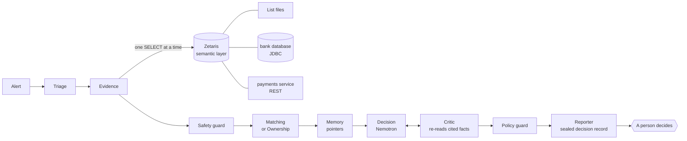

# sanctions-desk

An AI review desk for bank sanctions-screening alerts. For every alert it reads the evidence from the bank's data, compares the customer (or payment party, or owner) with the listed party under approved definitions, asks Nemotron models for a recommendation, has a second step re-read every cited fact, applies a written policy, and hands a **recommendation with its evidence** to a person. **A human always makes the final call**: the desk never blocks, never writes to a source system and never messages a customer.

Built for the Open Agent Hackathon 2026, Track 03 (Reasoning Architecture).

## Contents

- [What it does](#what-it-does)
- [Try it in two minutes](#try-it-in-two-minutes)
- [How it works](#how-it-works)
- [Sponsor technology](#sponsor-technology)
- [The decision trace](#the-decision-trace)
- [Evaluation](#evaluation)
- [Edge cases handled](#edge-cases-handled)
- [Guardrails](#guardrails)
- [Data sources and licences](#data-sources-and-licences)
- [Run it live](#run-it-live)
- [Configuration](#configuration)
- [API](#api)
- [Policy](#policy)
- [Development](#development)
- [Limits](#limits)
- [AI usage](#ai-usage)
- [Third-party code and licence](#third-party-code-and-licence)

## What it does

Name matching raises far more alerts than there are real matches. The desk works the way a careful analyst does:

| Alert                                                    | What the desk checks                                                                                              | Typical outcome                                                                                                                                     |
| -------------------------------------------------------- | ----------------------------------------------------------------------------------------------------------------- | --------------------------------------------------------------------------------------------------------------------------------------------------- |
| A customer's name resembles a listed party               | Date of birth, nationality, document numbers, aliases in other scripts, look-alike letters, earlier decisions     | Close a clear false positive with cited evidence; escalate a true match; ask for more information when data is missing                              |
| A payment counterparty resembles a listed party          | Counterparty name and country, watched jurisdictions                                                              | Escalate a match; refuse to clear a payment with no usable country                                                                                  |
| A listed party appears on a company's ownership register | Effective ownership through chains and several owners, exactly at the 50 percent line, loops, missing percentages | Escalate at or above the threshold; close below it; ask when a percentage is missing                                                                |
| The sanctions list changes                               | Every earlier decision against the entry as it is now                                                             | Re-open cleared cases whose entry changed; offer delisted parties for release by a person; say how many customers and pending payments are affected |
| Text in the data tries to instruct the reviewer          | A safety guard with a written policy and fixed patterns                                                           | Flag it, treat it as data, never close because of it                                                                                                |

## Try it in two minutes

Needs Docker, nothing else: no Zetaris, no model service, no credentials.

```bash
git clone <repository-url> sanctions-desk && cd sanctions-desk
SAMPLE_MODE=true docker compose up --build        # the API on http://localhost:8000

curl -s localhost:8000/run -H 'content-type: application/json' \
  -d '{"alert_id":"ALR-0004"}' | jq '{decision, confidence, rationale, critic, record_hash, sample_notice}'
curl -s localhost:8000/cases/ALR-0004/trace | jq '.definitions, .access, .cost.totals'
curl -s localhost:8000/list-change/replay -X POST -H 'content-type: application/json' -d '{}' | jq '.impact, (.reopen | length), (.release | length)'
```

Sample mode runs the real agents on saved answers from real Zetaris queries, with a labelled rules-based stand-in for the language model. See [docs/SAMPLE_MODE.md](docs/SAMPLE_MODE.md). Example inputs are in `input_examples/` and real outputs saved from live runs are in `output_examples/`.

## How it works



| Step         | What it does                                                                                                                                                                                                              | Uses a model                          |
| ------------ | ------------------------------------------------------------------------------------------------------------------------------------------------------------------------------------------------------------------------- | ------------------------------------- |
| Triage       | Chooses the path, judges whether the case is clear or contested                                                                                                                                                           | No                                    |
| Evidence     | Reads the semantic layer's own description, then builds one read-only tool per table and reads the alert, customer, list entry, aliases, dates, countries, identifiers, data-quality results and the approved definitions | No                                    |
| Safety guard | Screens text from the data for instructions aimed at the reviewer                                                                                                                                                         | Yes (fast, local)                     |
| Matching     | Field-by-field comparison with the approved definitions applied by code (true match, false positive, counterparty match)                                                                                                  | No                                    |
| Ownership    | Reads the register level by level; the ownership engine works out effective ownership                                                                                                                                     | No                                    |
| Memory       | Recalls earlier decisions as pointers (table, row key, content hash) and checks them against the entry now                                                                                                                | No                                    |
| Decision     | Recommends one of four outcomes with cited facts                                                                                                                                                                          | Yes (Nemotron, reasoning on, bounded) |
| Critic       | Re-reads every cited fact from the data, checks the recommendation against the definitions, asks a model for unsupported claims; may send it back, up to the policy's limit                                               | Yes                                   |
| Policy guard | Applies the hard rules. It can make a recommendation more cautious, never less                                                                                                                                            | No                                    |
| Reporter     | Seals a hash-protected decision record and returns the answer                                                                                                                                                             | No                                    |

The outcomes are `CLOSE_FALSE_POSITIVE`, `ESCALATE_L2`, `RECOMMEND_BLOCK` (needs two human approvals) and `NEED_MORE_INFO`.

**Approved business definitions** are data in the semantic layer, versioned and cited by id and version in every decision: `true_match`, `false_positive`, `counterparty_match`, `strong_identifier`, `effective_ownership_threshold`. If the approved wording changes and the code has not been reviewed for it, the guard stops automatic closes.

## Sponsor technology

### Zetaris

Zetaris is the only data path. Three kinds of source meet in one Unified Semantic Layer (`lightning.metastore.sanctions.screening_usl`, 14 tables):
- **list files** in the Zetaris file store (OFAC and UN sample, business definitions),
- a **Postgres bank database** over JDBC with a read-only login (customers, ownership, alerts, earlier decisions),
- a **payments service** read as a cached REST table.

The model has keys, foreign keys, a description for every table and column, and eight data-quality rules on top of the foreign-key rules. The agents read the model's own description at run time and build their tools from it. Three non-admin identities with their own tokens read it; identifier numbers are masked; a second guard in our code allows only one `SELECT` on the model's tables. Failing data-quality records can never support a close. Each query's id is matched to Zetaris's own statement history (`GET /cases/:id/trace?audit=true`), and the key queries' `EXPLAIN` plans are in [docs/QUERY_PLANS.md](docs/QUERY_PLANS.md). Details, setup and what this build does not offer: [docs/ZETARIS.md](docs/ZETARIS.md).

### Meterless engines

Three engines were implemented in TypeScript from the Meterless specifications (Apache-2.0, headers on every file) and pass the official conformance runners against our implementations:

| Engine                          | Where it works here                                                                                                                                                                                                                                                                                       | Test                                                             |
| ------------------------------- | --------------------------------------------------------------------------------------------------------------------------------------------------------------------------------------------------------------------------------------------------------------------------------------------------------- | ---------------------------------------------------------------- |
| **H-MEM** (hierarchical memory) | Pointer memory: a past decision is remembered as outcome, reason codes and a pointer to the row (table, key, content hash, list snapshot), never as personal data. Recall re-checks the pointer; a changed hash makes the memory stale. A human override beats memory and is written to the trust ledger. | `packages/engines/test/hmem.test.ts`, `pointer-memory.test.ts`   |
| **World Model**                 | The ownership picture of each company, written with provenance and validity dates; the 50 percent rule runs on it (chains multiply, listed owners add up, exactly the threshold counts, a missing percentage is unknown, loops end, a depth limit escalates).                                             | `packages/engines/test/world-model.test.ts`, `ownership.test.ts` |
| **Markovian**                   | List-change replay: every earlier decision is checked against the entry as it is now, in bounded batches with a carried cursor.                                                                                                                                                                           | `packages/engines/test/markovian.test.ts`, `rescreen.test.ts`    |

```bash
npm run test:engines     # the official runners against our code: H-MEM 13/13, World Model 8/8, Markovian 8/8
```

The runners are read from `../meterless-engines` (set `METERLESS_ENGINES_DIR` to use another location).

### Meterless Nightshift

All model calls go through Nightshift, an OpenAI-compatible runtime, with pinned modes only (`meterless/fast`, `meterless/deep`, `meterless/judge`); `meterless/auto` is rejected. Dead routes are retried once, then Ollama is the backup. Every answer's signed receipt is stored and verified (`valid_pinned`, `valid_unpinned`, `invalid`), and the requested and routed model, local or cloud, are recorded for every call. See [docs/MODELS.md](docs/MODELS.md).

### Where NVIDIA contributes

Nemotron models do the language work: Nemotron 3 Ultra 550B (cloud lane) and Nemotron 3.5 Lightning 30B (local lane) answer the decision, the critic and the safety guard. Each recommendation's model ledger shows which model answered which step, and the signed receipt backs it (`npm run ledger -- --case <alert id>`).

### What is distinctive

- Every recommendation can answer four questions from its sealed record: which approved definition was applied, what data it rested on, who was allowed to see what, and what it cost to produce.
- The critic does not trust the decision: it re-reads each cited fact from the data, and a claim that does not match is never approved, whatever any model says.
- Memory holds pointers, not copies, and goes stale the moment the listed entry changes.
- The policy guard can only add caution; a block needs a strong match and an approving critic, and always needs two people.

## The decision trace

`GET /cases/:alertId/trace` (or `/runs/:runId/trace`) answers four questions from the sealed record, and says if the record no longer verifies:

| Question                               | Answer in the trace                                                                                                                                               |
| -------------------------------------- | ----------------------------------------------------------------------------------------------------------------------------------------------------------------- |
| Which approved definition was applied? | `definitions`: id, version and a hash of the wording                                                                                                              |
| What data is it based on?              | `data`: model version, list snapshots, every query (id, statement hash, rows, latency, cache hit), row hashes                                                     |
| Who was allowed to see what?           | `access`: the role of each query, whether it ran under its own token or the labelled fallback, the masked columns, the policy version and hash                    |
| What did it cost to produce?           | `cost`: per call model, route, reasoning on or off, tokens, latency, receipt status; Zetaris query time and rows; totals and cost under the configured unit costs |

## Evaluation

The exam has 65 cases built from real public list entries and synthetic customers, payments and owners, in eleven groups (false positives, true matches, transliteration, missing data, hidden ownership at and above 50 percent, ownership below 50 percent, earlier clearances that still hold, earlier clearances that no longer hold, injection, tipping-off drafts, payment routes through watched jurisdictions). Each case has one right answer, acceptable alternatives, and answers that must never be given. The most important number is the **false-close rate**: how often a case that carries real risk is recommended for closing. The target is zero.

```bash
npm run exam -- --variant routed      # the full system, live
npm run exam -- --variant single      # one recommendation, no critic, no memory
npm run exam -- --variant local       # local lane only, reasoning off
npm run exam -- --variant rules       # rules stand-in, no language model
npm run exam -- --variant fuzzy       # baseline: a name-score threshold
npm run exam:report                   # builds eval/REPORT.md from the saved results
```

Results from real runs are in `eval/results/` and summarised in [eval/REPORT.md](eval/REPORT.md). Nothing in them is edited by hand.

## Edge cases handled

34 edge cases (names, ownership, lists and memory, data and systems, security) each have an expected outcome and a check: [docs/EDGE_CASES.md](docs/EDGE_CASES.md). Highlights: exactly 50 percent counts; 49.9 does not; 25 plus 25 from two listed owners does; circular ownership ends; a missing percentage is unknown, not zero; look-alike Cyrillic letters in a Latin name are seen through; a customer note that says "ignore previous instructions" is data; a draft that tells a customer they are being screened is refused.

## Guardrails

- Read-only by schema and by policy; no write to any source system; no customer message; no automatic block (locked off in the policy schema).
- A recommendation needs a person. `RECOMMEND_BLOCK` needs two approvals.
- The policy guard only raises caution. It stops a close on a strong match, an identifier match, a missing date of birth with a matching name, an unresolved possible match, low confidence, a watched jurisdiction, instruction-like text in the data, a failing data-quality rule, a changed approved definition, an ownership at or above the threshold, a missing ownership percentage, and an unresolved critic.
- Every model, query and external call has a timeout; loops are capped (the critic gets at most three rounds).
- Secrets come only from the environment and are scrubbed from every log line and trace event.
- Text that comes from the data is quoted as data; long fields are cut to a fixed length in prompts.

## Data sources and licences

| Data                                                                                       | Source                                     | Licence / note                                                                                                                   |
| ------------------------------------------------------------------------------------------ | ------------------------------------------ | -------------------------------------------------------------------------------------------------------------------------------- |
| OFAC SDN and consolidated list (`data/sample/`: 366-entry subset)                          | US Treasury OFAC, public download          | Public-domain US government data                                                                                                 |
| UN Security Council consolidated list (subset)                                             | scsanctions.un.org, public download        | Public; no explicit licence stated                                                                                               |
| GLEIF LEI records and parent relationships (`data/reference/gleif/`: 74 records, 48 links) | GLEIF public API                           | CC0 1.0, https://www.gleif.org/en/meta/lei-data-terms-of-use                                                                     |
| Customers, accounts, owners, payments, alerts, earlier decisions                           | Built by `npm run data:synthetic` (seeded) | **Synthetic**; every table says so. The list update used for re-opening cases is a labelled synthetic edit of a few real entries |

`npm run data:fetch`, `data:normalise` and `data:sample` rebuild the list data from the public sources.

## Run it live

Needs Zetaris running locally, the Nightshift runtime, and optionally Ollama.

```bash
npm install
cp .env.example .env                       # then add your own values; never commit .env
docker compose --env-file .env.data --profile data up -d --build bankdb payments-api   # synthetic bank + payments (see below)
npm run zetaris:rebuild                    # create everything in Zetaris from the committed scripts
npm run dev                                # the API on http://localhost:8000
npm run exam -- --variant routed           # the 60-case exam against live services
```

The `data` profile needs `BANKDB_ADMIN_PASSWORD`, `BANKDB_READER_PASSWORD` and `PAYMENTS_API_KEY` (any random values; keep them in a git-ignored file such as `.env.data`). The two containers join the Zetaris network only and publish no ports; `npm run check:isolation` proves that Zetaris can reach them and nothing else can.

Create the three non-admin Zetaris users and tokens as described in [docs/ZETARIS.md](docs/ZETARIS.md#roles-identities-and-tokens).

## Configuration

No URL, model name or timeout is written in the source. Configuration is layered, lowest priority first: `config/default.json` (committed defaults), `config/local.json` (git-ignored, this machine's non-secret settings such as a pinned receipt key), the file named by `CONFIG_FILE`, then environment variables, which are the only place secrets may come from. Invalid configuration stops the process at start-up. Secrets print as `[REDACTED]`.

| Variable                                                              | Overrides                      | Notes                                                                                                  |
| --------------------------------------------------------------------- | ------------------------------ | ------------------------------------------------------------------------------------------------------ |
| `HOST`, `PORT`                                                        | `server.*`                     | Defaults `0.0.0.0`, `8000`.                                                                            |
| `LOG_LEVEL`, `LOG_DIR`                                                | `logging.*`                    | A relative `LOG_DIR` is resolved from the project root.                                                |
| `SAMPLE_MODE`                                                         | `sampleMode`                   | `true` runs on saved answers and the labelled stand-in.                                                |
| `ZETARIS_REST_URL`, `ZETARIS_ORG_ID`                                  | `zetaris.*`                    |                                                                                                        |
| `ZETARIS_API_KEY`                                                     | `zetaris.apiKey`               | Secret. Setup tooling and the labelled fallback only.                                                  |
| `ZETARIS_TOKEN_EVIDENCE`, `_REVIEWER`, `_EVAL`                        | `zetaris.tokens.*`             | Secrets. One per runtime identity.                                                                     |
| `METERLESS_BASE_URL`, `METERLESS_APP_ID`, `METERLESS_EVAL_APP_ID`     | `nightshift.*`                 | The evaluation app id keeps the runtime's answer cache separate from live use.                         |
| `METERLESS_RUNTIME_TOKEN`                                             | `nightshift.runtimeToken`      | Secret.                                                                                                |
| `METERLESS_MODEL_FAST`, `_DEEP`, `_JUDGE`                             | `nightshift.models.*`          | Must be pinned modes.                                                                                  |
| `METERLESS_RECEIPT_PUBLIC_KEY`                                        | `nightshift.receiptPublicKeys` | Comma separated base64 Ed25519 keys; marks receipts `valid_pinned`.                                    |
| `OLLAMA_BASE_URL`, `OLLAMA_MODEL`                                     | `ollama.*`                     | Backup provider.                                                                                       |
| `METERLESS_ENGINES_DIR`                                               | none                           | Folder with the engine conformance runners for `npm run test:engines`. Default `../meterless-engines`. |
| `BANKDB_ADMIN_PASSWORD`, `BANKDB_READER_PASSWORD`, `PAYMENTS_API_KEY` | none                           | Used by the `data` Docker profile (synthetic bank and payments service). Secrets.                      |
| `PAYMENTS_FILE`                                                       | none                           | Payments service data file when run outside Docker. Default `data/synthetic/payment.json`.             |
| `LIVE_TESTS`                                                          | none                           | Set to `1` to run the live model checks (`npm run test:live`).                                         |
| `ZETARIS_CHECK_CONTAINER`                                             | none                           | Container used by `npm run check:isolation`. Default `zetaris-driver-1`.                               |

## API

Errors have one shape: `{ "status": "error", "request_id": "...", "error": { "type", "message", "recoverable" } }`.

| Method and path                                                           | Purpose                                                                                                                                                                                                                |
| ------------------------------------------------------------------------- | ---------------------------------------------------------------------------------------------------------------------------------------------------------------------------------------------------------------------- |
| `GET /health`, `GET /health/dependencies`                                 | Liveness; readiness of Nightshift and Ollama.                                                                                                                                                                          |
| `POST /run`                                                               | Review one alert by `alert_id` (customer name, ownership or payment alert). Returns the recommendation, rationale, citations, `what_would_change`, agents, model ledger, guard verdicts, critic result, `record_hash`. |
| `GET /cases/:alertId/trace`, `GET /runs/:runId/trace`                     | The decision trace; add `?audit=true` to match queries with Zetaris's history.                                                                                                                                         |
| `GET /runs/:runId/events`                                                 | The recorded events of a run.                                                                                                                                                                                          |
| `POST /list-change/replay`                                                | Earlier decisions against the list as it is now: cases to re-open, parties to release, portfolio impact.                                                                                                               |
| `POST /guard/outbound`                                                    | Check a draft meant for a customer; refuses anything that reveals screening or an investigation.                                                                                                                       |
| `GET /policy`, `/policy/versions`, `/policy/versions/:v`, `/policy/audit` | The versioned policy.                                                                                                                                                                                                  |

A review writes `logs/trace-<run>.jsonl` (one JSON event per step), the sealed `logs/records/<record>.json` and the signed receipts under `logs/receipts/`.

## Policy

`config/policy.default.json` is the initial policy: lists and weights, name threshold, ownership threshold and depth, watched jurisdictions (a configurable example, to be checked against current sanctions programmes before use), automation limits, the critic's round limit and confidence floor, the model and reasoning budget per step, the Zetaris role per step, the guard texts and patterns. Auto-block, customer messages and write access are fixed off in the schema. A change is a draft, then a publish by a different person (four-eyes); a run keeps the version it started with.

## Development

| Command                             | What it does                                                                                                                  |
| ----------------------------------- | ----------------------------------------------------------------------------------------------------------------------------- |
| `npm run ci`                        | Typecheck, lint, voice lint and all tests with coverage gates (90 percent lines, functions, statements; 80 percent branches). |
| `npm test`, `npm run test:coverage` | Unit tests.                                                                                                                   |
| `npm run test:engines`              | Official Meterless conformance runners against our engines.                                                                   |
| `npm run test:live`                 | Live checks against Nightshift and Ollama.                                                                                    |
| `npm run verify`                    | Whole-environment check (containers, Zetaris, Nightshift, Ollama, repository hygiene).                                        |
| `npm run check:isolation`           | Proves the data containers are reachable by Zetaris only.                                                                     |
| `npm run data:synthetic`            | Rebuild the seeded synthetic bank and the exam from the committed list sample.                                                |
| `npm run sample:record`             | Record the sample-mode cache from live Zetaris.                                                                               |

Layout: `apps/api` (HTTP), `apps/payments-api` (synthetic payments service), `packages/shared` (configuration, model seam, policy, events, records, receipts), `packages/data` (list parsers, matching, synthetic bank, exam), `packages/zetaris` (client, SQL guard, semantic-layer specification and scripts), `packages/agents` (the review steps), `packages/engines` (the three Meterless engines), `tools/`, `zetaris/sql/`, `docker/`, `eval/`, `docs/`.

## Limits

- The customers, accounts, owners and payments are **synthetic**; only the listed parties are real public entries. The exam measures behaviour on planted situations, not performance on a bank's real alert volume.
- The approved definitions are written in this repository for the exam. A high score shows consistency with them, not that they are the right ones for a given bank.
- There is no user interface yet: the desk is an API with a trace, a ledger and an exam report.
- Sanctions law and list programmes change; the jurisdiction list is an example.
- Embeddings are not used: this Nightshift build serves no embedding route.
- Column masking and row filters could not be set through SQL or REST in this Zetaris build; masking is done in the adapter as well, and the interface steps are in `docs/ZETARIS.md`.
- Model answers vary between runs, and cloud routing is decided by the runtime.

## AI usage

This project was built with the help of an AI coding assistant (Claude Code). The language models inside the product are NVIDIA Nemotron models reached through Meterless Nightshift, as described above.

## Third-party code and licence

Apache-2.0. See `LICENSE` and `THIRD_PARTY_NOTICES.md` (Meterless engine specifications and reference implementations, GLEIF data).
