# Architecture

How the desk is built: who it is for, each step and what it may do, the guardrails and how it fails. The diagrams are [below](#diagrams); memory and the engines are in [MEMORY.md](MEMORY.md).

## Diagrams

Drawn from the code (sources in [docs/diagrams/](diagrams/), rendered by `npm run diagrams`; also on the [architecture page](https://rahulmahadik.github.io/sanctions-desk/architecture.html)).

**How a review runs.**

**One live review, step by step (ALR-0073).**

**Every failure ends in a hold, never a close.**

**The life of an alert.**

**Where customer data goes.**

**Who may read what in Zetaris.**

## Who uses it and what stays private

**Privacy: raw notes are read on the analyst's machine and kept out of cloud prompts.** Customer notes, payment references and list remarks are read only by a local Nemotron model on the analyst's laptop; the cloud model receives structured facts only (fields from the bank's data, risk signals with the position they point at, document checks as yes or no), not the free text and never an identifier number in clear. Which model answers is chosen by Nightshift's router. The desk only accepts local answers for raw text: a safety-guard or screener answer from a cloud route is not accepted and the case is held (`guard_locality`, `screener_locality`). In runs made before cloud answers were refused, 7 safety-guard calls were answered by Nemotron 3 Ultra in the cloud because the router chose so. Nightshift's own answer memory, on during the recorded runs and kept off in the desk's configuration, could add earlier local answers to a cloud request. In four early runs, made before the screener existed (the headline 70-case run, single, no_memory and held-out v1), the cloud decision prompt held payment references and list remarks; customer notes were never in it. In every run with the screener, a check keeps all free text out of cloud prompts. Details: [PRIVACY.md](PRIVACY.md).

**Who uses it.** A sanctions screening analyst at a bank, who works each alert raised by name screening, and a senior reviewer, who approves blocks and less cautious overrides. **What they get per alert:** the evidence gathered from the bank's data in one place, every cited fact re-checked against that data, risk signals from the free text with the exact field and span they rest on, a recommendation with its reasons, and a signed case record of what was used and who decided. **What it saves them:** the gathering and cross-checking an analyst does by hand (looking up the customer, the payment, the list entry and earlier decisions, and comparing them field by field), and a written reason for every alert. Analyst time saved has not been measured, so no figure is claimed; the desk's own time per alert is measured (see the evaluation).

## Track 3 fit

Track 3 asks for a reasoning architecture, not a prompt. Each stage of the desk is a separate, checked step:
- **Data:** every fact comes through one Unified Semantic Layer in Zetaris, under one non-admin Zetaris role per review step that reads data (evidence, ownership, critic, memory, the document-on-record check and the list-change re-check), each granted only that step's tables (the critic gets no identifier table at all), with the desk's own SQL guard enforcing per-agent table and column allow-lists as a second layer (two more roles for reviewers and evaluation), and data-quality rules.
- **Knowledge:** approved, versioned definitions are data; the ownership step reads the register through Zetaris, writes it into the World Model engine and evaluates the 50 percent rule in code on what it gives back.
- **Memory:** H-MEM keeps earlier decisions, and the decisions people make on the desk, as pointers that go stale when the listed entry changes; a decision can cite one and the critic checks it.
- **Reasoning:** code gives a first finding, Nemotron models decide, a critic re-reads every cited fact from the data, a challenger argues against a close, and a policy guard can only make the result more cautious.
- **Human decision and action:** a person approves or overrides with a reason (a block, or an override that lowers caution to a close, needs two), and only then is the next action prepared. Nothing is sent or changed in a source system.

## What it does

Name matching raises far more alerts than there are real matches. The desk works the way a careful analyst does:

| Alert                                                                                 | What the desk checks                                                                                                                                                                                                                  | Typical outcome                                                                                                                                                           |
| ------------------------------------------------------------------------------------- | ------------------------------------------------------------------------------------------------------------------------------------------------------------------------------------------------------------------------------------- | ------------------------------------------------------------------------------------------------------------------------------------------------------------------------- |
| A customer's name resembles a listed party                                            | Date of birth, nationality, document numbers, aliases in other scripts, look-alike letters, earlier decisions                                                                                                                         | Close a clear false positive with cited evidence; escalate a true match; ask for more information when data is missing                                                    |
| A payment counterparty resembles a listed party                                       | Counterparty name and country, watched jurisdictions                                                                                                                                                                                  | Escalate a match; refuse to clear a payment with no usable country                                                                                                        |
| A listed party appears on a company's ownership register                              | Effective ownership through chains and several owners, exactly at the 50 percent line, loops, missing percentages                                                                                                                     | Escalate at or above the threshold; close below it; ask when a percentage is missing                                                                                      |
| The sanctions list changes                                                            | Every earlier decision against the entry as it is now                                                                                                                                                                                 | List cleared cases whose entry changed, for a person to re-open; offer delisted parties for release by a person; say how many customers and pending payments are affected |
| Text in the data tries to instruct the reviewer                                       | A safety guard with a written policy and fixed patterns                                                                                                                                                                               | Flag it, treat it as data, never close because of it                                                                                                                      |
| The safety guard's model gives no answer, or flags text that no fixed pattern matched | Not treated as clean: the case cannot be closed. The guard model is asked twice and a narrow check asks whether the text addresses the reviewer; a flag or a missing answer from any of them counts (changed after the recorded runs) | A flagged check on the case and an escalation                                                                                                                             |
| A safety-guard or screener answer came from a cloud route                             | The answer is not accepted, so the case cannot be closed                                                                                                                                                                              | A `guard_locality` or `screener_locality` check on the case                                                                                                               |
| A data-quality lookup comes back cut off by the row limit                             | A record not shown in the cut-off list counts as failing the rule, so no close (changed after the recorded runs)                                                                                                                      | The rule's name and "treated as failing"                                                                                                                                  |
| Zetaris cannot be reached                                                             | The case is held for a person with the reason; nothing is recommended (changed after the recorded runs; before, the review stopped with an error)                                                                                     | An escalation with confidence 0 and "the data service could not be reached"                                                                                               |

## The steps

| Step         | What it does                                                                                                                                                                                                                                                                                                                                                                   | Uses a model                                      |
| ------------ | ------------------------------------------------------------------------------------------------------------------------------------------------------------------------------------------------------------------------------------------------------------------------------------------------------------------------------------------------------------------------------ | ------------------------------------------------- |
| Triage       | Chooses the path, decides whether the case is clear or contested                                                                                                                                                                                                                                                                                                               | No                                                |
| Evidence     | Reads the semantic layer's own description, then builds one read-only tool per table and reads the alert, customer, list entry, aliases, dates, countries, identifiers, data-quality results and the approved definitions                                                                                                                                                      | No                                                |
| Safety guard | Screens text from the data for instructions aimed at the reviewer (the model is asked twice, plus a narrow check on whether the text addresses the reviewer; an answer from a cloud route is not accepted)                                                                                                                                                                     | Yes (fast, local)                                 |
| Screener     | Reads the customer note, the payment reference and the list remarks on the local model and returns structured facts only: risk signals (a type from a closed list, where in the text, a confidence) and documentary evidence that code checks against the evidence standard. The cloud models see these facts and not the text. If it cannot answer, the case cannot be closed | Yes (local)                                       |
| Matching     | Field-by-field comparison with the approved definitions applied by code (true match, false positive, counterparty match)                                                                                                                                                                                                                                                       | No                                                |
| Ownership    | Reads the register level by level; the ownership engine works out effective ownership                                                                                                                                                                                                                                                                                          | No                                                |
| Memory       | Recalls earlier decisions as pointers (table, row key, content hash) and checks them against the entry now                                                                                                                                                                                                                                                                     | No                                                |
| Decision     | Recommends one of four outcomes with cited facts                                                                                                                                                                                                                                                                                                                               | Yes (Nemotron; brief reasoning budget of our own) |
| Critic       | Re-reads every cited fact from the data, checks the recommendation against the definitions, asks a model for unsupported claims; may send it back, up to the policy's limit                                                                                                                                                                                                    | Yes                                               |
| Policy guard | Applies the hard rules. It can make a recommendation more cautious, never less                                                                                                                                                                                                                                                                                                 | No                                                |
| Reporter     | Seals a hash-protected decision record and returns the answer                                                                                                                                                                                                                                                                                                                  | No                                                |

The safety guard's model calls are logged under the agent name `policy_guard` (action `screen_inbound`): it is the inbound half of the policy guard, run on the data before any other model sees it; the rules half runs after the decision.

The outcomes are `CLOSE_FALSE_POSITIVE`, `ESCALATE_L2`, `RECOMMEND_BLOCK` (needs two human approvals) and `NEED_MORE_INFO`.

**Approved business definitions** are data in the semantic layer, versioned and cited by id and version in every decision: `true_match`, `false_positive`, `counterparty_match`, `strong_identifier`, `effective_ownership_threshold`. If the approved wording changes and the code has not been reviewed for it, the guard stops automatic closes.

## What it does on its own

**On every review, without being asked:**
- **Data-quality rules:** a customer record that fails a data-quality rule in Zetaris cannot support a close; the case goes to need-more-information. There is one exception: an individual's missing date of birth, when a note that meets the documentary standard, with its document on the customer's record, supplies the date (the failing rule stays on the record as a flag).
- **Safety guard:** text in the data that tries to instruct the reviewer is flagged and treated as data; a flagged case is not closed. The guard model is asked twice, plus a narrow check on whether the text addresses the reviewer, and an answer from a cloud route counts as a flag.
- **Screener:** customer notes, payment references and list remarks are read on the local model; every risk signal at or above its threshold blocks a close, grounded in the text or not.
- **Critic re-check:** code re-reads every cited fact from Zetaris before the critic's model sees the recommendation; a fact that does not hold is never approved, and after three rounds the case goes to a person.
- **Challenger:** takes a second look at a proposed close when one of the policy's triggers applies (confidence below 0.85, a name similarity of 0.95 or more, a failing data-quality rule, or any screener signal), and argues against it.
- **Document-on-record check:** a document number cited in a note is counted against the customer's identifiers inside Zetaris; a note whose document is not on record does not count as evidence.
- **Memory:** earlier decisions are checked against the listed entry as it is now; a decision whose entry changed is marked stale and not relied on.
- **Policy guard:** the written hard rules are applied last; they can only make the outcome more cautious.
- **Masking and access:** each agent reads only its own tables and columns; identifier numbers are masked by the application, and the model service receives only the masked form (the last two characters), never the clear number.
- **Record:** every recommendation is sealed with a hash and the signed receipts of its model calls.

**Only when a person starts it:** the list-change re-check (the **Check earlier decisions against the list as it is now** button, or `POST /list-change/replay`) offers earlier decisions for review when their listed entry changed; nothing is reopened until a person does it. Approving, overriding and preparing the next action are a person's. Automatic closing (autonomy level 1) is off by default.

**Never:** block an account, write to a source system, or contact a customer.

## Can and cannot, step by step

| Step                   | Can                                                                                                       | Cannot                                                                                                                                |
| ---------------------- | --------------------------------------------------------------------------------------------------------- | ------------------------------------------------------------------------------------------------------------------------------------- |
| Triage                 | choose the review path and grade how clear the case is                                                    | read data or recommend an outcome                                                                                                     |
| Evidence               | read its own tables through Zetaris, one read-only statement at a time                                    | write anything, read another agent's tables, or see an identifier number in clear                                                     |
| Safety guard           | flag text that tries to instruct the reviewer                                                             | change the data or recommend an outcome                                                                                               |
| Screener               | return risk signals with their exact span, and checked documentary facts                                  | send the free text to the cloud (an answer from a cloud route is not accepted, and the case cannot be closed) or recommend an outcome |
| Matching and ownership | compare the parties under the approved definitions and work out effective ownership                       | decide the outcome (code's finding is a first finding only)                                                                           |
| Memory                 | recall earlier decisions and mark them stale when the entry changed                                       | close a case on its own                                                                                                               |
| Decision               | recommend one of four outcomes with cited facts                                                           | see the free text, act on the recommendation, or skip the critic                                                                      |
| Critic                 | check every cited fact, approve, or send the recommendation back (up to three rounds)                     | change the recommendation itself, or approve a fact that does not hold                                                                |
| Challenger             | argue against a close that meets the policy's triggers, and turn it into an escalation                    | propose a close                                                                                                                       |
| Policy guard           | block a close and make any outcome more cautious                                                          | approve a close or make an outcome less cautious                                                                                      |
| Reporter               | seal the record with a hash and the receipts                                                              | change a record after it is sealed                                                                                                    |
| A person               | approve or override with a reason; a block, or an override to a close, needs a second, different approver | (the desk never acts without one)                                                                                                     |

## What is distinctive

- Every recommendation can answer four questions from its sealed record: which approved definition was applied, what data it rested on, who was allowed to see what, and what it cost to produce.
- The critic does not trust the decision: it re-reads each cited fact from the data, and a claim that does not match is never approved, whatever any model says.
- Memory holds pointers, not copies, and goes stale the moment the listed entry changes.
- The policy guard can only add caution; a block needs a strong match and an approving critic, and always needs two people.

## Edge cases handled

<!--fact:edge_cases-->43<!--/fact--> edge cases (names, ownership, lists and memory, data and systems, security) each have an expected outcome and a check: [docs/EDGE_CASES.md](EDGE_CASES.md). Highlights: exactly 50 percent counts; 49.9 does not; 25 plus 25 from two listed owners does; circular ownership ends; a missing percentage is unknown, not zero; look-alike Cyrillic letters in a Latin name are seen through; a customer note that says "ignore previous instructions" is data; a draft that tells a customer they are being screened is refused.

## Guardrails

- Read-only by schema and by policy; no write to any source system; no customer message; no automatic block (locked off in the policy schema).
- A recommendation needs a person. `RECOMMEND_BLOCK` needs two approvals.
- The policy guard only raises caution. It stops a close on a strong match, an identifier match, a missing date of birth with a matching name, an unresolved possible match, low confidence, a watched jurisdiction, instruction-like text in the data, a failing data-quality rule, a changed approved definition, an ownership at or above the threshold, a missing ownership percentage, and an unresolved critic.
- Every model, query and external call has a timeout; loops are capped (the critic gets at most three rounds).
- Secrets come only from the environment and are scrubbed from every log line and trace event.
- Text that comes from the data is quoted as data; long fields are cut to a fixed length in prompts.

## Failure handling

| What fails                                                                                  | What the system does                                                                                                                                                     | What the user sees                                                                                                          |
| ------------------------------------------------------------------------------------------- | ------------------------------------------------------------------------------------------------------------------------------------------------------------------------ | --------------------------------------------------------------------------------------------------------------------------- |
| The model service is down, or a step gets no answer at all                                  | Tries the next mode, then the Ollama backup, with a short pause after a provider failure. If every try fails, the decision step escalates the case; it never closes one. | An escalation with the reason "model decision unavailable"; the report counts provider failures apart from unusable answers |
| A model answer cannot be used (cut off, no JSON, an unknown decision word, a wrong type)    | Answers are requested as schema-constrained JSON; known spellings of the four decisions are read as the same decision; a bad answer is retried on the next mode          | The same escalation if every try fails, with the cause (service failure or unusable answer)                                 |
| Zetaris is slow or down (a network error, a time-out or a server error)                     | The case is held for a person: escalated at confidence 0 with the reason, no record sealed (changed after the recorded runs)                                             | `held_reason: data_service_unavailable` and "the data service could not be reached"                                         |
| The critic finds a cited fact that is not true, or does not exist                           | The recommendation goes back to the decision step with notes, up to three rounds; if the critic still cannot approve, the policy guard escalates                         | "critic: escalated after 3 rounds" and the critic's reasons                                                                 |
| The challenger cannot answer, or finds a credible true-match argument                       | A close does not stand either way: it becomes an escalation                                                                                                              | The escalation, with the argument or "the close could not be challenged"                                                    |
| A data-quality rule fails on the customer's or payment's record                             | No close; the outcome becomes "need more information" and confidence is capped                                                                                           | The rule's name and the capped confidence with its reason                                                                   |
| An ownership percentage is missing, the chain loops, or it is longer than the policy allows | The percentage is "unknown", never zero; a loop ends; a chain over the limit escalates                                                                                   | "Need more information" or an escalation with the ownership step's reason                                                   |
| Text in the data tries to instruct the reviewer                                             | It is treated as data; once flagged, it cannot close a case (not every injection is flagged: [EVALUATION.md](EVALUATION.md#safety-guard-against-injected-text))          | A flagged check on the case, and an escalation                                                                              |
| A safety-guard or screener answer came from a cloud route                                   | The answer is not accepted                                                                                                                                               | The case cannot be closed; `guard_locality` or `screener_locality` names the reason                                         |
| A draft message to a customer would reveal screening or an investigation                    | The draft is refused                                                                                                                                                     | The refusal and the reason                                                                                                  |
| A role's Zetaris token is refused, or access was emptied by a rebuild                       | A live API refuses to start and prints the fix steps; with the admin fallback switched on, the retry is labelled                                                         | The start-up message; every query record names the credential used                                                          |
| A query is outside an agent's tables or columns, or is not a single read-only statement     | It is blocked before anything is sent                                                                                                                                    | A recorded block (`agent_scope` or the guard's code)                                                                        |
| A policy change lifts a hard limit or has no second approver                                | It is rejected                                                                                                                                                           | The validation error naming the field, or the four-eyes refusal                                                             |
| A model receipt does not verify                                                             | The call is kept, with its status                                                                                                                                        | `valid_pinned`, `valid_unpinned`, `invalid` or `malformed` in the model ledger                                              |
| No live services are available                                                              | Sample mode replays saved answers with a labelled rules stand-in                                                                                                         | A notice on every answer saying so                                                                                          |

### Resilience, as it happened

Failures recorded in the committed runs, what the desk did and where to check it. Nothing here was staged except the Zetaris test, which pointed the desk at an unused port on purpose.

| What failed                                                                                | When                                                                                                                                                                                                                                                         | What the desk did                                                                                                                                                                                                                                                          | Evidence                                                                                                                                                                                                |
| ------------------------------------------------------------------------------------------ | ------------------------------------------------------------------------------------------------------------------------------------------------------------------------------------------------------------------------------------------------------------ | -------------------------------------------------------------------------------------------------------------------------------------------------------------------------------------------------------------------------------------------------------------------------- | ------------------------------------------------------------------------------------------------------------------------------------------------------------------------------------------------------- |
| The local screener failed on every case (empty answers to schema-constrained requests)     | Held-out v2, first run (blind)                                                                                                                                                                                                                               | No case was closed: 17 of 19 went to "need more information" and 2 were escalated; 0 of 14 risks closed, 0 of 5 clears made. The fix (plain JSON for the screener and local retries) changed no prompt, rule or threshold, and the set was re-run and labelled "not blind" | `eval/runs/heldout2-sys2-routed-20261023T180732Z/` (every screener step ends in an error in the trace); [EVALUATION.md](EVALUATION.md#held-out-rounds)                                                  |
| Zetaris unreachable (the desk pointed at an unused port on purpose)                        | Live test, 4 cases (a clear, a true match, a payment match, a missing date of birth)                                                                                                                                                                         | All 4 stopped with a connection error before any recommendation: no close and no model call                                                                                                                                                                                | [result](../eval/results/2026-10-23T23-49-30-051Z-zdown-routed.json); [EVALUATION.md](EVALUATION.md#what-changes-when-it-is-off)                                                                        |
| The decision step got no usable answer (every provider failed, or no answer could be used) | 20 cases across 6 recorded runs (4 in held-out v1, 9 in the headline 70-case run)                                                                                                                                                                            | All 20 were escalated to a person; none was closed                                                                                                                                                                                                                         | the `decision` events with status `error` in each run's `trace.jsonl.gz`, for example `eval/runs/heldout-routed-20261023T121140Z/` (HO-008, HO-014, HO-018, HO-019); [KNOWN_ISSUES.md](KNOWN_ISSUES.md) |
| Nightshift could not answer, so the Ollama backup (Lightning, no receipt) did              | 19 answers in the recorded runs: 15 decision, 2 critic, 2 challenger                                                                                                                                                                                         | Each answer is labelled `ollama` in the trace and counted apart; the critic, challenger and policy guard checked it as any other answer. None of the 19 cases ended in a wrong close                                                                                       | the `model_answer` events with provider `ollama` in `eval/runs/*/trace.jsonl.gz`; the fallbacks under [Receipt statistics](NEMOTRON.md#receipt-statistics)                                              |
| Critic and decision deadlocked (the critic kept rejecting a citation for three rounds)     | 18 cases in runs with the deadlock fix: 9 in the 70-case re-run, 3 in held-out v1, 1 and 3 in the two held-out v2 runs, and HO3-012 and HO4-012 with the citable-source list as well; the runs without the fix had 11, 13, 2 and 6 more, none of them closed | The policy guard escalated each case after the third round; a deadlock never ends in a close                                                                                                                                                                               | "Guard after a deadlock" in [eval/REPORT.md](../eval/REPORT.md); [KNOWN_ISSUES.md](KNOWN_ISSUES.md)                                                                                                     |
| A decision answer cited more than 8 facts                                                  | 3 answers in the recorded runs                                                                                                                                                                                                                               | The answer was set aside as unusable and retried                                                                                                                                                                                                                           | the fallbacks under [Receipt statistics](NEMOTRON.md#receipt-statistics)                                                                                                                                |

## FAQ

**How does Zetaris keep the data in place and mask fields?** The data stays in its sources (the file store, the bank database, the payments service); Zetaris federates them into one semantic layer, and the agents send one read-only `SELECT` at a time to it, so nothing is copied into the desk except query answers. Identifier numbers are protected in three ways: the SQL guard stops every agent except the evidence step from naming the column, the evidence step's masking returns only the last two characters, and a customer's identifier is compared with a listed one by a join inside Zetaris, so the comparison never needs the clear number (the evidence step's read reaches only the adapter, which masks it). Zetaris's own column policy for that column is configured, but this local edition does not enforce it, which is why the application does. See [docs/ZETARIS.md](ZETARIS.md) and `packages/zetaris/test/guard.test.ts`.

**How does memory change a decision?** The memory step recalls earlier decisions about the same customer and listed party, kept by H-MEM as pointers to the rows they rested on. A fresh pointer (the listed entry has not changed) can be cited by the decision, and a still-valid clearance on a case the definitions call a false positive takes the short path. A stale pointer (the entry changed since) is shown as stale and not relied on. Memory alone never closes a case, and a person's override beats it. Measured on the earlier-cleared cases: 11 of 11 acceptable with memory, 10 of 11 without. Example: [output_examples/close-previously-cleared/](../output_examples/close-previously-cleared); a stale one: alert ALR-0058 in sample mode.

**How does the 50 percent ownership rule work?** The ownership step reads who owns whom from the register through Zetaris and writes it into the World Model, with the source and date of each row. On what the World Model gives back it applies OFAC's rule as a cascade: a company owned 50 percent or more by blocked parties (added up) is itself blocked and its holdings count in full, so a chain of 70 percent of a 60 percent holder is blocked. Effective ownership (shares multiplied along a chain, added up across paths) is counted as well, and either one reaching the threshold escalates the alert (exactly 50 counts); below it the ownership alone does not stop a close; a missing percentage is unknown and the desk asks for more information; loops end, and a chain longer than the depth limit goes to a person. See [docs/EDGE_CASES.md](EDGE_CASES.md) and `packages/engines/test/ownership.test.ts`. The approved definition is `effective_ownership_threshold@2` in Zetaris; see [Changes after the evaluation](EVALUATION.md#changes-after-the-evaluation).

**What happens when data is missing or a service is down?** Missing data is never filled in: a record that fails a data-quality rule (for example no date of birth) cannot support a close and the case asks for more information. If the screener cannot read the free text, the case cannot be closed. If no model answers after the retry and the fallback, the case is escalated, never closed. If Zetaris cannot be reached, the case is held for a person with the reason (escalated at confidence 0, `held_reason: data_service_unavailable`, no record sealed); the recorded test ran a build without this hold, and in it 4 of 4 cases stopped with an error and none was closed. Every failure moves the case towards a person. See [Failure handling](#failure-handling).

**Why does every decision need a person, and a block or an override to a close two?** The desk recommends; it never blocks an account, writes to a source system or contacts a customer, and those limits are fixed in the policy schema, so no policy change can lift them. A person approves or overrides each recommendation with a reason, recorded against the sealed record. A block stops a customer's money and is the most serious outcome, so it needs a second, different approver; so does an override that lowers caution (a block or an escalation changed to a close), because it removes a check. See `packages/agents/src/human-decision.ts` and the roles check in `npm run prove`.

**What are the known limits?** The local screener over-flags, so correct clears go to a person; every result is one run; the bank data is synthetic (the list entries are real public entries). The full list is under [Limits](KNOWN_ISSUES.md#limits), [Not built / not verified](KNOWN_ISSUES.md#not-built--not-verified) and [docs/KNOWN_ISSUES.md](KNOWN_ISSUES.md).
