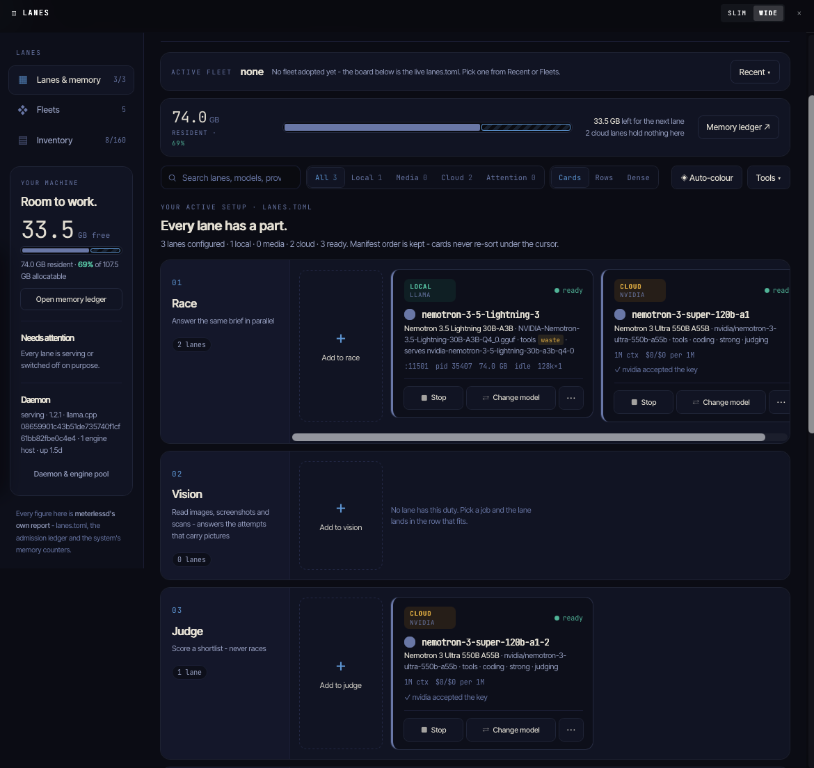
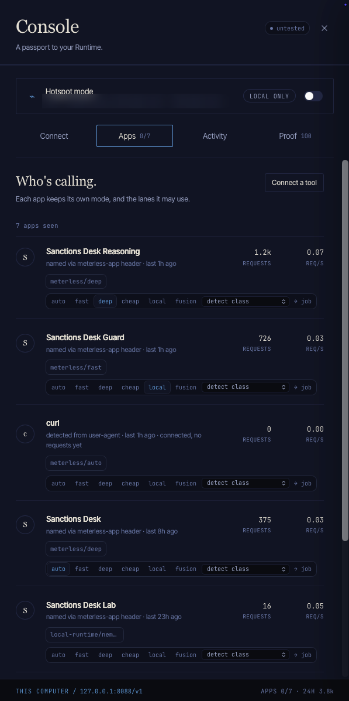

# Models: roles, routing and how to verify an answer

Every model call goes through one function, `generator`, which talks to **Meterless Nightshift** first (an OpenAI-compatible local runtime that also reaches cloud models), to a local **Ollama** model second, and, in sample mode only, to a clearly labelled rules-based stand-in. Nothing else in the code names a provider.

## What each model does

| Step                   | Mode we ask for (`config/policy.default.json`) | Reasoning budget (ours) | What it does                                                                                                                                                                                                                                                                                                                                           | Where it ran in the live exam                                                               |
| ---------------------- | ---------------------------------------------- | ----------------------- | ------------------------------------------------------------------------------------------------------------------------------------------------------------------------------------------------------------------------------------------------------------------------------------------------------------------------------------------------------ | ------------------------------------------------------------------------------------------- |
| Safety guard, inbound  | `fast`                                         | none                    | Reads the free text that came out of the data (names, notes, payment references) and flags anything that tries to instruct the reviewer. Answers in strict JSON.                                                                                                                                                                                       | Local Nemotron 3.5 Lightning                                                                |
| Safety guard, outbound | `fast`                                         | none                    | Checks a draft meant for a customer against the written tipping-off policy. Answers in strict JSON.                                                                                                                                                                                                                                                    | Local Nemotron 3.5 Lightning                                                                |
| Decision               | `deep`                                         | 500 tokens              | Reads the evidence and the approved definitions and recommends one of four outcomes with cited facts.                                                                                                                                                                                                                                                  | Cloud Nemotron 3 Ultra when the runtime routes there, otherwise local; see `eval/REPORT.md` |
| Critic                 | `judge`                                        | 400 tokens              | Checks the recommendation for claims the evidence does not support. The cited facts are re-read from the data by code first.                                                                                                                                                                                                                           | Cloud Nemotron 3 Ultra when the runtime routes there, otherwise local                       |
| Challenger             | `deep`                                         | 500 tokens              | Runs only on a close that could slip through (confidence below the policy line, a name similarity at or above it, or a failing data-quality rule). Argues the strongest honest case that the customer is the listed party; a credible argument turns the close into an escalation with its reason shown. If it cannot answer, the close does not stand | Cloud Nemotron 3 Ultra when the runtime routes there, otherwise local                       |

Decision, critic and challenger ask for **schema-constrained JSON** (`response_format` of type `json_schema`, strict): the model reasons in an `analysis` field that comes first and the answer is held to the schema, so there is no reasoning text to cut off before the JSON. Nightshift honours it on the fast and deep modes (tried first against `json_object`, which was not reliable on the deep mode, and against `guided_json`, which it ignored). The old way, reasoning then JSON last, remains behind `structuredOutput: false` in the policy. If a try gives no usable answer it is repeated on the fast mode and then on the Ollama backup; if every try fails, the decision step escalates the case with the reason "model decision unavailable", and the report counts provider failures and unusable answers separately.

Triage, evidence reading, matching, ownership, memory and the policy guard are plain code: they call no model. They are listed in the trace like any other step.

**Name matching is deterministic first.** Names are compared with a fold of accents and look-alike letters, token-set Jaro-Winkler scores, a consonant skeleton for spelling variants, initials and legal-form words. Nightshift lists an embedding class and the model `nvidia/nemotron-3-embed-1b`, but this runtime build serves no embedding route (`class_carrier_unsupported`), so embeddings are not used. The matching code does not depend on them.

## The laptop used

Nemotron 3.5 Lightning 30B runs on a local laptop through Nightshift. Everything in this repository was measured on one Apple silicon laptop (a Max-class chip, 128 GB of memory, macOS 27). We did not test smaller machines, so we make no claim about the memory the 30B model needs; on a machine that cannot hold it, ask Nightshift for the cloud route or use the Ollama backup with a smaller build. Sample mode needs none of this.

## How a call is routed

- The code always asks for a **pinned mode** (`meterless/fast`, `meterless/deep`, `meterless/judge`). `meterless/auto` is rejected by the configuration schema. We do not route by difficulty and we do not pin the cloud.
- **Which model serves a mode is Nightshift's decision.** Each app identity is bound to one mode in the cockpit, and the bind replaces the mode the client asked for: in the headline run the receipts show the served mode `local` for the guard identity (70 calls) and `deep` for the reasoning identity (190 calls), with the routing policy `learned-router` choosing the model inside that mode (`mode_coerced` is true where the asked-for mode differed from the bind, false for `deep` asked under the `deep` bind). Before the binds were set, every call was served as the runtime's own `auto`. So each call records both what was **requested** and what **answered** (`model_requested` and `model_routed`, with `route_kind` local or cloud as the receipt reports it, and the mode the runtime says it served).
- A retired mode (HTTP 410, `class_no_route`, or a cloud "Function not found") is retried once on the next configured mode, then the call falls back to Ollama.
- A try that gives no usable answer is repeated on the fast mode and then on the Ollama backup, with a short pause after a provider failure.
- **The reasoning budget is ours, not a model parameter.** It is a token limit for the answer plus an instruction to put brief reasoning in the answer's `analysis` field. Nothing is sent to Nightshift to switch thinking on, and the runtime stops waiting for a slow model after about 45 seconds, which is why the budget is small.

### Two app identities, and what the cockpit does with them

Nightshift decides routing **per app**, and the cockpit can bind an app to a routing mode. By default every app, including a newly seen one, is bound to `auto`, and a bind **overrides what the client asked for** (the receipt records both). That is why an unbound desk saw every requested mode and even a request for a named model id served as `auto`: we tested it (`npm run lab:routing`, results in `eval/routing-lab*.json`) and a request naming the local Lightning model id was answered by cloud Ultra under an `auto` bind, so a model id does not pin.

The desk therefore sends its calls under two app identities, named in `nightshift.apps` (`METERLESS_APP_REASONING`, `METERLESS_APP_GUARD`), and the policy says which step uses which (`models.<step>.identity`):

| Identity                   | Steps                                   | Cockpit bind                                   | What was measured on this machine                                                                                                                 |
| -------------------------- | --------------------------------------- | ---------------------------------------------- | ------------------------------------------------------------------------------------------------------------------------------------------------- |
| `sanctions-desk-guard`     | the safety guard (inbound and outbound) | **local** (on-device only, no cloud)           | headline run: 70 of 70 calls served by Nemotron 3.5 Lightning 30B (local), served mode `local` (receipts in `eval/runs/routed-20261023T133311Z/`) |
| `sanctions-desk-reasoning` | decision, critic, challenger            | **deep** (frontier routes and second opinions) | headline run: 187 of 190 calls served by Nemotron 3 Ultra 550B (cloud), 3 by Lightning, because `deep` races both and no lane allowlist is set    |

So the guard is deterministic, and reasoning is mostly but not guaranteed to be Ultra. Reasoning could be made deterministic with a per-app **lane allowlist**; the runtime supports one (`lanes` in the app's entry, matched by lane id or model id) but this cockpit build shows no screen for it, so we do not claim it. The receipts remain the proof: the split reported for any run is read from them, never assumed from the setting.

### App binds used in the final runs

The cockpit was left unchanged for every final run (held-out, headline routed, single and no_memory): `sanctions-desk-guard` bound to **local** and `sanctions-desk-reasoning` bound to **deep**. Each result file records the binds (`features.cockpit_binds`), `run-meta.json` of each exported run repeats them as `app_binds`, and the report's "What each run had" table shows them. The split below is read from the signed receipts of the headline run.

<!-- binds:start -->
Headline run of 2026-10-23 (binds: `sanctions-desk-eval` auto, `sanctions-desk-reasoning` deep, `sanctions-desk-guard` local); the model that served each call, from the signed receipts:

| Step         | Calls | Nemotron 3.5 Lightning 30B (local) | Nemotron 3 Ultra 550B (cloud) |
| ------------ | ----: | ---------------------------------: | ----------------------------: |
| Safety guard |    70 |                        100.0% (70) |                             0 |
| Decision     |    89 |                           2.3% (2) |                    97.8% (87) |
| Critic       |    86 |                           1.2% (1) |                    98.8% (85) |
| Challenger   |    15 |                                  0 |                   100.0% (15) |
<!-- binds:end -->

**Cockpit setup (about two minutes).** Start the desk once so the identities appear, or run `npm run lab:routing -- --only apps --apps sanctions-desk-reasoning,sanctions-desk-guard`. Open the Nightshift Console and its list of connected apps. Bind `Sanctions Desk Guard` to **local** and `Sanctions Desk Reasoning` to **deep**. Check from the command line, which changes nothing:

```bash
ns route --app sanctions-desk-guard --mode fast --prompt "x"        # bound local; only Lightning is raced
ns route --app sanctions-desk-reasoning --mode fast --prompt "x"    # bound deep; Ultra and Lightning are raced
```

Without these two binds the desk still works: the identities are then bound to `auto` like every other app, and the old behaviour applies (the learned router decides, and the split is whatever the receipts show).

**Rate limits.** The cloud model sometimes answers 429 (too many requests). The generator waits (3 s, then 6 s, then 12 s; `nightshift.rateLimit`), holds back the calls that follow for the rest of the wait, and sends the same request again before the agent's own fallback (the fast mode, then Ollama) is used.

**Pinned-model check (exact model ids): not run.** The plan was a five-case smoke test asking for exact model ids (Lightning for the guard and the screener, Ultra for the decision, the critic and the challenger) and checking that each receipt's routed model equals the requested one. That needs Nightshift 1.2.3 or later; the runtime on the laptop used is 1.2.1 (`defaults read /Applications/Nightshift.app/Contents/Info CFBundleShortVersionString`, 24 Oct 2026), and the runtime was not updated during the evaluation. Every model named in this repository is therefore the one Nightshift's router chose under the binds above, as each signed receipt records; none was pinned.

## The model ledger

Every recommendation carries a ledger of the model calls behind it: step, the mode asked for and the model that answered (cloud or local), reasoning budget, tokens in and out, latency and the signed receipt.

```bash
npm run ledger -- --case ALR-0004      # or:  npm run ledger -- <run id>
```

or over HTTP: `GET /cases/:alertId/trace`. Costs use the unit costs in `config/default.json` (`costs`), which are assumptions for comparing routes, not prices.

## Verifying a receipt

Nightshift signs a receipt for every answer (Ed25519 over the sorted-key JSON of its body). The full signed receipt is stored next to the trace in `logs/receipts/<receipt id>.json`, and its status is in the ledger:

| Status                  | Meaning                                                                                                                  |
| ----------------------- | ------------------------------------------------------------------------------------------------------------------------ |
| `valid_pinned`          | The signature is valid and the key is one you pinned.                                                                    |
| `valid_unpinned`        | The signature is valid but the key came from the same response: it shows the receipt was not altered, not who signed it. |
| `invalid` / `malformed` | The receipt does not check out.                                                                                          |

A receipt also carries the runtime's host readings at the time of the call (`host_pressure`: memory, CPU, GPU, thermal, battery and network), the ids of any memories Nightshift added, and a short preview of the prompt. They are part of the signed body, so the exported receipts in `eval/runs/` publish them unchanged; for the guard identity the prompt preview can hold the start of a synthetic note or payment reference.

To pin the runtime's key: `npm run receipt:pubkey` prints the public key (and nothing secret). Put it in `METERLESS_RECEIPT_PUBLIC_KEY`, or for this machine only in the git-ignored `config/local.json`:

```json
{ "nightshift": { "receiptPublicKeys": ["<printed key>"] } }
```

Pinning the key printed by the runtime trusts it on first use. Compare it with a key you obtained another way if that matters to you.

### Why the cloud lane names say super-120b

- The cloud lanes were first set up for Nemotron 3 Super 120B.
- During development its hosted endpoint was retired (calls returned "Function not found"), so both cloud lanes were switched to Nemotron 3 Ultra 550B, keeping their lane ids `nemotron-3-super-120b-a1` and `nemotron-3-super-120b-a1-2`.
- Every receipt records the model that actually answered (`nvidia/nemotron-3-ultra-550b-a55b`), so the evidence is unaffected by the lane name.
- Renaming the lanes to match the model was tested. After the rename, and again after each restart of Nightshift, its router started over: on a cloud decision call it was exploring (routing confidence about 0.2 instead of 0.934) and raced 6 attempts instead of 2, and more decision answers exceeded the desk's limit of 8 facts and fell back to the local model (4 of 6 in three live cases, against 3 of 773 on 23 Oct).
- Restoring the original lane ids did not bring the learned routing back, because the reset comes with the restart, not only with the name. With the ids restored, ALR-0073 again gave ESCALATE_L2 at 0.9, the same as before the test, with the cloud steps answered by Ultra 550B and the local steps by Lightning.
- All recorded evaluation runs were made before the test and are unchanged.
- When Nightshift supports exact model selection, the desk can request Ultra 550B by name, and the lanes can then be renamed without depending on routing.

### Nightshift's cross-check on each call

Every receipt carries a `cross_check` block: Nightshift's own check on the call (for example whether the response holds personal data or credentials, matches the declared schema, or backs factual claims with citation markers), with a status, a risk level and a recommended action. It is part of the signed receipt body, so it is stored with every receipt in `logs/receipts/` and in the exported `eval/runs/*/receipts.jsonl.gz`. The desk does not display it and does not act on it; its own checks (the critic's fact re-check and the policy guard) are separate.

Across the 1,492 receipts of the 28 exported runs, every receipt has the field (none predates it):

| Status  | Receipts | Where                                                                                                                                                                                                                                           |
| ------- | -------: | ----------------------------------------------------------------------------------------------------------------------------------------------------------------------------------------------------------------------------------------------- |
| skipped |      979 | all 523 calls of the guard identity and 456 of the reasoning identity, marked `tier_a_chat`                                                                                                                                                     |
| warning |      465 | reasoning identity only; in every one the single warning is `citation_consistency` ("Factual claim requested but response lacks citation markers"), risk medium, not blocking, recommended action `show_warning`, Nightshift's verifier not run |
| passed  |       48 | reasoning identity                                                                                                                                                                                                                              |

The desk's answers cite their facts in a structured `citations` field rather than as markers in the text, which is a likely reason for the citation warning; that is not verified. Count them again with the receipt files in `eval/runs/`.

### Nightshift's own memory (switched off on 24 Oct 2026)

Nightshift 1.2.1 has an answer memory of its own, separate from the desk's H-MEM. It keeps the text of earlier answers it judged reliable (up to 4,000 characters each, with the first 600 characters of the prompt, stored on the laptop) and adds up to three of the closest ones to later requests as a system message of "prior vetted answers". The receipt records it: `hmem.injected`, `hmem.ids`, and `hmem:N records` in `egress.sent.context_sources`.
- **In the recorded runs it was on.** 1,483 of the 1,492 receipts in `eval/runs/` carry added memories; 960 of them are cloud calls of the reasoning identity, carrying 996 different memories. Memories are found by similarity across cases and runs, so a call for one case could carry an answer given for another.
- **What that could carry.** In 1.2.1 the runtime looks memories up by scope, not by app identity, and for a request that may go to the cloud it does not leave out memories made from answers of the local model. A screener answer can hold a document number, a date of birth or a name it read in a note, so text first read on the laptop could have been added to a cloud call. Whether that happened cannot be checked now: receipts keep memory ids, not their text, and the memories from that period are no longer in the runtime's store. The desk's own prompts never held raw free text (the check below), and the SHA-256 recorded as `cloud_payloads` covers the desk's prompt only, not what Nightshift added.
- **The memory comparison.** The `no_memory` variant switched off the desk's memory step; Nightshift's memory was still on in that run, so the comparison is between the desk's memory on and off, not memory on and off.
- **Now off.** There is no per-app or per-request switch through the OpenAI-compatible API in 1.2.1. The runtime's knowledge memory was switched off for the whole runtime with its setting `hmemKnowledge: false` (local admin socket, `POST /admin/setpoints`). Checked on six live runs afterwards (ALR-0004 twice, ALR-0020, ALR-0043, ALR-0058, ALR-0073, with no restart of the runtime): all 30 receipts show no added memory and `context_sources` of `messages` only, 9 on the guard identity served by Lightning and 21 on the reasoning identity served by Ultra.

## Privacy mode

`PRIVACY_MODE=pseudonymise` (config `privacyMode`; default `off`) changes only what the three cloud steps (decision, critic, challenger) send. Code: `packages/agents/src/privacy.ts`; tests: `packages/agents/test/privacy.test.ts`.
- **What the cloud sees.** Each name, alias, identifier, date of birth, address and country value of the case becomes a token that is stable within the case: the same value always gets the same token, so equal values stay visibly equal. Names of the customer, a counterparty or a non-listed owner are `PARTY_A`, `PARTY_B`, ...; listed names and aliases `LISTED_1`, ...; identifier numbers `DOC_1`, ...; dates of birth `DOB_1`, ...; countries `COUNTRY_1`, ...; addresses `ADDR_1`, .... The comparison block worked out on the real values (name score, date of birth exact, partial or conflicting, nationality same or different, definitions met, close blockers) is sent as before, and a short `<privacy>` block says which country tokens are watched jurisdictions.
- **What it does not see.** The values behind the tokens. The token map is kept in memory and in the sealed record (`privacy` field), never in a prompt or a Nightshift request.
- **The check.** After pseudonymising, the outgoing system prompt and prompt are searched for every raw name, alias, identifier and date of birth of the case; if one is still there, the call is not made (a `guard_blocked` failure, which never closes a case).
- **The answer.** Tokens in the model's answer are mapped back before the critic's fact check, the record and the reporter read it, so the case view and the record show real values.
- **Off by default.** With the mode off the steps send exactly what they sent before: all 82 sample-mode alerts give identical answers and sealed records with and without this code.

Small test of an optional mode, not part of the recorded evaluation (24 Oct 2026, one live run each, Nightshift warmed up and not restarted): on held-out v4 (12 cases) and 8 of the 70 exam cases (4 risks, 4 clears), privacy mode wrongly closed 0 of 10 risk cases, as the default did in the same session; it made 5 of 10 clears against 3 for the default, and 14 of 20 outcomes were the same (the others moved between escalate and need more information, or were clears the default escalated). Its 65 cloud prompts all passed the raw-value check, and its 104 receipts verify, none with an added memory.

## What leaves the machine, per step

Customer notes, payment references and list remarks can carry risk that no structured field shows (a customer who trades under a listed party's name, or who was introduced by a listed relative). They are also free text that anyone can write, so they are never sent to a cloud model. A **screener** reads them on the local model (the `guard` identity, bound to the local model in the cockpit) and returns structured facts only. Code checks every value of the answer against the text and against the evidence standard before anything uses it.

| Step                   | Model                                               | Local or cloud                    | What it receives                                                                                                                                                                                                                                                                                                                                                                                                                              | What it never receives                                                                                    |
| ---------------------- | --------------------------------------------------- | --------------------------------- | --------------------------------------------------------------------------------------------------------------------------------------------------------------------------------------------------------------------------------------------------------------------------------------------------------------------------------------------------------------------------------------------------------------------------------------------- | --------------------------------------------------------------------------------------------------------- |
| Safety guard, inbound  | `fast`, `guard` identity                            | Local                             | The free text of the data, to flag instructions aimed at the reviewer                                                                                                                                                                                                                                                                                                                                                                         | Nothing is withheld; it never leaves the machine                                                          |
| Screener               | `fast`, `guard` identity (`models.screener`)        | Local                             | The customer note, the payment reference and the list remarks (each with a field id), the customer, counterparty and listed party names, the watched place names                                                                                                                                                                                                                                                                              | Nothing is withheld; it never leaves the machine                                                          |
| Decision               | `deep`, `reasoning` identity (retry under `guard`)  | Cloud (a lane the runtime routes) | Structured fields of the alert, customer, payment, list entry and identifiers; **names**: the customer's full name, the payment counterparty's name, the listed party's name and up to 25 of its aliases; earlier desk decisions with the **reason a person wrote**; the comparison and the close blockers worked out by code; the approved definitions; the screener's facts; a date of birth from a verified note, with its check reference | Customer notes, payment references, list remarks, or any run of 20 characters from them; document numbers |
| Critic                 | `judge`, `reasoning` identity (retry under `guard`) | Cloud                             | The same evidence block as the decision step, the decision's recommendation, and the critic's own fact checks (a check of a free-text column says only that it does not match, never the value)                                                                                                                                                                                                                                               | Customer notes, payment references, list remarks, or fragments of them                                    |
| Challenger             | `deep`, `reasoning` identity (retry under `guard`)  | Cloud                             | The same evidence block, and the recommendation to close                                                                                                                                                                                                                                                                                                                                                                                      | Customer notes, payment references, list remarks, or fragments of them                                    |
| Safety guard, outbound | `fast`, `guard` identity                            | Local                             | A draft message meant for a customer                                                                                                                                                                                                                                                                                                                                                                                                          | Nothing is withheld; it never leaves the machine                                                          |

Span grounding and the check of a note's document number do not change this table: both run in code and in Zetaris, and the cloud steps see only whether a signal is grounded and whether a note meets the standard, never the words or the number.

The `guard` identity is bound to the local model in the cockpit; that is a setting, not something code can promise. Code checks the route of every screener answer: if a cloud route served it, the review carries a `screener_locality` flag, the trace says `served_by_cloud`, and the case cannot be closed without a person at autonomy level 1.

What the screener may return, and what happens to it:
- **Risk signals.** A type from a closed list (`alias_or_former_name`, `relationship_to_listed_party`, `ownership_or_control_claim`, `sanctioned_jurisdiction_link`, `adverse_media`, `instruction_to_reviewer`, `other`), a span id (the field and the character range, for example `customer.notes:9-30`; code builds it and marks a range that does not point into the field) and a confidence from 0 to 1. Code also marks whether a signal is **grounded**: it checks that the span lies inside the field, that the span's own text holds a term of the signal's type, and that a name from the evidence (the listed name or an alias, the customer, the counterparty; compared without case or accents) is in the span or within 80 characters of it. For a link to a watched place, the place in the span is the entity. The term lists, in English, Spanish, French, German, Portuguese, Italian and Dutch, are policy data (`screener.grounding`, policy version 7). `instruction_to_reviewer` and `other` are not checked. A signal that is not grounded is kept with `grounded: false` and a reason, recorded, counted in the trace (`ungrounded`), shown to the cloud steps as `grounded: false` and to the reviewer as a `screener_grounding` flag. Grounding only adds context: any signal at or above `screener.confidenceThreshold` (0.5), grounded or not, stops a close; `other` stops one only from `screener.otherConfidenceThreshold` (0.7) and is shown as a flag below it. Any recorded signal, grounded or not, makes the challenger look at a close and keeps a case out of an automatic close.
- **Documentary evidence**, reduced by code to tokens: the check reference as a plain token (`KYC-482113`), an ISO date, the date of birth only when the text labels it as one ("born", "date of birth" or "dob" next to the date; any other date is ignored), a nationality only as a two-letter code, a named party only when it is a name already in the evidence (otherwise only `named_party_present`), and only whether a document number is present. The check reference and the date are taken from exact places in the text: the result records their start and end offsets, and each value is the text at those offsets. Whether the note meets the evidence standard is decided by code, never by the model.
- **The note's document number on the customer record.** When a customer note meets the standard and cites a document number, one count runs inside Zetaris under the evidence step's identity: how many of the customer's identifier rows hold that number (both sides upper case, letters and digits only). Only the count comes back; no model sees the number, and the trace and the record keep a SHA-256 hash of it and the statement with the number replaced. A count of 0 means the note does not meet the standard ("document cited in note not on customer record", shown in the documentary result, the guard verdict and the case file), and a close goes to NEED_MORE_INFO. A count that cannot be made (in sample mode, a check with no saved answer) is "not verified": the note is not documentary, with the reason.
- **Injection.** Whether the text tries to instruct the reviewer. It marks the data as instructing the reviewer only with a pattern hit; the model's word alone is recorded but not acted on.
- **A screener that cannot answer** (no answer, or invalid JSON after the normal retries), **a missing result**, or **a field longer than `screener.maxFieldChars`** never allows a close. The case is escalated with the reason, and the failure is counted apart in the trace (`screen_text`, status `error`, `failure: screener_unavailable`, with the cause).
- **Off switch.** `screener.enabled: false` skips the step for a comparison run: no text is read, there are no signals, and the policy guard records "screener off". The run's features record the setting.

**The definitions and the guard agree.** Matching reports the approved definition of a false positive as not met when the policy guard would refuse a close anyway (a blocking signal, unread text, instruction-like text, or a failing data-quality rule that a verified note does not answer). The decision prompt, the first finding and the critic all read that one value, so none of them asks for a close the guard will turn down. A date of birth from a verified note answers the date-of-birth data-quality rule in the guard and in the critic alike.

**The desk never sends free text, and a prompt that holds any is not sent at all.** (Nightshift's own answer memory is separate: see [Nightshift's own memory](#nightshifts-own-memory-switched-off-on-24-oct-2026).) Before each decision, critic and challenger call, code compares the prompt with the case's notes, payment references and list remarks. If the prompt holds one of them, or any run of 20 characters from one (runs that are part of a name or list value sent on purpose, or of the approved definitions' wording, are not counted), the call is not made. The step treats that as a failure: the decision is "model decision unavailable" with the reason that free text was found, the critic approves nothing, the challenger does not let the close stand.

**What was sent is on record.** For every step that calls a model, the trace has a `cloud_payload` event and the sealed record has `cloud_payloads`: the names of the blocks and evidence fields with how many items each held, the length, a SHA-256 hash of the whole prompt, and `raw_free_text_present`. The text itself is not kept in either. The screener's own result (status, signals with their span ids, documentary checks, the model, whether a cloud route served it, truncated fields and the signed receipt) is in the record under `screener`, and its calls are in the model ledger like any other step. Each review result also names the model and route of the recommendation used, whether a fallback made it, the decision model's own last recommendation and whether the critic was left unresolved.

## Meterless power: Nightshift runs every model call

Nightshift, an OpenAI-compatible runtime, is the AI provider for all model calls. Nothing in the code names a model provider: one injected `generator` function asks Nightshift for a **pinned mode** (`meterless/fast`, `meterless/deep`, `meterless/judge`; `meterless/auto` is rejected), falls back to the Ollama backup only if Nightshift cannot answer, and a labelled rules stand-in exists for sample mode only.

| Step         | Mode we ask for | Reasoning budget (ours) | What it does                                                                                                       |
| ------------ | --------------- | ----------------------- | ------------------------------------------------------------------------------------------------------------------ |
| Safety guard | `fast`          | none                    | Reads text that came out of the data for instructions aimed at the reviewer; checks drafts for tipping off         |
| Decision     | `deep`          | 500 tokens              | Recommends one of four outcomes with cited facts                                                                   |
| Critic       | `judge`         | 400 tokens              | Checks the recommendation against the evidence the code re-read                                                    |
| Challenger   | `deep`          | 500 tokens              | Argues against a close that could slip through (low confidence, a very close name, or a failing data-quality rule) |

The **reasoning budget** is our own token limit plus an instruction to put brief reasoning in the answer's `analysis` field; it is not a model parameter and nothing is sent to Nightshift to switch thinking on. Triage, evidence, matching, ownership, memory, the policy guard and the reporter are code and call no model.

**Which model serves a mode is Nightshift's decision, not ours.** Under the cockpit binds of the final runs (guard identity bound to local, reasoning identity bound to deep), the receipts of the headline run record the mode served as `deep` (190 calls) or `local` (70 calls), and within that mode Nightshift's learned router chose the model (routing policy `learned-router` in every receipt). We do not route by difficulty and we do not pin the cloud. What we do is record, for every call, the mode asked for, the model that answered (`routed_model`), reasoning budget, latency, tokens, the signed receipt and the cost under the configured unit costs (tokens served by the local model are priced at zero). The decision, critic and challenger ask for schema-constrained JSON with the reasoning in a field of the answer; the screener and local retries ask for plain JSON, checked by the same schema. See [docs/MODELS.md](#models-roles-routing-and-how-to-verify-an-answer).

**In the Nightshift app** (read-only screenshots, 24 Oct 2026, Nightshift 1.2.1; local network addresses blurred):

<table>
<tr>
<td width="62%"></td>
<td width="38%"></td>
</tr>
<tr>
<td>The lanes: local Nemotron 3.5 Lightning 30B and cloud Nemotron 3 Ultra 550B, all ready. The cloud lane ids still say <code>super-120b</code>; they serve Ultra 550B (<a href="#why-the-cloud-lane-names-say-super-120b">why</a>).</td>
<td>The app identities: <code>Sanctions Desk Reasoning</code> bound to deep, <code>Sanctions Desk Guard</code> bound to local.</td>
</tr>
</table>

Nightshift 1.2.1 has no per-request list. The model behind each call is in the review steps of a live review ([screenshot](media/screenshots/13-live-agent-map.png)) and the routing panel ([screenshot](media/screenshots/15-live-routing-and-receipts.png)), and every receipt is checked by `npm run evidence:verify`.

## NVIDIA Nemotron

The language work is done by Nemotron models through Nightshift: **Nemotron 3 Ultra 550B** (served in the cloud) and **Nemotron 3.5 Lightning 30B** (served on a local laptop). Which of them answers a call is decided by Nightshift's router, so the split in [App binds used in the final runs](#app-binds-used-in-the-final-runs) is a measurement, not a setting.

App binds used in the final runs: `sanctions-desk-guard` bound to local and `sanctions-desk-reasoning` bound to deep in the Nightshift cockpit, unchanged for all of them (the report lists them per run).

Which agent runs on which Nemotron model, and what it does:

| Agent (step)             | Nemotron model               | Where it runs                                 | What it does                                                                                                                                                                |
| ------------------------ | ---------------------------- | --------------------------------------------- | --------------------------------------------------------------------------------------------------------------------------------------------------------------------------- |
| Safety guard             | Nemotron 3.5 Lightning 30B   | local laptop (guard identity, bound to local) | Flags text in the data that tries to instruct the reviewer; blocks a customer draft that would tip them off                                                                 |
| Free-text screener       | Nemotron 3.5 Lightning 30B   | local laptop (guard identity)                 | Reads customer notes, payment references and list remarks and returns structured risk signals and validated documentary evidence only; the raw text never leaves the laptop |
| Decision                 | mostly Nemotron 3 Ultra 550B | cloud (reasoning identity, bound to deep)     | Recommends one of four outcomes from the structured evidence and the approved definitions, with cited facts                                                                 |
| Critic                   | mostly Nemotron 3 Ultra 550B | cloud                                         | Checks the recommendation against the evidence after code has re-read every cited fact; can send it back                                                                    |
| Challenger               | mostly Nemotron 3 Ultra 550B | cloud                                         | Argues against a close that could slip through                                                                                                                              |
| Retry after a failed try | Nemotron 3.5 Lightning 30B   | local (guard identity)                        | Answers in place of a step whose cloud call failed; such cases are counted in the report                                                                                    |

**We log the requested model, the routed model and the signed receipt for every model call**, side by side in the trace, the stdout lines and the case view's routing panel; when the model that served a call is not the one asked for, both are shown. Check any run yourself with the receipt verifier, `npm run evidence:verify` ([tools/evidence-verify.ts](../tools/evidence-verify.ts); see [Check which model served each call](#check-which-model-served-each-call)).

**Pinned-model check: not run.** It needs Nightshift 1.2.3 or later to pin an exact model id per call; the runtime installed here is 1.2.1, so every model id above is the one Nightshift's router chose, as the receipts record. See [docs/MODELS.md](#models-roles-routing-and-how-to-verify-an-answer).

**The signed receipt log of the final runs** (one Ed25519-signed Nightshift receipt per model call; the model that served each call is in `winning_route.model`):

<!-- receipts:start -->
| Run                                              | Receipts | Receipt log                                                                                                                                                 | Check it                                                                              |
| ------------------------------------------------ | -------: | ----------------------------------------------------------------------------------------------------------------------------------------------------------- | ------------------------------------------------------------------------------------- |
| `rules-20261023T085618Z`                         |        0 | [eval/runs/rules-20261023T085618Z/receipts.jsonl.gz](../eval/runs/rules-20261023T085618Z/receipts.jsonl.gz)                                                 | `npm run evidence:verify -- eval/runs/rules-20261023T085618Z`                         |
| `fuzzy-20261023T085617Z`                         |        0 | [eval/runs/fuzzy-20261023T085617Z/receipts.jsonl.gz](../eval/runs/fuzzy-20261023T085617Z/receipts.jsonl.gz)                                                 | `npm run evidence:verify -- eval/runs/fuzzy-20261023T085617Z`                         |
| `escalate_all-20261023T085617Z`                  |        0 | [eval/runs/escalate_all-20261023T085617Z/receipts.jsonl.gz](../eval/runs/escalate_all-20261023T085617Z/receipts.jsonl.gz)                                   | `npm run evidence:verify -- eval/runs/escalate_all-20261023T085617Z`                  |
| `routed-20261023T133311Z`                        |      260 | [eval/runs/routed-20261023T133311Z/receipts.jsonl.gz](../eval/runs/routed-20261023T133311Z/receipts.jsonl.gz)                                               | `npm run evidence:verify -- eval/runs/routed-20261023T133311Z`                        |
| `single-20261023T161731Z`                        |      132 | [eval/runs/single-20261023T161731Z/receipts.jsonl.gz](../eval/runs/single-20261023T161731Z/receipts.jsonl.gz)                                               | `npm run evidence:verify -- eval/runs/single-20261023T161731Z`                        |
| `no_memory-20261023T173107Z`                     |       42 | [eval/runs/no_memory-20261023T173107Z/receipts.jsonl.gz](../eval/runs/no_memory-20261023T173107Z/receipts.jsonl.gz)                                         | `npm run evidence:verify -- eval/runs/no_memory-20261023T173107Z`                     |
| `heldout-rules-20261023T081308Z`                 |        0 | [eval/runs/heldout-rules-20261023T081308Z/receipts.jsonl.gz](../eval/runs/heldout-rules-20261023T081308Z/receipts.jsonl.gz)                                 | `npm run evidence:verify -- eval/runs/heldout-rules-20261023T081308Z`                 |
| `heldout-fuzzy-20261023T082432Z`                 |        0 | [eval/runs/heldout-fuzzy-20261023T082432Z/receipts.jsonl.gz](../eval/runs/heldout-fuzzy-20261023T082432Z/receipts.jsonl.gz)                                 | `npm run evidence:verify -- eval/runs/heldout-fuzzy-20261023T082432Z`                 |
| `heldout-escalate_all-20261023T083248Z`          |        0 | [eval/runs/heldout-escalate_all-20261023T083248Z/receipts.jsonl.gz](../eval/runs/heldout-escalate_all-20261023T083248Z/receipts.jsonl.gz)                   | `npm run evidence:verify -- eval/runs/heldout-escalate_all-20261023T083248Z`          |
| `heldout-routed-20261023T121140Z`                |      142 | [eval/runs/heldout-routed-20261023T121140Z/receipts.jsonl.gz](../eval/runs/heldout-routed-20261023T121140Z/receipts.jsonl.gz)                               | `npm run evidence:verify -- eval/runs/heldout-routed-20261023T121140Z`                |
| `heldout2-sys2-routed-20261023T180732Z`          |       81 | [eval/runs/heldout2-sys2-routed-20261023T180732Z/receipts.jsonl.gz](../eval/runs/heldout2-sys2-routed-20261023T180732Z/receipts.jsonl.gz)                   | `npm run evidence:verify -- eval/runs/heldout2-sys2-routed-20261023T180732Z`          |
| `heldout2-escalate_all-20261023T193323Z`         |        0 | [eval/runs/heldout2-escalate_all-20261023T193323Z/receipts.jsonl.gz](../eval/runs/heldout2-escalate_all-20261023T193323Z/receipts.jsonl.gz)                 | `npm run evidence:verify -- eval/runs/heldout2-escalate_all-20261023T193323Z`         |
| `heldout2-fuzzy-20261023T193323Z`                |        0 | [eval/runs/heldout2-fuzzy-20261023T193323Z/receipts.jsonl.gz](../eval/runs/heldout2-fuzzy-20261023T193323Z/receipts.jsonl.gz)                               | `npm run evidence:verify -- eval/runs/heldout2-fuzzy-20261023T193323Z`                |
| `heldout2-rules-20261023T193324Z`                |        0 | [eval/runs/heldout2-rules-20261023T193324Z/receipts.jsonl.gz](../eval/runs/heldout2-rules-20261023T193324Z/receipts.jsonl.gz)                               | `npm run evidence:verify -- eval/runs/heldout2-rules-20261023T193324Z`                |
| `heldout2-sys2b-routed-20261023T193436Z`         |       98 | [eval/runs/heldout2-sys2b-routed-20261023T193436Z/receipts.jsonl.gz](../eval/runs/heldout2-sys2b-routed-20261023T193436Z/receipts.jsonl.gz)                 | `npm run evidence:verify -- eval/runs/heldout2-sys2b-routed-20261023T193436Z`         |
| `sys2b-routed-20261023T195504Z`                  |      305 | [eval/runs/sys2b-routed-20261023T195504Z/receipts.jsonl.gz](../eval/runs/sys2b-routed-20261023T195504Z/receipts.jsonl.gz)                                   | `npm run evidence:verify -- eval/runs/sys2b-routed-20261023T195504Z`                  |
| `heldout-sys2b-routed-20261023T214515Z`          |      135 | [eval/runs/heldout-sys2b-routed-20261023T214515Z/receipts.jsonl.gz](../eval/runs/heldout-sys2b-routed-20261023T214515Z/receipts.jsonl.gz)                   | `npm run evidence:verify -- eval/runs/heldout-sys2b-routed-20261023T214515Z`          |
| `heldout2-sys2bnoscreen-routed-20261023T222222Z` |      102 | [eval/runs/heldout2-sys2bnoscreen-routed-20261023T222222Z/receipts.jsonl.gz](../eval/runs/heldout2-sys2bnoscreen-routed-20261023T222222Z/receipts.jsonl.gz) | `npm run evidence:verify -- eval/runs/heldout2-sys2bnoscreen-routed-20261023T222222Z` |
| `heldout3-sys3-routed-20261023T231901Z`          |       67 | [eval/runs/heldout3-sys3-routed-20261023T231901Z/receipts.jsonl.gz](../eval/runs/heldout3-sys3-routed-20261023T231901Z/receipts.jsonl.gz)                   | `npm run evidence:verify -- eval/runs/heldout3-sys3-routed-20261023T231901Z`          |
| `heldout3-escalate_all-20261023T233941Z`         |        0 | [eval/runs/heldout3-escalate_all-20261023T233941Z/receipts.jsonl.gz](../eval/runs/heldout3-escalate_all-20261023T233941Z/receipts.jsonl.gz)                 | `npm run evidence:verify -- eval/runs/heldout3-escalate_all-20261023T233941Z`         |
| `heldout3-rules-20261023T234147Z`                |        0 | [eval/runs/heldout3-rules-20261023T234147Z/receipts.jsonl.gz](../eval/runs/heldout3-rules-20261023T234147Z/receipts.jsonl.gz)                               | `npm run evidence:verify -- eval/runs/heldout3-rules-20261023T234147Z`                |
| `heldout3-sys3-single-20261023T234224Z`          |       36 | [eval/runs/heldout3-sys3-single-20261023T234224Z/receipts.jsonl.gz](../eval/runs/heldout3-sys3-single-20261023T234224Z/receipts.jsonl.gz)                   | `npm run evidence:verify -- eval/runs/heldout3-sys3-single-20261023T234224Z`          |
| `heldout4-sys4-routed-20261024T024523Z`          |       56 | [eval/runs/heldout4-sys4-routed-20261024T024523Z/receipts.jsonl.gz](../eval/runs/heldout4-sys4-routed-20261024T024523Z/receipts.jsonl.gz)                   | `npm run evidence:verify -- eval/runs/heldout4-sys4-routed-20261024T024523Z`          |
| `heldout4-sys4-single-20261024T025629Z`          |       36 | [eval/runs/heldout4-sys4-single-20261024T025629Z/receipts.jsonl.gz](../eval/runs/heldout4-sys4-single-20261024T025629Z/receipts.jsonl.gz)                   | `npm run evidence:verify -- eval/runs/heldout4-sys4-single-20261024T025629Z`          |
| `heldout4-rules-20261024T030240Z`                |        0 | [eval/runs/heldout4-rules-20261024T030240Z/receipts.jsonl.gz](../eval/runs/heldout4-rules-20261024T030240Z/receipts.jsonl.gz)                               | `npm run evidence:verify -- eval/runs/heldout4-rules-20261024T030240Z`                |
| `heldout4-escalate_all-20261024T030324Z`         |        0 | [eval/runs/heldout4-escalate_all-20261024T030324Z/receipts.jsonl.gz](../eval/runs/heldout4-escalate_all-20261024T030324Z/receipts.jsonl.gz)                 | `npm run evidence:verify -- eval/runs/heldout4-escalate_all-20261024T030324Z`         |
| `heldout3-fuzzy-20261024T033840Z`                |        0 | [eval/runs/heldout3-fuzzy-20261024T033840Z/receipts.jsonl.gz](../eval/runs/heldout3-fuzzy-20261024T033840Z/receipts.jsonl.gz)                               | `npm run evidence:verify -- eval/runs/heldout3-fuzzy-20261024T033840Z`                |
| `heldout4-fuzzy-20261024T033840Z`                |        0 | [eval/runs/heldout4-fuzzy-20261024T033840Z/receipts.jsonl.gz](../eval/runs/heldout4-fuzzy-20261024T033840Z/receipts.jsonl.gz)                               | `npm run evidence:verify -- eval/runs/heldout4-fuzzy-20261024T033840Z`                |

`npm run evidence:verify` with no argument checks every run: each signature, that every model call has a receipt, and that the model in the trace equals the model in the receipt.
<!-- receipts:end -->

The **model ledger** of every recommendation lists, per step, the mode asked for, the model that answered, reasoning budget, tokens, latency and the signed receipt with its verification status (`GET /cases/:alertId/trace`, `npm run ledger -- --case <alert id>`, the routing panel of the review desk, and the saved decision records in `output_examples/`).

## Models per step

| Step                                | Model                                         | What it does                                                                                                                                                                                                                                                                                         |
| ----------------------------------- | --------------------------------------------- | ---------------------------------------------------------------------------------------------------------------------------------------------------------------------------------------------------------------------------------------------------------------------------------------------------- |
| Safety guard (inbound and outbound) | Nemotron 3.5 Lightning 30B, on a local laptop | Reads free text that came out of the data for instructions aimed at the reviewer; checks a draft for a customer against the tipping-off policy. The guard's app identity is bound to _local_ in the Nightshift cockpit, and in the headline run 70 of 70 of its calls were served locally (receipts) |
| Decision                            | mostly Nemotron 3 Ultra 550B (cloud)          | Reads the evidence and the approved definitions; recommends one of four outcomes with cited facts                                                                                                                                                                                                    |
| Critic                              | mostly Nemotron 3 Ultra 550B (cloud)          | Looks for claims the evidence does not support (cited facts are re-read from the data by code first)                                                                                                                                                                                                 |
| Challenger                          | mostly Nemotron 3 Ultra 550B (cloud)          | Argues the case against a close that could slip through                                                                                                                                                                                                                                              |

## Check which model served each call

The final runs are exported to `eval/runs/<run-id>/`: `results.json`, `run-meta.json`, `trace.jsonl.gz` (the decision events, with local paths, addresses, e-mail addresses and tokens removed) and `receipts.jsonl.gz` (the runtime's signed receipts, untouched). Anyone can check them from a fresh clone: The safety guard's calls appear under the step name `policy_guard` (actions `screen_inbound` and `screen_outbound`), as the inbound and outbound half of the policy guard; the policy guard's own rules call no model. Each receipt also carries the runtime's host readings at the time of the call (memory, CPU, GPU, thermal, battery and network pressure), which are part of the signed body and so are published as they are.

```bash
npm ci
npm run evidence:verify                      # every signature, every call has a receipt, trace model = receipt model
npm run evidence:verify -- eval/runs/<run-id>   # one run: the share of calls each model served, per step
```

The third command, `gunzip -c eval/runs/<run-id>/receipts.jsonl.gz | head -1`, shows one signed receipt: `winning_route.model` is the model that served the call and `routing` records whether the runtime coerced the requested mode. `npm run evidence:export` rebuilds the folder from `logs/` and `eval/results/` and refuses to write anything that still matches a redaction pattern.

## Where NVIDIA's models contribute

The decision, the critic and the challenger are Nemotron answers. Which Nemotron model answers is Nightshift's choice, so the split is measured from the receipts and shown in [the exam report](../eval/REPORT.md#where-the-model-calls-were-answered) and under [App binds used in the final runs](#app-binds-used-in-the-final-runs): in the headline routed run (`eval/runs/routed-20261023T133311Z`), read from the receipts, the decision calls were 87 of 89 Nemotron 3 Ultra 550B (cloud), the critic calls 85 of 86, the challenger 15 of 15, and the safety guard 70 of 70 Nemotron 3.5 Lightning (local) ([the report](../eval/REPORT.md#where-the-model-calls-were-answered) has the counts). The ledger shows, for each recommendation, which of them answered each step. Nothing here is hard-coded to a model name: the modes are configuration.
