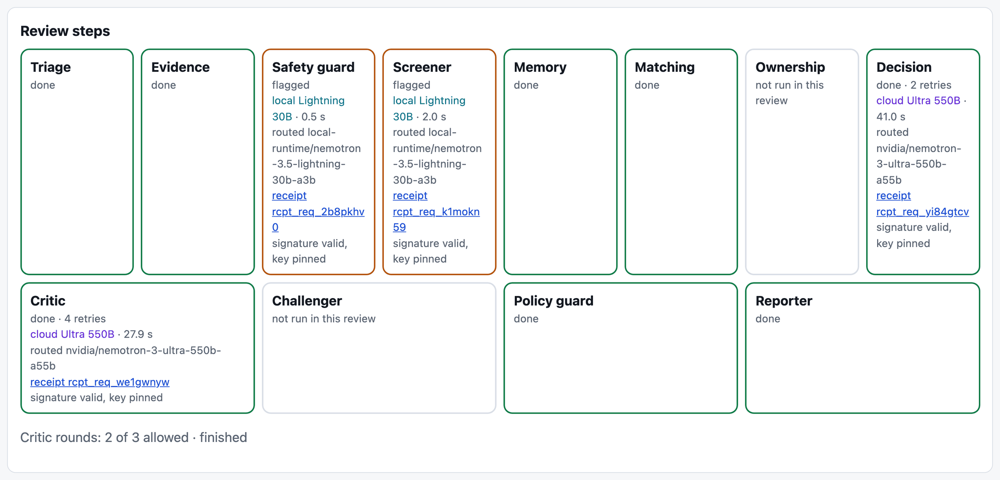
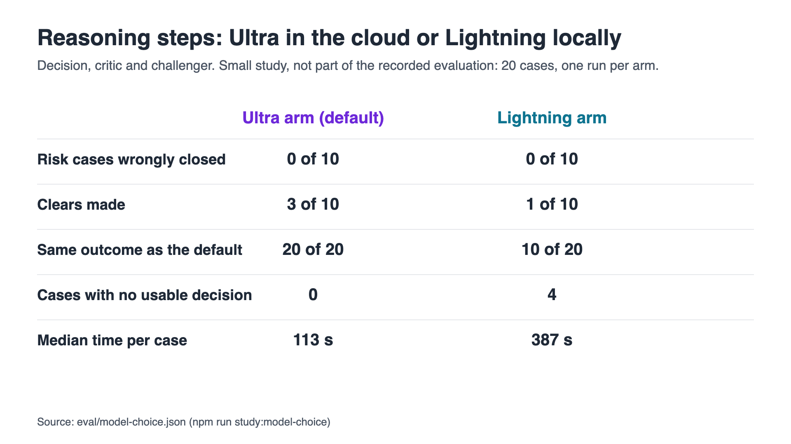
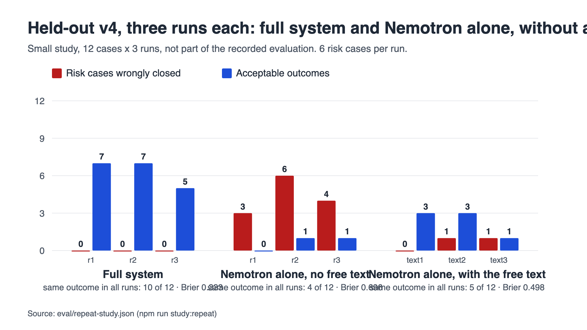
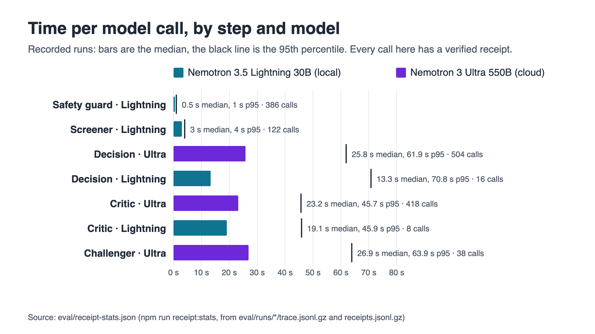

# How NVIDIA Nemotron is used

Sanctions Desk uses two NVIDIA Nemotron models, both through Meterless Nightshift: **Nemotron 3.5 Lightning 30B** on the analyst's laptop, where the raw text is, and **Nemotron 3 Ultra 550B** in the cloud, where the reasoning over structured evidence happens. Every answer from Nightshift carries a signed receipt naming the model that served it, so each statement below can be checked.

## Which model does each step, and why

| Step                                 | Model                                                                   | Where                                                      | Why this model                                                                                                                                                                                                                                                                               |
| ------------------------------------ | ----------------------------------------------------------------------- | ---------------------------------------------------------- | -------------------------------------------------------------------------------------------------------------------------------------------------------------------------------------------------------------------------------------------------------------------------------------------- |
| Safety guard (inbound)               | Nemotron 3.5 Lightning 30B                                              | Laptop (`sanctions-desk-guard`, bound to the local lane)   | It reads the free text of the data to flag instructions aimed at the reviewer, so the text must stay on the machine; a short yes/no answer, about half a second.                                                                                                                             |
| Free-text screener                   | Nemotron 3.5 Lightning 30B                                              | Laptop (same identity)                                     | It reads customer notes, payment references and list remarks and returns risk signals with the exact text span; only those structured signals go further.                                                                                                                                    |
| Decision                             | Nemotron 3 Ultra 550B                                                   | Cloud (`sanctions-desk-reasoning`, bound to the deep lane) | Applying the approved definitions to many fields at once and citing the rows it rests on is the hardest step; it receives structured fields and signals, never free text.                                                                                                                    |
| Critic                               | Nemotron 3 Ultra 550B                                                   | Cloud (same identity, `judge` mode)                        | It checks the recommendation against the evidence after code has re-read every cited fact from Zetaris.                                                                                                                                                                                      |
| Challenger                           | Nemotron 3 Ultra 550B                                                   | Cloud (same identity)                                      | It argues against a close before it can stand.                                                                                                                                                                                                                                               |
| Safety guard (outbound drafts)       | Nemotron 3.5 Lightning 30B                                              | Laptop                                                     | It checks a draft meant for a customer for tipping-off wording, on top of fixed patterns.                                                                                                                                                                                                    |
| Backup when Nightshift cannot answer | Nemotron 3.5 Lightning 30B (local Ollama, `nemotron-3.5-lightning:30b`) | Laptop                                                     | Keeps a step answering when Nightshift fails; the same model as the local steps. 19 answers in the recorded runs (15 decision, 2 critic, 2 challenger), none in a case that ended in a wrong close. No receipt, since the call does not go through Nightshift; the trace labels it `ollama`. |



Nightshift's learned router chooses the model inside the lane each app identity is bound to. In the headline run the receipts show the safety guard on Lightning in 70 of 70 calls and the decision, critic and challenger on Ultra in 187 of 190 (3 answered by Lightning). The desk asks for a pinned mode per step (`meterless/fast`, `meterless/deep`, `meterless/judge`) and records both the mode asked for and the model that answered. Details: [MODELS.md](MODELS.md).

<!-- adversarial:start -->
**Safety guard against injected text (one run, 2026-10-23, policy 7):** Lightning flagged 70 of 70 injected instructions, against 24 for the fixed patterns alone, and 12 of 12 tipping-off drafts (patterns: 1); it wrongly flagged 1 of 23 harmless texts. It tests the safety guard only, not a full review. Details: [EVALUATION.md](EVALUATION.md#safety-guard-against-injected-text).
<!-- adversarial:end -->

## The privacy design

- **Free text never goes into a cloud prompt from the desk.** Before each decision, critic and challenger call, code compares the prompt with the case's notes, payment references and list remarks; if any of them, or a run of 20 characters from one, is in the prompt, the call is not made and the case goes to a person ([MODELS.md](MODELS.md#what-leaves-the-machine-per-step)).
- **Nightshift's own answer memory is off.** It was on during the recorded runs and could add earlier answers, local ones included, to a cloud request; that cannot be checked for those runs. Since 24 Oct 2026 it is off, checked on the live runs since (no receipt carries an added memory) ([MODELS.md](MODELS.md#nightshifts-own-memory-switched-off-on-24-oct-2026)).
- **Optional privacy mode.** With `PRIVACY_MODE=pseudonymise` the cloud steps receive per-case tokens instead of names, identifiers, dates of birth, addresses and countries, plus the comparison worked out locally; a prompt that still holds a raw value is not sent. Small test of an optional mode, not part of the recorded evaluation: 0 wrong closes in both modes; 14 of 20 outcomes identical; all 65 cloud prompts passed the raw-value check ([MODELS.md](MODELS.md#privacy-mode)).

## Why two models: a small study of model choice

The same 20 cases were run with the decision, critic and challenger on Ultra in the cloud (the default) and on Lightning on the laptop. It is one live run per arm on a small sample, so it shows the shape of the trade-off, not a measured difference.

<!-- model-choice:start -->
**Small study of model choice, not part of the recorded evaluation.** Held-out v4 (12 cases) and 8 of the 70 exam cases (4 risks, 4 clears), one live run per arm on 24 Oct 2026, Nightshift warmed up and not restarted. The default arm is the privacy-mode-off run of the same day.

| Arm                                                                      | Risk cases wrongly closed | Clears made | Outcomes identical to the default | Errors | Reasoning calls (receipts verified) | Median s per reasoning call | Median s per case | Answers set aside for more than 8 facts | Backup answers (no receipt) |
| ------------------------------------------------------------------------ | ------------------------: | ----------: | --------------------------------: | -----: | ----------------------------------: | --------------------------: | ----------------: | --------------------------------------: | --------------------------: |
| Decision, critic and challenger on Nemotron 3 Ultra (cloud), the default |                   0 of 10 |     3 of 10 |                          20 of 20 |      0 |                             75 (75) |                        27.4 |               113 |                                       6 |                           6 |
| Decision, critic and challenger on Nemotron 3.5 Lightning (local)        |                   0 of 10 |     1 of 10 |                          10 of 20 |      4 |                             81 (81) |                         8.3 |               387 |                                       0 |                          32 |

Which model served the reasoning calls (receipts): Ultra arm (default): Nemotron 3 Ultra 550B (cloud) 62, Nemotron 3.5 Lightning 30B (local) 13; Lightning arm: Nemotron 3.5 Lightning 30B (local) 81.
<!-- model-choice:end -->



Read plainly: neither arm closed a risk case. With Lightning doing the reasoning, the desk made fewer clears, reached the same outcome as the default on half the cases, had 4 cases with no usable decision, and took longer per case, because many local reasoning calls through Nightshift failed and fell back to the Ollama copy of Lightning. Ultra's single calls are slower, but its answers were usable far more often. That is why the reasoning steps are bound to the cloud lane and the raw-text steps to the laptop. One run per arm on 20 cases shows the shape of the trade-off, not a measured difference.

## What the agents add over Nemotron alone

The same 12 held-out cases, three runs each: the full system, and Nemotron alone (one Ultra call per case on the structured case facts the decision step gets, with no free text, no critic, no challenger, no policy guard and no memory, through the same Nightshift path with receipts). It is reported as measured, including where Nemotron alone does as well or better.



<!-- repeat-study:start -->
**Small study, 12 cases x 3 runs, not part of the recorded evaluation.** Held-out v4 run three times by the full system (privacy mode off) and three times by Nemotron alone (one cloud Ultra call per case on the structured case facts the decision step gets: no free text, critic, challenger, policy guard or memory), 24-25 Oct 2026, after a warm-up and without restarting Nightshift.

**1. Agreement between runs.** Same outcome in all 3 runs: Full system on 10 of 12 cases; Nemotron alone on 4 of 12 cases.

**2. Ranges across the runs** (lowest to highest of the three):

| System         | Risk cases wrongly closed | Clears made | Acceptable outcomes | Escalated share | Errors |
| -------------- | ------------------------: | ----------: | ------------------: | --------------: | -----: |
| Full system    |                    0 of 6 |      1 of 6 |        5 to 7 of 12 |       75 to 92% |      0 |
| Nemotron alone |               3 to 6 of 6 | 0 to 1 of 6 |        0 to 1 of 12 |         0 to 8% | 2 to 4 |

Each run:

| System         | Run | Risk cases wrongly closed | Clears made | Acceptable outcomes | Escalated share | Errors |
| -------------- | --- | ------------------------: | ----------: | ------------------: | --------------: | -----: |
| Full system    | r1  |                    0 of 6 |      1 of 6 |             7 of 12 |             92% |      0 |
| Full system    | r2  |                    0 of 6 |      1 of 6 |             7 of 12 |             92% |      0 |
| Full system    | r3  |                    0 of 6 |      1 of 6 |             5 of 12 |             75% |      0 |
| Nemotron alone | r1  |                    3 of 6 |      0 of 6 |             0 of 12 |              0% |      4 |
| Nemotron alone | r2  |                    6 of 6 |      1 of 6 |             1 of 12 |              8% |      2 |
| Nemotron alone | r3  |                    4 of 6 |      1 of 6 |             1 of 12 |              0% |      3 |

**3. Calibration** (Brier score, lower is better; with this few cases it is indicative only, and a difference of a few hundredths is not read as one system being better calibrated):

| Runs                                                                          | Cases with a confidence (n) | Brier score |
| ----------------------------------------------------------------------------- | --------------------------: | ----------: |
| Full system (3 runs above)                                                    |                          36 |       0.333 |
| Nemotron alone (3 runs above)                                                 |                          27 |       0.696 |
| Full system, privacy mode off (24 Oct, held-out v4 and 8 exam cases, one run) |                          20 |       0.328 |
| Full system, privacy mode on (24 Oct, same 20 cases, one run)                 |                          20 |       0.201 |
| Reasoning on Lightning (24 Oct, same 20 cases, one run)                       |                          16 |       0.165 |
| Deterministic rules, name match, escalate everything (no real confidence)     |                           0 |         n/a |

Brier score: Mean of (confidence - y) squared over cases, where y is 1 when the chosen outcome is acceptable for the case (its expected or an acceptable outcome) and 0 otherwise. 0 is perfect; always answering with confidence 0.5 scores 0.25. Lower is better.
<!-- repeat-study:end -->

Read plainly: in each of its three runs Nemotron alone closed risk cases (3, 6 and 4 of 6); the full system closed none in any run. HO4-001 to HO4-003 carry their risk only in free text (an uncle who is the listed person, a German nominee note, a former name), and their structured fields alone meet the false-positive definition, so a model given only those fields closes them; Nemotron alone did in all three runs. In the full system the local screener reads that text on the laptop and passes a risk signal that blocks the close. Nemotron alone also closed HO4-004 to HO4-006 in some runs, gave an answer the decision schema rejects on 2 to 4 cases per run (the full system retries those), and agreed with itself on 4 of 12 cases against 10 of 12 for the full system. The full system's cost is the other side: it made 1 of 6 clears in each run and escalated the rest. With this few cases the Brier scores are indicative only; the full system's 0.333 is worse than always answering 0.5 would score, because it gives high confidence to escalations of clear cases.

**Nemotron alone on held-out v1 and v3.** The two rounds where the full system wrongly closed risk cases, run once each:

<!-- alone-sets:start -->
**Small study, one run per set, not part of the recorded evaluation.** Nemotron alone (one cloud Ultra call per case on the structured case facts, as above) once on held-out v1 and v3, the two rounds where the full system wrongly closed risk cases, 25 Oct 2026, after a warm-up and without restarting Nightshift; beside the recorded runs of the same frozen sets (one run each, 23 Oct 2026).

| Set                    | System                                                       | Risk cases wrongly closed | Clears made | Acceptable outcomes | Errors | Result file                                                  |
| ---------------------- | ------------------------------------------------------------ | ------------------------: | ----------: | ------------------: | -----: | ------------------------------------------------------------ |
| Held-out v1 (30 cases) | Nemotron alone                                               |                   2 of 22 |      3 of 8 |            16 of 30 |      7 | `2026-10-24T17-11-05-604Z-heldout-once-nemotron_alone.json`  |
| Held-out v1 (30 cases) | Full system, first system (no screener)                      |                   2 of 22 |      0 of 8 |            20 of 30 |      0 | `2026-10-23T12-11-40-825Z-heldout-routed.json`               |
| Held-out v1 (30 cases) | Full system after the screener was added (re-run, not blind) |                   0 of 22 |      0 of 8 |            22 of 30 |      0 | `2026-10-23T21-45-15-877Z-heldout-sys2b-routed.json`         |
| Held-out v1 (30 cases) | Deterministic rules                                          |                   6 of 22 |      0 of 8 |            16 of 30 |      0 | `2026-10-23T08-13-08-222Z-heldout-rules.json`                |
| Held-out v3 (12 cases) | Nemotron alone                                               |                    4 of 6 |      2 of 6 |             2 of 12 |      3 | `2026-10-24T17-54-48-801Z-heldout3-once-nemotron_alone.json` |
| Held-out v3 (12 cases) | Full system (span grounding)                                 |                    2 of 6 |      0 of 6 |             3 of 12 |      0 | `2026-10-23T23-19-01-303Z-heldout3-sys3-routed.json`         |
| Held-out v3 (12 cases) | Deterministic rules                                          |                    1 of 6 |      1 of 6 |             6 of 12 |      0 | `2026-10-23T23-41-47-213Z-heldout3-rules.json`               |
<!-- alone-sets:end -->

Read plainly: v1 is not a like-for-like comparison, because the first system had no free-text screener yet; on v1, Nemotron alone and the first system each closed 2 of 22 risk cases (HO-002 and HO-006 for Nemotron alone; HO-005 and HO-006 for the first system), Nemotron alone made 3 of 8 clears where the first system made none, and it gave no usable answer on 7 cases. On v3, Nemotron alone closed 4 of 6 risk cases against 2 for the full system. The main result stays the three runs on v4 above: the full system closed none of the 6 risk cases in any run; Nemotron alone closed 3, 6 and 4.

**Held-out v3 three ways.** Nemotron alone, the system recorded at the time, and today's system re-run three times:

<!-- v3-today:start -->
**Small study, not part of the recorded evaluation.** Held-out v3 (12 cases, 6 risks, 6 clears) three ways. The recorded result of the system at the time stays the headline; today's system (policy 8, fail-closed) was re-run three times after the fail-closed fix, which held-out v3 led to, so those runs are not blind. 25 Oct 2026, after a warm-up and without restarting Nightshift.

| Held-out v3                                                 | Run      | Risk cases wrongly closed | Clears made | Acceptable outcomes | Errors |
| ----------------------------------------------------------- | -------- | ------------------------: | ----------: | ------------------: | -----: |
| Nemotron alone (one run)                                    | once     |                    4 of 6 |      2 of 6 |             2 of 12 |      3 |
| The system recorded at the time (one run, the headline)     | recorded |                    2 of 6 |      0 of 6 |             3 of 12 |      0 |
| Today's system, re-run after the fail-closed fix, not blind | t1       |                    0 of 6 |      0 of 6 |             6 of 12 |      0 |
| Today's system, re-run after the fail-closed fix, not blind | t2       |                    0 of 6 |      0 of 6 |             6 of 12 |      0 |
| Today's system, re-run after the fail-closed fix, not blind | t3       |                    0 of 6 |      0 of 6 |             6 of 12 |      0 |
<!-- v3-today:end -->

Read plainly: today's system closed none of the 6 v3 risk cases in any of its three runs and made none of the 6 clears; it gave the same outcome in all three runs on 11 of 12 cases (HO3-009 was escalated once and held for more information twice). These runs are not blind: the fail-closed change was made after v3 showed its two wrong closes, which stay in the headline.

## What we tried and why it isn't used

- **NVIDIA guard and jailbreak-detection models.** Requests naming `nvidia/llama-3.1-nemoguard-8b-content-safety` and `nvidia/nemoguard-jailbreak-detect` were answered by Nemotron 3 Ultra, as their receipts show, and Nightshift 1.2.1's list of models that can be added as a lane offers no NVIDIA guard, safety or jailbreak-detection model (the list was read; nothing was added or changed). So they are not served on this version, and they are not claimed.
- **Nemotron embedding.** `nvidia/nemotron-3-embed-1b` is listed, but the embeddings endpoint returns 404 on this build and a chat call in the embed mode is refused ("no route on this build returns embed"); there is no rerank model. Memory recall stays on exact pointers.

We only claim a model when a verified receipt shows it answered.

## Receipt statistics

Every model call in the recorded runs and in the labelled small runs of 24 Oct 2026, per step and per model that served it, from the traces and the signed receipts. The groups are kept apart and never added together. Rebuild with `npm run receipt:stats`.



<!-- receipt-stats:start -->
**Recorded runs (28 exported runs in eval/runs)**

| Step         | Model that served it                  | Calls | Receipts verified | Median s | p95 s | Median tokens in | Median tokens out |
| ------------ | ------------------------------------- | ----: | ----------------: | -------: | ----: | ---------------: | ----------------: |
| Safety guard | Nemotron 3.5 Lightning 30B (local)    |   386 |               386 |      0.5 |     1 |              513 |                19 |
| Screener     | Nemotron 3.5 Lightning 30B (local)    |   122 |               122 |        3 |     4 |             1571 |               223 |
| Decision     | Nemotron 3 Ultra 550B (cloud)         |   504 |               504 |     25.8 |  61.9 |             4943 |               673 |
| Decision     | Nemotron 3.5 Lightning 30B (local)    |    16 |                16 |     13.3 |  70.8 |             4232 |               531 |
| Decision     | Ollama backup (Lightning, no receipt) |    15 |                 0 |     16.2 |  20.6 |             2863 |              1603 |
| Critic       | Nemotron 3 Ultra 550B (cloud)         |   418 |               418 |     23.2 |  45.7 |             3381 |               158 |
| Critic       | Nemotron 3.5 Lightning 30B (local)    |     8 |                 8 |     19.1 |  45.9 |             3258 |               672 |
| Critic       | Ollama backup (Lightning, no receipt) |     2 |                 0 |       13 |  14.9 |             1703 |              1688 |
| Challenger   | Nemotron 3 Ultra 550B (cloud)         |    38 |                38 |     26.9 |  63.9 |             3203 |               406 |
| Challenger   | Ollama backup (Lightning, no receipt) |     2 |                 0 |     20.2 |  20.5 |             1663 |              2068 |

Fallbacks: Decision: 15 answer(s) from the Ollama backup, 3 answer(s) set aside for citing more than 8 facts; Critic: 2 answer(s) from the Ollama backup, 0 answer(s) set aside for citing more than 8 facts; Challenger: 2 answer(s) from the Ollama backup, 0 answer(s) set aside for citing more than 8 facts.

**Small test of an optional mode: privacy mode off (24 Oct 2026, not part of the recorded evaluation)**

| Step         | Model that served it                  | Calls | Receipts verified | Median s | p95 s | Median tokens in | Median tokens out |
| ------------ | ------------------------------------- | ----: | ----------------: | -------: | ----: | ---------------: | ----------------: |
| Safety guard | Nemotron 3.5 Lightning 30B (local)    |    20 |                20 |      0.3 |   0.3 |              351 |                19 |
| Screener     | Nemotron 3.5 Lightning 30B (local)    |    15 |                15 |      2.3 |   4.9 |              830 |               188 |
| Decision     | Nemotron 3 Ultra 550B (cloud)         |    31 |                31 |     31.1 |  44.7 |             3716 |               690 |
| Decision     | Nemotron 3.5 Lightning 30B (local)    |     8 |                 8 |      8.4 |  15.3 |             3962 |               422 |
| Decision     | Ollama backup (Lightning, no receipt) |     5 |                 0 |      9.4 |  16.8 |             3929 |               493 |
| Critic       | Nemotron 3 Ultra 550B (cloud)         |    28 |                28 |     26.9 |  40.2 |             2169 |               165 |
| Critic       | Nemotron 3.5 Lightning 30B (local)    |     2 |                 2 |     28.4 |  52.6 |             1925 |               796 |
| Critic       | Ollama backup (Lightning, no receipt) |     1 |                 0 |      3.3 |   3.3 |             1886 |               236 |
| Challenger   | Nemotron 3 Ultra 550B (cloud)         |     3 |                 3 |     32.4 |  53.2 |             2123 |               382 |
| Challenger   | Nemotron 3.5 Lightning 30B (local)    |     3 |                 3 |     11.3 |  74.9 |             1962 |               391 |

Fallbacks: Decision: 5 answer(s) from the Ollama backup, 6 answer(s) set aside for citing more than 8 facts; Critic: 1 answer(s) from the Ollama backup, 0 answer(s) set aside for citing more than 8 facts.

**Small test of an optional mode: privacy mode on (24 Oct 2026, not part of the recorded evaluation)**

| Step         | Model that served it                  | Calls | Receipts verified | Median s | p95 s | Median tokens in | Median tokens out |
| ------------ | ------------------------------------- | ----: | ----------------: | -------: | ----: | ---------------: | ----------------: |
| Safety guard | Nemotron 3.5 Lightning 30B (local)    |    20 |                20 |      0.3 |   0.3 |              351 |                19 |
| Screener     | Nemotron 3.5 Lightning 30B (local)    |    15 |                15 |      2.1 |   4.5 |              830 |               188 |
| Decision     | Nemotron 3 Ultra 550B (cloud)         |    31 |                31 |       30 |  37.4 |             3878 |               709 |
| Decision     | Nemotron 3.5 Lightning 30B (local)    |     4 |                 4 |      8.2 |  10.5 |             4074 |               464 |
| Decision     | Ollama backup (Lightning, no receipt) |     3 |                 0 |     16.5 |    23 |             4048 |              1500 |
| Critic       | Nemotron 3 Ultra 550B (cloud)         |    28 |                28 |     18.9 |  32.9 |             2220 |               156 |
| Critic       | Nemotron 3.5 Lightning 30B (local)    |     1 |                 1 |      3.6 |   3.6 |             2922 |               215 |
| Challenger   | Nemotron 3 Ultra 550B (cloud)         |     5 |                 5 |     29.5 |  46.5 |             2143 |               322 |

Fallbacks: Decision: 3 answer(s) from the Ollama backup, 4 answer(s) set aside for citing more than 8 facts.

**Small study of model choice: decision, critic and challenger on Lightning (not part of the recorded evaluation)**

| Step         | Model that served it                  | Calls | Receipts verified | Median s | p95 s | Median tokens in | Median tokens out |
| ------------ | ------------------------------------- | ----: | ----------------: | -------: | ----: | ---------------: | ----------------: |
| Safety guard | Nemotron 3.5 Lightning 30B (local)    |    20 |                20 |      0.3 |  29.1 |              351 |                19 |
| Screener     | Nemotron 3.5 Lightning 30B (local)    |    15 |                15 |      2.4 |   6.7 |              830 |               188 |
| Decision     | Nemotron 3.5 Lightning 30B (local)    |    46 |                46 |      8.9 |  58.1 |             3803 |               443 |
| Decision     | Ollama backup (Lightning, no receipt) |    18 |                 0 |       11 |  44.5 |             3841 |               518 |
| Critic       | Nemotron 3.5 Lightning 30B (local)    |    33 |                33 |      4.8 |  46.9 |             2173 |               275 |
| Critic       | Ollama backup (Lightning, no receipt) |    12 |                 0 |     23.8 |  37.2 |             2053 |              1395 |
| Challenger   | Nemotron 3.5 Lightning 30B (local)    |     2 |                 2 |       58 |    82 |             3081 |               400 |
| Challenger   | Ollama backup (Lightning, no receipt) |     2 |                 0 |     36.2 |  51.4 |             1927 |              1500 |

Fallbacks: Decision: 18 answer(s) from the Ollama backup, 0 answer(s) set aside for citing more than 8 facts; Critic: 12 answer(s) from the Ollama backup, 0 answer(s) set aside for citing more than 8 facts; Challenger: 2 answer(s) from the Ollama backup, 0 answer(s) set aside for citing more than 8 facts.
<!-- receipt-stats:end -->

## Verify every receipt yourself

```bash
npm ci
npm run evidence:verify      # every signature of the exported runs, every call has a receipt, trace model = receipt model
```

Without installing anything: the [receipt log](https://rahulmahadik.github.io/sanctions-desk/receipts/) lists every model call of the committed runs with its receipt, each signature checked when the site was built. The case view's **Verify receipt** button checks one call of a live review the same way. How a receipt is signed and how to pin the key: [MODELS.md](MODELS.md#verifying-a-receipt).

## Honest limits

- **Lane names.** The two cloud lanes in Nightshift are still named `nemotron-3-super-120b-a1` from before the Super endpoint was retired; they serve Ultra 550B, and every receipt names the model that answered ([MODELS.md](MODELS.md#why-the-cloud-lane-names-say-super-120b)).
- **Nightshift's memory in the recorded runs.** It was on, so whether text read on the laptop reached the cloud that way cannot be checked for those runs; it is off now.
- **Exact model pinning is not available.** Nightshift 1.2.1 lets the router choose inside a lane; a run with the exact model fixed per step needs a newer build, so "mostly Ultra" is a measurement, not a guarantee.
- **Not available on Nightshift 1.2.1:** a Nemotron embedding route (the catalog lists `nemotron-3-embed-1b`, but no route returns an embedding), a rerank model, and an NVIDIA guard or jailbreak-detection model (calls naming them are answered by Ultra, as the receipts show). Details: [KNOWN_ISSUES.md](KNOWN_ISSUES.md#considered-not-done).
- **The Ollama backup has no receipt.** When Nightshift cannot answer, the local Ollama copy of Lightning may; those answers are labelled `ollama` and are counted in the fallbacks above.
- **One run each.** Model answers vary between runs; the small studies above are labelled and are not part of the recorded evaluation.
