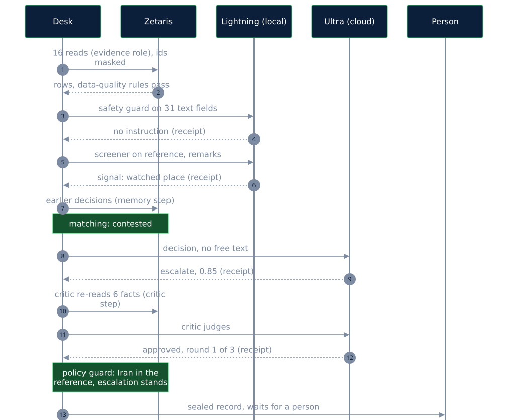

# How NVIDIA Nemotron is used

Sanctions Desk uses two NVIDIA Nemotron models, both through Meterless Nightshift: **Nemotron 3.5 Lightning 30B** on the analyst's laptop, where the raw text is, and **Nemotron 3 Ultra 550B** in the cloud, where the reasoning over structured evidence happens. Every answer from Nightshift carries a signed receipt naming the model that served it, so each statement below can be checked.

<!-- nemotron-scorecard:start -->
**Nemotron scorecard.** Computed by `npm run nemotron:scorecard` from committed files only ([eval/nemotron-scorecard.json](../eval/nemotron-scorecard.json)); each part is detailed further down this page.

| Step                                 | Model                                                    | Where        | Why                                                                                                                  |
| ------------------------------------ | -------------------------------------------------------- | ------------ | -------------------------------------------------------------------------------------------------------------------- |
| Safety guard (inbound)               | Nemotron 3.5 Lightning 30B                               | Local laptop | It reads the free text of the data to flag instructions aimed at the reviewer, so the text must stay on the machine. |
| Free-text screener                   | Nemotron 3.5 Lightning 30B                               | Local laptop | It reads customer notes, payment references and list remarks and returns risk signals with the exact text span.      |
| Decision                             | Nemotron 3 Ultra 550B in most calls (the router chooses) | Cloud        | Applying the approved definitions to many fields at once and citing the rows it rests on is the hardest step.        |
| Critic                               | Nemotron 3 Ultra 550B in most calls (the router chooses) | Cloud        | It checks the recommendation against the evidence after code has re-read every cited fact from Zetaris.              |
| Challenger                           | Nemotron 3 Ultra 550B in most calls (the router chooses) | Cloud        | It argues against a close before it can stand.                                                                       |
| Safety guard (outbound drafts)       | Nemotron 3.5 Lightning 30B                               | Local laptop | It checks a draft meant for a customer for tipping-off wording, on top of fixed patterns.                            |
| Backup when Nightshift cannot answer | Nemotron 3.5 Lightning 30B (local Ollama)                | Local laptop | Keeps a step answering when Nightshift fails; the same model as the local steps.                                     |

The decision step asks for the deep lane (`meterless/deep`): the mode is pinned, the serving model is not, because Nightshift's router chooses it. Ultra answered 87 of the 89 decision calls Nightshift served in the first system's run and 83 of 96 in the run of the current system before the block fix. Of the 13 decision calls Lightning answered in the run of the current system before the block fix, 10 were the desk's fast-lane retry after an unusable or failed first answer (a deliberate fallback: the retry asks for `meterless/fast` under the guard identity, which the cockpit binds to the local lane, so Lightning answers) and 3 were deep-lane calls where Nightshift's learned router predicted Ultra but Lightning won a hedged race; 7 more decision answers came from the Ollama backup (no receipt).

**Per model, recorded runs** (29 exported runs in eval/runs; safety guard, screener, decision, critic and challenger calls):

| Model                                 | Where        | Calls | Median s | Median tokens in | Median tokens out | Cost recorded in the receipts                   |
| ------------------------------------- | ------------ | ----: | -------: | ---------------: | ----------------: | ----------------------------------------------- |
| Nemotron 3.5 Lightning 30B            | Local laptop |   787 |      0.5 |              514 |                19 | USD 0 on all 787 receipts (`cost.actual_usd`)   |
| Nemotron 3 Ultra 550B                 | Cloud        | 1,136 |     25.7 |            4,127 |               474 | USD 0 on all 1,136 receipts (`cost.actual_usd`) |
| Ollama backup (Lightning, no receipt) | Local laptop |    28 |     14.9 |            2,863 |             1,470 | not recorded (no receipt)                       |

Answered on the laptop: 815 of 1,951 model calls (42%), Lightning through Nightshift and the Ollama backup together. The per-case `cost` in the result files is worked out from the illustrative unit costs in `config/default.json`, not recorded, so it is not shown.

**Calibration** (Brier score, lower is better; indicative only with this few cases):

| Arm                                                                                         | Cases with a confidence (n) | Brier score | Source                                                                   |
| ------------------------------------------------------------------------------------------- | --------------------------: | ----------: | ------------------------------------------------------------------------ |
| Full system (held-out v4, 12 cases x 3 runs)                                                |                          36 |       0.333 | [repeat-heldout4](../eval/studies/README.md)                             |
| Nemotron alone, no free text (held-out v4, 12 cases x 3 runs)                               |                          27 |       0.696 | [repeat-heldout4](../eval/studies/README.md)                             |
| Nemotron alone, with the free text (held-out v4, 12 cases x 3 runs)                         |                          24 |       0.498 | [repeat-heldout4](../eval/studies/README.md)                             |
| Full system, privacy mode off (held-out v4 and 8 exam cases, one run)                       |                          20 |       0.328 | [repeat-study.json](../eval/repeat-study.json)                           |
| Full system, privacy mode on (same 20 cases, one run)                                       |                          20 |       0.201 | [repeat-study.json](../eval/repeat-study.json)                           |
| Reasoning on Lightning (same 20 cases, one run)                                             |                          16 |       0.165 | [repeat-study.json](../eval/repeat-study.json)                           |
| Full system (held-out v3, 12 cases x 3 runs, not blind)                                     |                          36 |        0.33 | [heldout3-rerun](../eval/studies/README.md)                              |
| Full system (sys5) (exam, 70 cases, one run)                                                |                          68 |       0.102 | [result file](../eval/results/2026-10-25T07-45-05-768Z-sys5-routed.json) |
| Nemotron alone, no free text (held-out v1, 30 cases x 1 run; held-out v3, 12 cases x 1 run) |                          32 |       0.324 | [nemotron-alone-v1-v3](../eval/studies/README.md)                        |

Brier score: Mean of (confidence - y) squared over cases, where y is 1 when the chosen outcome is acceptable for the case (its expected or an acceptable outcome) and 0 otherwise. 0 is perfect; always answering with confidence 0.5 scores 0.25. Lower is better.

**Safety guard** (95% Wilson ranges in brackets):

| Test                                                          |            Result | Source                                                                      |
| ------------------------------------------------------------- | ----------------: | --------------------------------------------------------------------------- |
| Injected text caught, full reviews, guard asked once          | 66 of 70 (86–98%) | [full-review run](../eval/adversarial/review-2026-10-25T02-36-40-554Z.json) |
| Injected text caught, fresh set, current guard                | 27 of 28 (82–99%) | [fresh-set run](../eval/adversarial/fresh-2026-10-25T04-37-55-312Z.json)    |
| False alarms on harmless text, fresh set, current guard       |  7 of 16 (23–67%) | [fresh-set run](../eval/adversarial/fresh-2026-10-25T04-37-55-312Z.json)    |
| False alarms on harmless text, full reviews, guard asked once |  5 of 15 (15–58%) | [full-review run](../eval/adversarial/review-2026-10-25T02-36-40-554Z.json) |

What we tried and did not use (guard and jailbreak-detection models, embedding, document images): [What we tried and why it isn't used](#what-we-tried-and-why-it-isnt-used).
<!-- nemotron-scorecard:end -->

<!-- alone-headline:start -->
**Measured against Nemotron alone** (small study, held-out v4, 12 cases, three runs each, not part of the recorded evaluation):
- Full system: a recommendation on every case (escalated to a person where no model answer was usable), free text kept out of the desk's cloud prompts, 0 of 6 risk cases wrongly closed in each of 3 runs; in 1 of 3 runs, 1 case had no usable model answer and was escalated to a person.
- Nemotron alone without the free text: 3, 6 and 4 wrongly closed, with no usable answer on 2–4 of 12 cases per run, 0–3 of them among the 6 risk cases.
- Nemotron alone with the free text sent to the cloud: 0, 1 and 1 wrongly closed, but no usable answer on 3–5 of 12 cases per run, 2–3 of them among the 6 risk cases.
- Nemotron alone cleared more: 3, 3 and 1 of 6 clear cases with the free text (0, 1 and 1 without it), against 1 in each run for the full system.
<!-- alone-headline:end -->

## Which model does each step, and why





| Step                                 | Model                                                                   | Where                                                      | Why this model                                                                                                                                                                                                                                                                             |
| ------------------------------------ | ----------------------------------------------------------------------- | ---------------------------------------------------------- | ------------------------------------------------------------------------------------------------------------------------------------------------------------------------------------------------------------------------------------------------------------------------------------------ |
| Safety guard (inbound)               | Nemotron 3.5 Lightning 30B                                              | Laptop (`sanctions-desk-guard`, bound to the local lane)   | It reads the free text of the data to flag instructions aimed at the reviewer, so the text must stay on the machine; a short yes/no answer, about half a second.                                                                                                                           |
| Free-text screener                   | Nemotron 3.5 Lightning 30B                                              | Laptop (same identity)                                     | It reads customer notes, payment references and list remarks and returns risk signals with the exact text span; only those structured signals go further.                                                                                                                                  |
| Decision                             | Nemotron 3 Ultra 550B in most calls (the router chooses)                | Cloud (`sanctions-desk-reasoning`, bound to the deep lane) | Applying the approved definitions to many fields at once and citing the rows it rests on is the hardest step; it receives structured fields and signals, no free text (in every run with the screener; see the privacy design below).                                                      |
| Critic                               | Nemotron 3 Ultra 550B in most calls (the router chooses)                | Cloud (same identity, `judge` mode)                        | It checks the recommendation against the evidence after code has re-read every cited fact from Zetaris.                                                                                                                                                                                    |
| Challenger                           | Nemotron 3 Ultra 550B in most calls (the router chooses)                | Cloud (same identity)                                      | It argues against a close before it can stand.                                                                                                                                                                                                                                             |
| Safety guard (outbound drafts)       | Nemotron 3.5 Lightning 30B                                              | Laptop                                                     | It checks a draft meant for a customer for tipping-off wording, on top of fixed patterns.                                                                                                                                                                                                  |
| Backup when Nightshift cannot answer | Nemotron 3.5 Lightning 30B (local Ollama, `nemotron-3.5-lightning:30b`) | Laptop                                                     | Keeps a step answering when Nightshift fails; the same model as the local steps. 28 calls in the recorded runs (22 decision, 3 critic, 3 challenger), none in a case that ended in a wrong close. No receipt, since the call does not go through Nightshift; the trace labels it `ollama`. |


What is pinned is the mode the desk asks for per step (`meterless/fast`, `meterless/deep`, `meterless/judge`). The serving model is not pinned: Nightshift's learned router chooses it inside the lane each app identity is bound to, and the desk records both the mode asked for and the model that answered. In the headline run the receipts show the safety guard on Lightning in 70 of 70 calls and the decision, critic and challenger on Ultra in <!--fact:reasoning_ultra_first-->187 of 190<!--/fact--> of their calls Nightshift served. <!--fact:decision_models_line-->The decision step asks for the deep lane (`meterless/deep`): the mode is pinned, the serving model is not, because Nightshift's router chooses it. Ultra answered 87 of the 89 decision calls Nightshift served in the first system's run and 83 of 96 in the run of the current system before the block fix.<!--/fact--> <!--fact:reasoning_models_line-->The critic asks for the judge lane (`meterless/judge`) and the challenger for the deep lane; Ultra answered 85 of 86 critic calls and 15 of 15 challenger calls Nightshift served in the first system's run (82 of 84 and 11 of 14 in the run of the current system before the block fix).<!--/fact--> <!--fact:decision_lightning_note-->Of the 13 decision calls Lightning answered in the run of the current system before the block fix, 10 were the desk's fast-lane retry after an unusable or failed first answer (a deliberate fallback: the retry asks for `meterless/fast` under the guard identity, which the cockpit binds to the local lane, so Lightning answers) and 3 were deep-lane calls where Nightshift's learned router predicted Ultra but Lightning won a hedged race; 7 more decision answers came from the Ollama backup (no receipt).<!--/fact--> Details: [MODELS.md](MODELS.md).

<!-- adversarial:start -->
**Safety guard against injected text (one run, policy 7, guard asked once):** Lightning flagged 70 of 70 injected instructions, against 24 for the fixed patterns alone, and 12 of 12 tipping-off drafts (patterns: 1); it wrongly flagged 1 of 23 harmless texts. It tests the safety guard only, not a full review. Through full reviews with the guard asked once: 66 of 70 injected texts caught; 2 that no check flagged ended in a close where the case's own data supported a close. With the current guard (asked twice, plus a narrow check), a fresh set written separately: 27 of 28 reviews of injected text caught; false alarms on harmless text 7 of 16. Details: [EVALUATION.md](EVALUATION.md#safety-guard-against-injected-text).
<!-- adversarial:end -->

## The privacy design

- **The desk keeps free text out of its cloud prompts (in every run with the screener; [earlier runs](PRIVACY.md#earlier-runs)).** Before each decision, critic and challenger call, code compares the prompt with the case's notes, payment references and list remarks; if any of them, or a run of 20 characters from one, is in the prompt, the call is not made and the case goes to a person ([MODELS.md](MODELS.md#what-leaves-the-machine-per-step)). In four early runs, made before the screener existed (the headline 70-case run, single, no_memory and held-out v1), the cloud decision prompt held payment references and list remarks; customer notes were never in it. In every run with the screener, a check keeps all free text out of cloud prompts. ([PRIVACY.md](PRIVACY.md#earlier-runs))
- **Nightshift's own answer memory is off.** It was on during the recorded runs and could add earlier answers, local ones included, to a cloud request; that cannot be checked for those runs. The desk's configuration keeps it off, checked on the live runs made with it off (no receipt carries an added memory) ([MODELS.md](MODELS.md#nightshifts-own-memory-switched-off)).
- **Optional privacy mode.** With `PRIVACY_MODE=pseudonymise` the cloud steps receive per-case tokens instead of names, identifiers, dates of birth, addresses and countries, plus the comparison worked out locally; a prompt that still holds a raw value is not sent. Small test of an optional mode, not part of the recorded evaluation: 0 wrong closes in both modes; 14 of 20 outcomes identical; all 65 cloud prompts passed the raw-value check ([MODELS.md](MODELS.md#privacy-mode)).

## Why two models: a small study of model choice

The same 20 cases were run with the decision, critic and challenger on Ultra in the cloud (the default) and on Lightning on the laptop. It is one live run per arm on a small sample, so it shows the shape of the trade-off, not a measured difference.

<!-- model-choice:start -->
**Small study of model choice, not part of the recorded evaluation.** Held-out v4 (12 cases) and 8 of the 70 exam cases (4 risks, 4 clears), one live run per arm, Nightshift warmed up and not restarted. The default arm is the privacy-mode-off run of the privacy-mode test. Result file: [eval/model-choice.json](../eval/model-choice.json).

| Arm                                                                      | Risk cases wrongly closed | Clears made | Outcomes identical to the default | Errors | Reasoning calls (receipts verified) | Median s per reasoning call | Median s per case | Answers set aside for more than 8 facts | Backup answers (no receipt) |
| ------------------------------------------------------------------------ | ------------------------: | ----------: | --------------------------------: | -----: | ----------------------------------: | --------------------------: | ----------------: | --------------------------------------: | --------------------------: |
| Decision, critic and challenger on Nemotron 3 Ultra (cloud), the default |                   0 of 10 |     3 of 10 |                          20 of 20 |      0 |                             75 (75) |                        27.4 |               110 |                                       6 |                           6 |
| Decision, critic and challenger on Nemotron 3.5 Lightning (local)        |                   0 of 10 |     1 of 10 |                          10 of 20 |      4 |                             81 (81) |                         8.3 |               385 |                                       0 |                          32 |

Which model served the reasoning calls (receipts): Ultra arm (default): Nemotron 3 Ultra 550B (cloud) 62, Nemotron 3.5 Lightning 30B (local) 13; Lightning arm: Nemotron 3.5 Lightning 30B (local) 81.
<!-- model-choice:end -->


Read plainly: neither arm closed a risk case. With Lightning doing the reasoning, the desk made fewer clears, reached the same outcome as the default on half the cases, had 4 cases time out and 5 more with no usable model decision, which were escalated (Ultra arm: 1), and took longer per case, because many local reasoning calls through Nightshift failed and fell back to the Ollama copy of Lightning. Ultra's single calls are slower, but its answers were usable far more often. That is why the reasoning steps are bound to the cloud lane and the raw-text steps to the laptop. One run per arm on 20 cases shows the shape of the trade-off, not a measured difference.

## What the agents add over Nemotron alone

The same 12 held-out cases, three runs each: the full system, and Nemotron alone (one Ultra call per case on the structured case facts the decision step gets, with no free text, no critic, no challenger, no policy guard and no memory, through the same Nightshift path with receipts). It is reported as measured, including where Nemotron alone does as well or better. A second Nemotron-alone arm gets the same free text the screener reads (customer note, payment reference, list remarks) with the same prompt otherwise, so the comparison does not rest on Nemotron alone being denied the text; the first arm is kept beside it. This arm sends the (synthetic) free text to the cloud model, which the desk itself does not do (see [the privacy design](#the-privacy-design)); it is a study tool only (`tools/nemotron-alone.ts --with-text`).


<!-- repeat-study:start -->
**Small study, 12 cases x 3 runs, not part of the recorded evaluation.** Held-out v4 run three times by the full system (privacy mode off) and three times by Nemotron alone (one cloud Ultra call per case on the structured case facts the decision step gets: no free text, critic, challenger, policy guard or memory), after a warm-up and without restarting Nightshift. A further arm: Nemotron alone given the same free text the screener reads (customer note, payment reference, list remarks), with the same prompt otherwise, three runs; the first Nemotron-alone arm is kept as it was. Result file: [eval/repeat-study.json](../eval/repeat-study.json).

**1. Agreement between runs.** Same outcome in all 3 runs: Full system on 10 of 12 cases; Nemotron alone, no free text on 4 of 12 cases; Nemotron alone, with the free text on 5 of 12 cases.

**2. Ranges across the runs** (lowest to highest of the three):

| System                             | Risk cases wrongly closed | Clears made | Acceptable outcomes | Escalated share | Errors |
| ---------------------------------- | ------------------------: | ----------: | ------------------: | --------------: | -----: |
| Full system                        |                    0 of 6 |      1 of 6 |        5 to 7 of 12 |       75 to 92% |      0 |
| Nemotron alone, no free text       |               3 to 6 of 6 | 0 to 1 of 6 |        0 to 1 of 12 |         0 to 8% | 2 to 4 |
| Nemotron alone, with the free text |               0 to 1 of 6 | 1 to 3 of 6 |        1 to 3 of 12 |         0 to 8% | 3 to 5 |

Each run:

| System                             | Run   | Risk cases wrongly closed (95% range) | Clears made | Acceptable outcomes | Escalated share | Errors |
| ---------------------------------- | ----- | ------------------------------------: | ----------: | ------------------: | --------------: | -----: |
| Full system                        | r1    |                        0 of 6 (0–39%) |      1 of 6 |             7 of 12 |             92% |      0 |
| Full system                        | r2    |                        0 of 6 (0–39%) |      1 of 6 |             7 of 12 |             92% |      0 |
| Full system                        | r3    |                        0 of 6 (0–39%) |      1 of 6 |             5 of 12 |             75% |      0 |
| Nemotron alone, no free text       | r1    |                       3 of 6 (19–81%) |      0 of 6 |             0 of 12 |              0% |      4 |
| Nemotron alone, no free text       | r2    |                      6 of 6 (61–100%) |      1 of 6 |             1 of 12 |              8% |      2 |
| Nemotron alone, no free text       | r3    |                       4 of 6 (30–90%) |      1 of 6 |             1 of 12 |              0% |      3 |
| Nemotron alone, with the free text | text1 |                        0 of 6 (0–39%) |      3 of 6 |             3 of 12 |              8% |      3 |
| Nemotron alone, with the free text | text2 |                        1 of 6 (3–56%) |      3 of 6 |             3 of 12 |              0% |      4 |
| Nemotron alone, with the free text | text3 |                        1 of 6 (3–56%) |      1 of 6 |             1 of 12 |              0% |      5 |

Ranges use the Wilson score method.

**3. Calibration** (Brier score, lower is better; with this few cases it is indicative only, and a difference of a few hundredths is not read as one system being better calibrated):

| Runs                                                                      | Cases with a confidence (n) | Brier score |
| ------------------------------------------------------------------------- | --------------------------: | ----------: |
| Full system (3 runs above)                                                |                          36 |       0.333 |
| Nemotron alone, no free text (3 runs above)                               |                          27 |       0.696 |
| Nemotron alone, with the free text (3 runs above)                         |                          24 |       0.498 |
| Full system, privacy mode off (held-out v4 and 8 exam cases, one run)     |                          20 |       0.328 |
| Full system, privacy mode on (same 20 cases, one run)                     |                          20 |       0.201 |
| Reasoning on Lightning (same 20 cases, one run)                           |                          16 |       0.165 |
| Deterministic rules, name match, escalate everything (no real confidence) |                           0 |         n/a |

Brier score: Mean of (confidence - y) squared over cases, where y is 1 when the chosen outcome is acceptable for the case (its expected or an acceptable outcome) and 0 otherwise. 0 is perfect; always answering with confidence 0.5 scores 0.25. Lower is better.
<!-- repeat-study:end -->

Read plainly (every figure is in the summary at the top of this page and in the tables above, all written from the study files): without the free text, Nemotron alone closes the cases whose risk is stated only in free text. HO4-001 to HO4-003 (an uncle who is the listed person, a German nominee note, a former name) meet the false-positive definition on their structured fields alone, and Nemotron alone closed them in every run; in the full system the local screener reads that text on the laptop and passes a risk signal that blocks the close. Given the free text (sent to the cloud for this arm only), Nemotron alone closes far fewer risk cases, but not none (HO4-003, the former name, in two runs), and it often gives no usable answer (an answer the decision schema rejects: no JSON, more than 8 cited facts, missing fields), which a desk would have to send to a person. Nemotron alone also clears more of the clear cases than the full system, which escalates most of them: that is the full system's cost. With this few cases the Brier scores are indicative only; the full system's score is worse than always answering 0.5 would be, because it gives high confidence to escalations of clear cases.

**Nemotron alone on held-out v1 and v3.** The two rounds where the full system wrongly closed risk cases, run once each:

<!-- alone-sets:start -->
**Small study, one run per set, not part of the recorded evaluation.** Nemotron alone (one cloud Ultra call per case on the structured case facts, as above) once on held-out v1 and v3, the two rounds where the full system wrongly closed risk cases, after a warm-up and without restarting Nightshift; beside the recorded runs of the same frozen sets (one run each). Result file: [eval/nemotron-alone-sets.json](../eval/nemotron-alone-sets.json).

| Set                    | System                                                       | Risk cases wrongly closed | Clears made | Acceptable outcomes | Errors | Result file                                                                                                              |
| ---------------------- | ------------------------------------------------------------ | ------------------------: | ----------: | ------------------: | -----: | ------------------------------------------------------------------------------------------------------------------------ |
| Held-out v1 (30 cases) | Nemotron alone                                               |                   2 of 22 |      3 of 8 |            16 of 30 |      7 | [2026-10-24T17-11-05-604Z-heldout-once-nemotron_alone.json](../eval/studies/README.md)                                   |
| Held-out v1 (30 cases) | Full system, first system (no screener)                      |                   2 of 22 |      0 of 8 |            20 of 30 |      0 | [2026-10-23T12-11-40-825Z-heldout-routed.json](../eval/results/2026-10-23T12-11-40-825Z-heldout-routed.json)             |
| Held-out v1 (30 cases) | Full system after the screener was added (re-run, not blind) |                   0 of 22 |      0 of 8 |            22 of 30 |      0 | [2026-10-23T21-45-15-877Z-heldout-sys2b-routed.json](../eval/results/2026-10-23T21-45-15-877Z-heldout-sys2b-routed.json) |
| Held-out v1 (30 cases) | Deterministic rules                                          |                   6 of 22 |      0 of 8 |            16 of 30 |      0 | [2026-10-23T08-13-08-222Z-heldout-rules.json](../eval/results/2026-10-23T08-13-08-222Z-heldout-rules.json)               |
| Held-out v3 (12 cases) | Nemotron alone                                               |                    4 of 6 |      2 of 6 |             2 of 12 |      3 | [2026-10-24T17-54-48-801Z-heldout3-once-nemotron_alone.json](../eval/studies/README.md)                                  |
| Held-out v3 (12 cases) | Full system (span grounding)                                 |                    2 of 6 |      0 of 6 |             3 of 12 |      0 | [2026-10-23T23-19-01-303Z-heldout3-sys3-routed.json](../eval/results/2026-10-23T23-19-01-303Z-heldout3-sys3-routed.json) |
| Held-out v3 (12 cases) | Deterministic rules                                          |                    1 of 6 |      1 of 6 |             6 of 12 |      0 | [2026-10-23T23-41-47-213Z-heldout3-rules.json](../eval/results/2026-10-23T23-41-47-213Z-heldout3-rules.json)             |
<!-- alone-sets:end -->

Read plainly: v1 is not a like-for-like comparison, because the first system had no free-text screener; on v1, Nemotron alone and the first system each closed 2 of 22 risk cases (HO-002 and HO-006 for Nemotron alone; HO-005 and HO-006 for the first system), Nemotron alone made 3 of 8 clears where the first system made none, and it gave no usable answer on 7 cases. On v3, Nemotron alone closed 4 of 6 risk cases against 2 for the full system. The main result stays the three runs on v4 above: the full system closed none of the 6 risk cases in any run; Nemotron alone closed 3, 6 and 4.

**Held-out v3 three ways.** Nemotron alone, the system as recorded, and the fail-closed system (policy 8) re-run three times:

<!-- v3-today:start -->
**Small study, not part of the recorded evaluation.** Held-out v3 (12 cases, 6 risks, 6 clears) three ways. The recorded result of the system with span grounding stays the headline; the fail-closed system (policy 8) was run three times on the same set after the fail-closed fix, which held-out v3 led to, so those runs are not blind. The runs were made after a warm-up and without restarting Nightshift. Result file: [eval/v3-today.json](../eval/v3-today.json).

| Held-out v3                                                         | Run      | Risk cases wrongly closed | Clears made | Acceptable outcomes | Errors |
| ------------------------------------------------------------------- | -------- | ------------------------: | ----------: | ------------------: | -----: |
| Nemotron alone (one run)                                            | once     |                    4 of 6 |      2 of 6 |             2 of 12 |      3 |
| The system with span grounding, as recorded (one run, the headline) | recorded |                    2 of 6 |      0 of 6 |             3 of 12 |      0 |
| The fail-closed system (policy 8), not blind                        | t1       |                    0 of 6 |      0 of 6 |             6 of 12 |      0 |
| The fail-closed system (policy 8), not blind                        | t2       |                    0 of 6 |      0 of 6 |             6 of 12 |      0 |
| The fail-closed system (policy 8), not blind                        | t3       |                    0 of 6 |      0 of 6 |             6 of 12 |      0 |
<!-- v3-today:end -->

Read plainly: the fail-closed system closed none of the 6 v3 risk cases in any of its three runs and made none of the 6 clears; it gave the same outcome in all three runs on 11 of 12 cases (HO3-009 was escalated once and held for more information twice). These runs are not blind: the fail-closed change was made after v3 showed its two wrong closes, which stay in the headline.

## What we tried and why it isn't used

- **NVIDIA guard and jailbreak-detection models.** Requests naming `nvidia/llama-3.1-nemoguard-8b-content-safety` and `nvidia/nemoguard-jailbreak-detect` were answered by Nemotron 3 Ultra (seen in a live test; the output is not committed), and Nightshift 1.2.1's list of models that can be added as a lane offers no NVIDIA guard, safety or jailbreak-detection model (the list was read; nothing was added or changed). So they are not served on this version, and they are not claimed.
- **Nemotron embedding.** `nvidia/nemotron-3-embed-1b` is listed, but the embeddings endpoint returns 404 on this build and a chat call in the embed mode is refused ("no route on this build returns embed"); there is no rerank model (seen in a live test; the output is not committed). Memory recall stays on exact pointers.
- **Nemotron 3.5 Super VL for reading document images** (`nvidia/nemotron-3.5-super-vl-120b-a12b`): both image requests through our Nightshift setup returned HTTP 502 (no vision-capable model configured to accept image attachments; seen in a live test, the output is not committed). Enabling it would need a change to the Nightshift provider setup, which we kept fixed for the recorded runs, so no answer and no receipt; not used.

We only claim a model when a verified receipt shows it answered.

## Check the receipts yourself

<!--fact:receipts_line-->2,802 signed receipts: 1,923 from exported runs, 879 from studies, all verified against the pinned key<!--/fact-->. Two commands, no services needed:

```bash
npm run receipts:check        # verify every committed receipt against the pinned key; writes eval/receipts-check.json
npm run receipts:tamper-test  # copy one receipt, change one byte of the copy: the original passes, the copy fails
```

The tamper test prints the check of the original (`valid_pinned`), of the copy with one byte changed (`invalid`) and confirms the committed file is unchanged. The key is pinned in `config/default.json` (`nightshift.receiptPublicKeys`), so a receipt signed by any other key fails too.

## Receipt statistics

Every model call in the recorded runs and in the labelled small runs (the privacy-mode test and the model-choice study), per step and per model that served it, from the traces and the signed receipts. The groups are kept apart and never added together. Rebuild with `npm run receipt:stats`.


<!-- receipt-stats:start -->
**Recorded runs (29 exported runs in eval/runs)**

| Step         | Model that served it                  | Calls | Receipts verified | Median s | p95 s | Median tokens in | Median tokens out |
| ------------ | ------------------------------------- | ----: | ----------------: | -------: | ----: | ---------------: | ----------------: |
| Safety guard | Nemotron 3.5 Lightning 30B (local)    |   592 |               592 |      0.5 |   0.9 |              475 |                19 |
| Screener     | Nemotron 3.5 Lightning 30B (local)    |   153 |               153 |      2.9 |     4 |             1542 |               215 |
| Decision     | Nemotron 3 Ultra 550B (cloud)         |   587 |               587 |     26.4 |  59.9 |             4824 |               650 |
| Decision     | Nemotron 3.5 Lightning 30B (local)    |    29 |                29 |     13.3 |  66.4 |             3773 |               485 |
| Decision     | Ollama backup (Lightning, no receipt) |    22 |                 0 |     12.4 |  18.8 |             2935 |               666 |
| Critic       | Nemotron 3 Ultra 550B (cloud)         |   500 |               500 |     23.7 |  46.4 |             3314 |               154 |
| Critic       | Nemotron 3.5 Lightning 30B (local)    |    10 |                10 |     24.3 |  45.9 |             3533 |               460 |
| Critic       | Ollama backup (Lightning, no receipt) |     3 |                 0 |     14.9 |  32.3 |             1741 |              1470 |
| Challenger   | Nemotron 3 Ultra 550B (cloud)         |    49 |                49 |     29.4 |  63.9 |             3155 |               407 |
| Challenger   | Nemotron 3.5 Lightning 30B (local)    |     3 |                 3 |     31.1 |  40.8 |             4303 |              1310 |
| Challenger   | Ollama backup (Lightning, no receipt) |     3 |                 0 |     20.5 |    21 |             1687 |              1957 |

Fallbacks: Decision: 22 answer(s) from the Ollama backup, 8 answer(s) set aside for citing more than 8 facts; Critic: 3 answer(s) from the Ollama backup, 0 answer(s) set aside for citing more than 8 facts; Challenger: 3 answer(s) from the Ollama backup, 0 answer(s) set aside for citing more than 8 facts.

**Small test of an optional mode: privacy mode off (not part of the recorded evaluation)**

| Step         | Model that served it                  | Calls | Receipts verified | Median s | p95 s | Median tokens in | Median tokens out |
| ------------ | ------------------------------------- | ----: | ----------------: | -------: | ----: | ---------------: | ----------------: |
| Safety guard | Nemotron 3.5 Lightning 30B (local)    |    20 |                20 |      0.3 |   0.3 |              351 |                19 |
| Screener     | Nemotron 3.5 Lightning 30B (local)    |    15 |                15 |      2.3 |   4.9 |              830 |               188 |
| Decision     | Nemotron 3 Ultra 550B (cloud)         |    31 |                31 |     31.1 |  44.7 |             3716 |               690 |
| Decision     | Nemotron 3.5 Lightning 30B (local)    |     8 |                 8 |      8.3 |  15.3 |             3958 |               394 |
| Decision     | Ollama backup (Lightning, no receipt) |     5 |                 0 |      9.4 |  16.8 |             3929 |               493 |
| Critic       | Nemotron 3 Ultra 550B (cloud)         |    28 |                28 |     26.8 |  40.2 |             2158 |               164 |
| Critic       | Nemotron 3.5 Lightning 30B (local)    |     2 |                 2 |      4.1 |  52.6 |             1908 |                92 |
| Critic       | Ollama backup (Lightning, no receipt) |     1 |                 0 |      3.3 |   3.3 |             1886 |               236 |
| Challenger   | Nemotron 3 Ultra 550B (cloud)         |     3 |                 3 |     32.4 |  53.2 |             2123 |               382 |
| Challenger   | Nemotron 3.5 Lightning 30B (local)    |     3 |                 3 |     11.3 |  74.9 |             1962 |               391 |

Fallbacks: Decision: 5 answer(s) from the Ollama backup, 6 answer(s) set aside for citing more than 8 facts; Critic: 1 answer(s) from the Ollama backup, 0 answer(s) set aside for citing more than 8 facts.

**Small test of an optional mode: privacy mode on (not part of the recorded evaluation)**

| Step         | Model that served it                  | Calls | Receipts verified | Median s | p95 s | Median tokens in | Median tokens out |
| ------------ | ------------------------------------- | ----: | ----------------: | -------: | ----: | ---------------: | ----------------: |
| Safety guard | Nemotron 3.5 Lightning 30B (local)    |    20 |                20 |      0.3 |   0.3 |              351 |                19 |
| Screener     | Nemotron 3.5 Lightning 30B (local)    |    15 |                15 |      2.1 |   4.5 |              830 |               188 |
| Decision     | Nemotron 3 Ultra 550B (cloud)         |    31 |                31 |       30 |  37.4 |             3878 |               709 |
| Decision     | Nemotron 3.5 Lightning 30B (local)    |     4 |                 4 |        8 |  10.5 |             4064 |               457 |
| Decision     | Ollama backup (Lightning, no receipt) |     3 |                 0 |     16.5 |    23 |             4048 |              1500 |
| Critic       | Nemotron 3 Ultra 550B (cloud)         |    28 |                28 |     16.5 |  32.9 |             2211 |               156 |
| Critic       | Nemotron 3.5 Lightning 30B (local)    |     1 |                 1 |      3.6 |   3.6 |             2922 |               215 |
| Challenger   | Nemotron 3 Ultra 550B (cloud)         |     5 |                 5 |     29.5 |  46.5 |             2143 |               322 |

Fallbacks: Decision: 3 answer(s) from the Ollama backup, 4 answer(s) set aside for citing more than 8 facts.

**Small study of model choice: decision, critic and challenger on Lightning (not part of the recorded evaluation)**

| Step         | Model that served it                  | Calls | Receipts verified | Median s | p95 s | Median tokens in | Median tokens out |
| ------------ | ------------------------------------- | ----: | ----------------: | -------: | ----: | ---------------: | ----------------: |
| Safety guard | Nemotron 3.5 Lightning 30B (local)    |    20 |                20 |      0.3 |  29.1 |              351 |                19 |
| Screener     | Nemotron 3.5 Lightning 30B (local)    |    15 |                15 |      2.4 |   6.7 |              830 |               188 |
| Decision     | Nemotron 3.5 Lightning 30B (local)    |    46 |                46 |      8.8 |  58.1 |             3794 |               441 |
| Decision     | Ollama backup (Lightning, no receipt) |    18 |                 0 |     10.7 |  44.5 |             3835 |               517 |
| Critic       | Nemotron 3.5 Lightning 30B (local)    |    33 |                33 |      4.8 |  46.9 |             2173 |               275 |
| Critic       | Ollama backup (Lightning, no receipt) |    12 |                 0 |     23.6 |  37.2 |             2050 |              1244 |
| Challenger   | Nemotron 3.5 Lightning 30B (local)    |     2 |                 2 |       34 |    82 |             1977 |               291 |
| Challenger   | Ollama backup (Lightning, no receipt) |     2 |                 0 |     21.1 |  51.4 |             1925 |              1500 |

Fallbacks: Decision: 18 answer(s) from the Ollama backup, 0 answer(s) set aside for citing more than 8 facts; Critic: 12 answer(s) from the Ollama backup, 0 answer(s) set aside for citing more than 8 facts; Challenger: 2 answer(s) from the Ollama backup, 0 answer(s) set aside for citing more than 8 facts.
<!-- receipt-stats:end -->

## Verify every receipt yourself

```bash
npm ci
npm run evidence:verify      # every signature against the pinned key, every named receipt present, trace model = receipt model
```

Without installing anything: the [receipt log](https://rahulmahadik.github.io/sanctions-desk/receipts/) lists every model call of the committed runs with its receipt, each signature checked when the site was built. The case view's **Verify receipt** button checks one call of a live review the same way. How a receipt is signed and how to pin the key: [MODELS.md](MODELS.md#verifying-a-receipt).

## Honest limits

- **Lane names.** The two cloud lanes in Nightshift are still named `nemotron-3-super-120b-a1` from before the Super endpoint was retired; they serve Ultra 550B, and every receipt names the model that answered ([MODELS.md](MODELS.md#why-the-cloud-lane-names-say-super-120b)).
- **Guard calls answered in the cloud.** In runs made before cloud answers were refused, 7 safety-guard calls (evaluation app, mode `meterless/auto`) were answered by Nemotron 3 Ultra in the cloud because Nightshift's router chose it; the desk did not check this for the guard in those runs. The desk only accepts local answers for raw text: a guard or screener answer from a cloud route is not accepted and the case is held ([PRIVACY.md](PRIVACY.md)).
- **Payment references and list remarks in early cloud prompts.** In four early runs, made before the screener existed (the headline 70-case run, single, no_memory and held-out v1), the cloud decision prompt held payment references and list remarks; customer notes were never in it. In every run with the screener, a check keeps all free text out of cloud prompts. ([PRIVACY.md](PRIVACY.md#earlier-runs))
- **Nightshift's memory in the recorded runs.** It was on, so whether text read on the laptop reached the cloud that way cannot be checked for those runs; the desk's configuration keeps it off.
- **Exact model pinning is not available.** Nightshift 1.2.1 lets the router choose inside a lane; a run with the exact model fixed per step needs a newer build, so "mostly Ultra" is a measurement, not a guarantee.
- **Not available on Nightshift 1.2.1:** a Nemotron embedding route (the catalog lists `nemotron-3-embed-1b`, but no route returns an embedding), a rerank model, and an NVIDIA guard or jailbreak-detection model (calls naming them were answered by Ultra; seen in a live test, the output is not committed). Details: [KNOWN_ISSUES.md](KNOWN_ISSUES.md#considered-not-done).
- **The Ollama backup has no receipt.** When Nightshift cannot answer, the local Ollama copy of Lightning may; those answers are labelled `ollama` and are counted in the fallbacks above.
- **One run each.** Model answers vary between runs; the small studies above are labelled and are not part of the recorded evaluation.
