# Privacy: where customer data goes

Every customer, account, alert and payment in this project is synthetic; the listed parties are real public OFAC and UN entries. This page says, for every place the desk writes or sends data, which customer-identifying fields appear there, whether they are masked, and why. It was written from a read-only audit of the code and the files; what that audit changed in the code is listed under [Changes from the privacy audit](#changes-from-the-privacy-audit).

The fields that can identify a customer: name and aliases, date of birth, nationality and residence country, the identifier number (`customer_identifier.id_number`), the payment counterparty's name and bank code, and three free-text fields: the customer note (`customer.notes`), the payment reference (`payment.payment_reference`) and the listed party's remarks (`list_entry.remarks`). The data has no account-number, IBAN or street-address columns.

## Where data goes

| Output                                                                              | Where (code)                                                                                                      | Customer fields in it                                                                                                                                                                                                                                                                                                                                                                                                                                                                                          | Masked?                                                                     | Why it is kept                                                                                                                                                                                                                                 |
| ----------------------------------------------------------------------------------- | ----------------------------------------------------------------------------------------------------------------- | -------------------------------------------------------------------------------------------------------------------------------------------------------------------------------------------------------------------------------------------------------------------------------------------------------------------------------------------------------------------------------------------------------------------------------------------------------------------------------------------------------------- | --------------------------------------------------------------------------- | ---------------------------------------------------------------------------------------------------------------------------------------------------------------------------------------------------------------------------------------------- |
| Cloud prompts (decision, critic, challenger, on Nemotron 3 Ultra)                   | `packages/agents/src/decision.ts` (`renderEvidence`), `critic.ts`, `challenger.ts`; checked by `cloud-payload.ts` | Names, date of birth, countries, counterparty name and bank code; identifier numbers masked to the last two characters; risk signals the local screener found, with their positions. **No free text** in any run with the screener ([Earlier runs](#earlier-runs)): before every cloud call the prompt is checked for each note, reference and remark, whole or as any 20-character piece, and the call is refused if one is found                                                                             | Identifier numbers yes; names and dates of birth no (see pseudonymise mode) | The decision needs the structured facts. Each sealed record lists what each step was sent (field names, counts, a hash, `raw_free_text_present: false`)                                                                                        |
| Local steps (safety guard and screener, on Nemotron 3.5 Lightning)                  | `safety.ts`, `screener.ts`                                                                                        | The free text itself, and names                                                                                                                                                                                                                                                                                                                                                                                                                                                                                | No                                                                          | These steps exist to read the text. They must run on this machine: an answer that came from a cloud route is not accepted, and the case is held (see below)                                                                                    |
| App log (pino)                                                                      | `apps/api/src/app.ts`, `apps/api/src/runtime.ts`                                                                  | None: user and role, route, status; model and Zetaris calls by id, status and latency, never the prompt, the SQL or the answer                                                                                                                                                                                                                                                                                                                                                                                 | Secrets masked                                                              | Operations and audit of who called what                                                                                                                                                                                                        |
| Trace `logs/trace-<run>.jsonl` (also stdout and the live view)                      | `packages/shared/src/trace.ts` and each step                                                                      | Ids, counts, statuses, signal types and positions, the matched listed name (public). **No free text and no quoted customer values**: the safety guard names the pattern number or "the guard model", not the text; an unusable answer from the screener or guard is logged by length only; the critic's findings say which field differs with the values withheld; file paths are relative. The decision's and challenger's first 200 to 300 characters of reasoning can name the parties and dates of birth   | Free text and quoted values: yes                                            | To replay what happened, step by step                                                                                                                                                                                                          |
| Sealed decision record `logs/records/rec-*.json`                                    | `packages/agents/src/record.ts`                                                                                   | Every query's SQL (ids only; the document number a note cites is replaced by its hash, `redacted: true`), hashes of the rows read, the model's rationale (can name parties and dates of birth), the checks and their reasons (can quote the values compared), the screener's signals with positions (no text), what each cloud step was sent (hashes and counts), the people's decisions and reasons; with pseudonymise mode on, the token map with the real values                                            | Identifier numbers and free text: yes; names and dates of birth: no         | It is the audit record: what the desk knew, what it recommended and why. An auditor needs the values                                                                                                                                           |
| Nightshift receipts `logs/receipts/<id>.json`                                       | saved as returned, `model-call.ts`                                                                                | A 180-character `prompt_preview` of each prompt. The guard's prompts put the text last, after more than 180 characters of instructions, so a guard receipt previews only instructions (the committed run exports below are older and differ). A cloud step's preview can show the start of the structured evidence (names, a counterparty, an amount: values the cloud already has)                                                                                                                            | No (a receipt cannot be edited: Nightshift's signature covers it)           | Proof of which model answered each call                                                                                                                                                                                                        |
| Committed run exports `eval/runs/`, `eval/studies/`                                 | `tools/evidence-export.ts`, `tools/studies-export.ts`                                                             | Everything the traces and receipts above held **at the time of each run**, including guard quotes of free text, failed-answer excerpts, critic findings with names and dates of birth, and 515 guard receipts whose preview starts with the raw text, and, from the four recorded runs made without the screener (added 23 Oct 2026), cloud reasoning receipts whose preview shows a payment reference or list remark that was then part of the cloud prompt. Secrets, local paths and host names were removed | No customer scrub                                                           | They are the published evidence of the recorded runs and are not rewritten. They contain only synthetic customers and public list entries. The receipts cannot be edited without breaking their signatures, so their previews stay as they are |
| Replay pages `site/runs/`                                                           | `tools/lib/runs-site.ts` (`scrub`)                                                                                | Names and dates of birth of the synthetic customers and public list entries; free text withheld; identifier numbers masked                                                                                                                                                                                                                                                                                                                                                                                     | Free text and identifiers: yes                                              | A readable replay of six recorded alerts                                                                                                                                                                                                       |
| Receipt log and results pages `site/receipts/`, `site/results.html`                 | `tools/lib/receipt-log.ts`, `tools/lib/results-page.ts`                                                           | None: ids, steps, models, timings, totals                                                                                                                                                                                                                                                                                                                                                                                                                                                                      | n/a                                                                         | Public proof                                                                                                                                                                                                                                   |
| Case file (Markdown and PDF) and the review screen                                  | `case-file.ts`, `apps/api/src/routes/desk.ts`                                                                     | Everything a reviewer needs, including the note and payment reference in full and the identifier masked                                                                                                                                                                                                                                                                                                                                                                                                        | Identifiers: yes                                                            | The person deciding must read the evidence; both are behind sign-in                                                                                                                                                                            |
| Next-action records `outbox/`                                                       | `actions.ts`                                                                                                      | Ids, the decision, the rationale, staff reasons, a draft request for information (checked for tipping off)                                                                                                                                                                                                                                                                                                                                                                                                     | n/a                                                                         | The action a person approved                                                                                                                                                                                                                   |
| Policy audit `logs/policy/audit.jsonl`, decision audit `logs/decisions/audit.jsonl` | `policy-store.ts`, `human-decision.ts`                                                                            | Who did what and when; staff reasons; no customer values                                                                                                                                                                                                                                                                                                                                                                                                                                                       | n/a                                                                         | Audit                                                                                                                                                                                                                                          |
| API errors                                                                          | `apps/api/src/app.ts` (error handler)                                                                             | Type and message; unknown errors become "internal server error"; Zetaris's statement history is never returned                                                                                                                                                                                                                                                                                                                                                                                                 | n/a                                                                         | The caller needs to know what failed                                                                                                                                                                                                           |
| Zetaris statement history (on the Zetaris side)                                     | every query the desk sends                                                                                        | SQL with ids; the note check's SQL holds the document number the note cites (the desk's own record keeps only its hash)                                                                                                                                                                                                                                                                                                                                                                                        | Not by the desk                                                             | Outside the desk; it is Zetaris's own log                                                                                                                                                                                                      |
| Sample cache `data/sample/query-cache.json`                                         | `packages/zetaris/src/replay.ts`                                                                                  | Saved Zetaris answers, unmasked, for sample mode                                                                                                                                                                                                                                                                                                                                                                                                                                                               | No                                                                          | Synthetic data only; never to be pointed at real data                                                                                                                                                                                          |

## Free text stays on this machine: what is enforced

The safety guard and the screener are the only steps that read raw free text, and they run on Nemotron 3.5 Lightning on the analyst's laptop. Which model answers a call is chosen by Nightshift's router, not by the desk. On 22 and 23 Oct 2026, 7 safety-guard calls (under the evaluation app, mode `meterless/auto`) were answered by Nemotron 3 Ultra in the cloud because the router chose it; the desk did not check this for the guard in those runs (it flagged it for the screener only).

The desk only accepts local answers for raw text: if a safety-guard answer or a screener answer comes from a cloud route, it is not accepted, the text is not treated as clean, and the case is held for a person (`guard_locality` or `screener_locality` in the record and on the case screen; "guard ran in the cloud" in the trace). Tests: `packages/agents/test/safety.test.ts` (does not accept a guard answer served by a cloud route), `packages/agents/test/fail-closed.test.ts` (a safety guard answered from the cloud), `packages/agents/test/screener-rules.test.ts` (does not accept an answer served by a cloud route). In the 105-text run of 25 Oct, all 87 guard calls and 88 screener calls were answered locally ([EVALUATION.md](EVALUATION.md#safety-guard-against-injected-text)). Nightshift's own settings were not changed.

## Earlier runs

In the four recorded runs made without the screener, which was added on 23 Oct 2026 (the headline 70-case run, single, no_memory and held-out v1), the cloud decision prompt held payment references and list remarks; customer notes were never in it. In every run with the screener, a check keeps all free text out of cloud prompts. The receipts of those runs show it in their previews, and they are kept as they are (see the committed run exports above). Two more points apply to the recorded runs: 7 safety-guard calls on 22 and 23 Oct were answered in the cloud (above), and Nightshift's own answer memory was on during them, so whether text read on the laptop reached the cloud that way cannot be checked for them ([MODELS.md](MODELS.md#nightshifts-own-memory-switched-off-on-24-oct-2026)).

## Pseudonymise mode

Off by default (`PRIVACY_MODE=pseudonymise` turns it on). It changes the cloud prompts only: names, identifiers, dates of birth, addresses and country values are replaced by stable per-case tokens (`PARTY_A`, `DOC_1`, `DOB_1`, `COUNTRY_1`), the cloud model sees the tokens and the comparison worked out locally, a prompt that still holds a raw value is not sent, and the answer is mapped back on this machine. It does not change the local steps (the guard and screener still read the raw text locally), the traces, the case file or the sealed record, which keep the real values; the sealed record also stores the token map with the real values. Code: `packages/agents/src/privacy.ts`. Tested on a small live sample only ([MODELS.md](MODELS.md#privacy-mode)).

## Changes from the privacy audit

- Trace: the safety guard records the pattern number or "the guard model" instead of the text; an unusable answer from the screener or guard is logged by its length only; the critic's findings withhold the values compared; the record path is relative; the `token_source` field is not hidden as if it were a secret. Test: `packages/agents/test/trace-privacy.test.ts`. On the 82 sample alerts no decision or confidence changed.
- A safety-guard or screener answer from a cloud route holds the case (above).
- The guard's prompts put the text last, so a receipt's preview holds only instructions (test: "puts the text last" in `packages/agents/test/safety.test.ts`).

Not changed: the committed run exports and their receipts (above), and the sealed record's contents.
