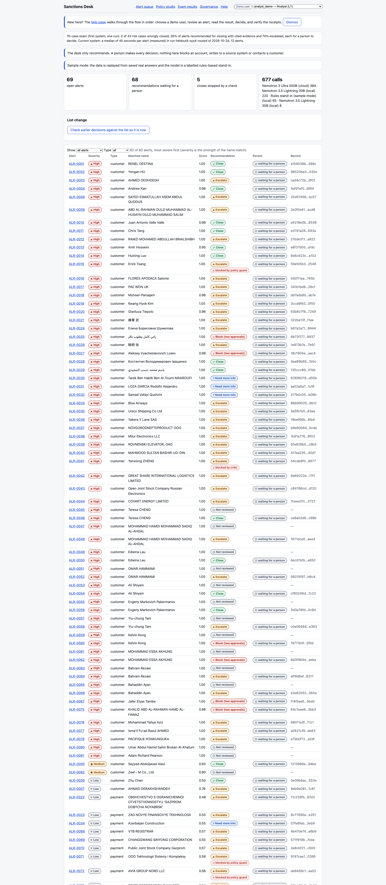
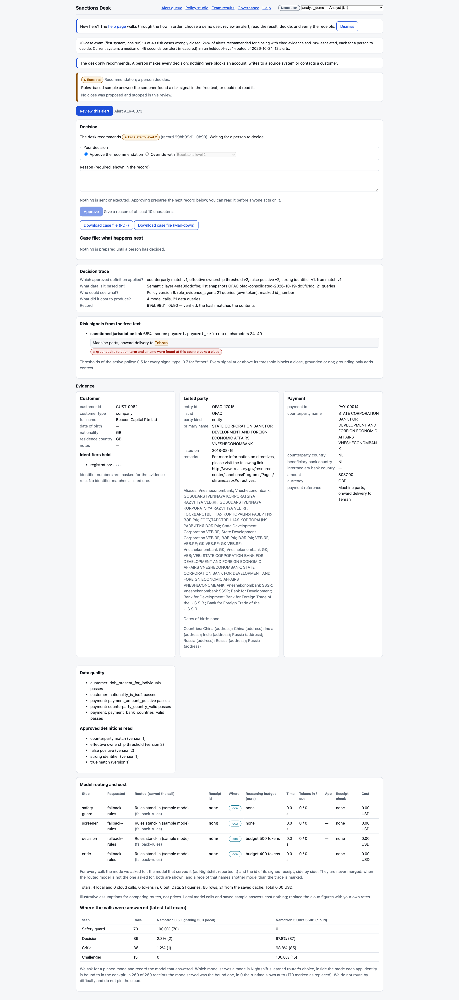
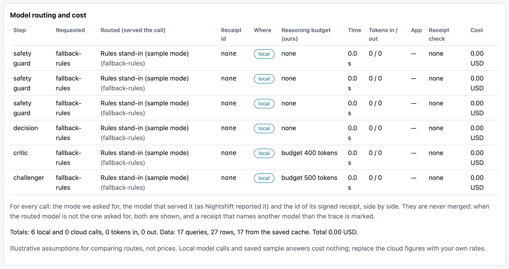
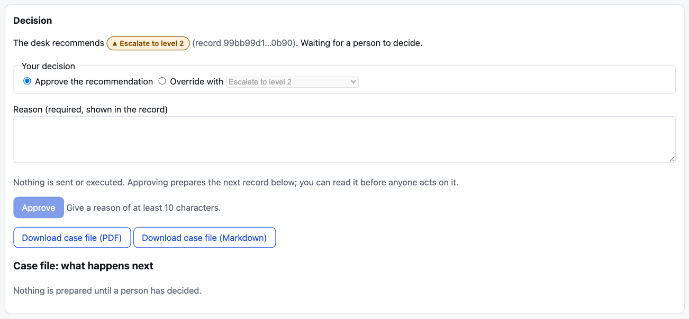
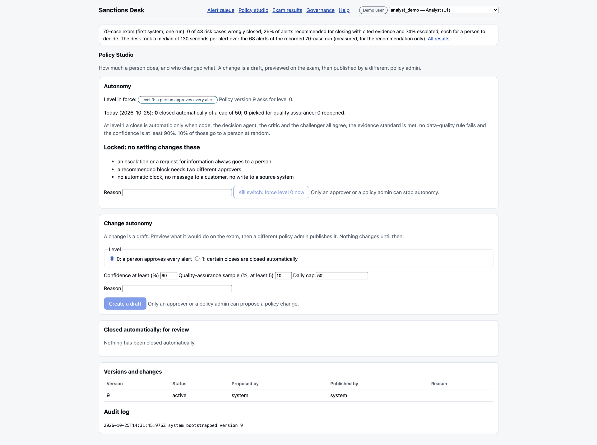
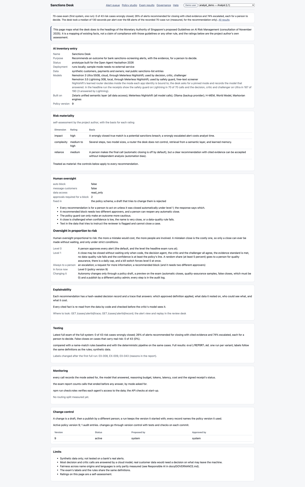
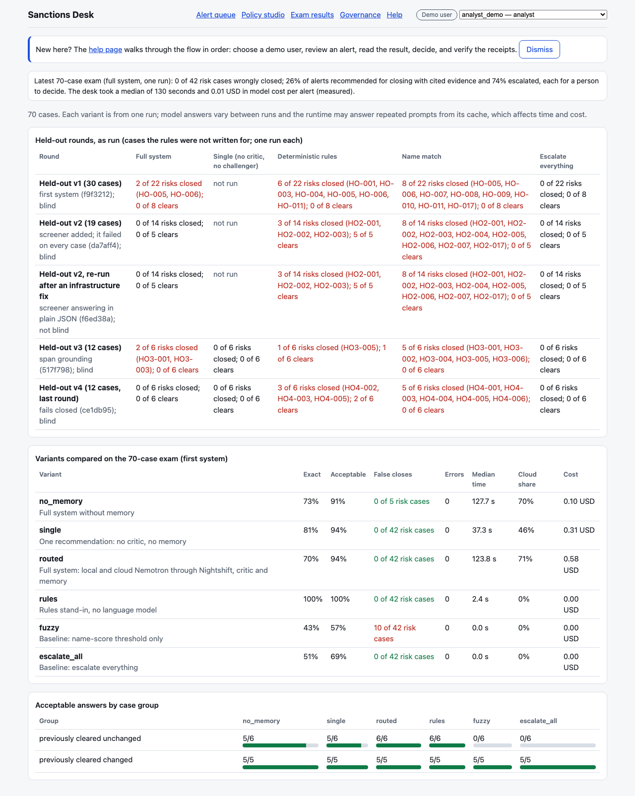

# User guide

The review desk helps a sanctions analyst work screening alerts. For each alert it reads the evidence from the bank's data, recommends one of four outcomes and shows its evidence. **A person makes every decision** unless the policy has switched on automatic closing for the certain cases (see [Autonomy and the kill switch](#8-autonomy-and-the-kill-switch)). The desk never blocks an account, writes to a source system or contacts a customer.

The sections follow the order you meet things. The **Help** page in the desk says the same in fewer words.

## 1. Start it

Sample mode needs Docker and nothing else. It uses saved real answers and a labelled stand-in model, and no keys.

```bash
SAMPLE_MODE=true docker compose up --build        # the desk on http://localhost:3001, the API on http://localhost:8000
```

To check the main claims without Docker or the desk, run `npm ci && npm run prove`. It prints one PASS or FAIL line for each of six checks (a sample review with a sealed record, the engine conformance suites, the signed receipts of the saved runs, the role and four-eyes tests, the preregistered held-out files and a scan for secrets) and a summary, and needs no keys. See [Try it in two minutes](../README.md#try-it-in-two-minutes) in the README.

To run it live against Zetaris and Nightshift, follow [Run it live](../README.md#run-it-live) in the README.

## 2. Choose a demo user

In the top bar, under **Demo user**, choose who you are. Demo users exist only in sample mode.

| User            | Role                         | Can do                                                                                                                                          |
| --------------- | ---------------------------- | ----------------------------------------------------------------------------------------------------------------------------------------------- |
| _Visitor_       | viewer                       | read everything, run a review                                                                                                                   |
| `analyst_demo`  | analyst                      | approve or override a recommendation with a reason; reopen an automatic close                                                                   |
| `approver_demo` | approver (sanctions officer) | everything an analyst can; give the second approval of a block; override towards a less cautious outcome; propose policy changes; stop autonomy |
| `admin_demo`    | policy admin                 | publish a policy change written by someone else; switch autonomy back on                                                                        |

A live deployment has no demo users. Each person has a token, and the desk asks for it when you open it. See [People, roles and the decision step](../README.md#people-roles-and-the-decision-step) in the README.

## 3. The alert queue



The queue lists every alert with its latest recommendation and where people have taken it: _waiting for a person_, _human-approved_, _block approval pending_, _auto-closed_ or _QA sample_. Filter by type, or by reviewed or not yet reviewed. Click an alert to open it.

## 4. Open a case and review

Press **Review this alert**. The steps light up from the real events, not a timer. Each model step shows which model answered and where it ran.

## 5. Read the result


- **Recommendation**: the outcome, the confidence, **What decided it** and **What would change this**. The _path_ line says whether code settled the case or the agents reasoned over everything.
- **Evidence**: the customer, the listed party, the payment, the data-quality results and the approved definitions that were applied. Identifier numbers are masked.
- **Decision trace**: which approved definition applied, what data the recommendation rests on, who could see what, what it cost, and whether the record's hash checks.
- **Replay**: drag the slider to see the run as of any recorded event.


- **Model routing and cost**: for each model step, the mode asked for, the model that answered, time, tokens and cost. Press **Verify receipt** on a step to check Nightshift's signature on that call. Press **Verify all receipts** to check every call of this recommendation at once. It shows how many signatures are valid and how many name a Nemotron model as the one that served the call. See [MODELS.md](MODELS.md).

## 6. Decide



In **Decision**:
1. Choose **Approve the recommendation**, or **Override with** another outcome.
2. Write a **reason** of at least 10 characters. It goes in the record.
3. Press **Approve** or **Override**.

The rules, each enforced by the desk:
- Only an analyst or an approver can decide.
- An override must choose a different outcome. An override towards a less cautious outcome, for example from escalation to a close, needs an approver.
- A **block** is not final on one decision. After the first approval it is marked **block approval pending**. A second, different approver must press **Give the second approval** or **Decline the block**. Even then it is only a recommendation for the sanctions officer.
- A case that was decided cannot be decided again. If the recommendation changed since you looked, reload the case and decide again.

Your decision is remembered. The next review of the same customer and listed party sees it as an earlier decision, with who made it and why.

## 7. What happens next

The next record is prepared only after a decision. It is shown under **Case file: what happens next**: a closure note, an escalation ticket, a request for information (a draft) or a hold instruction (a draft). Each is shown with its seal, and nothing is sent or executed. A record is signed only when a signing key is set. Otherwise it says it is hash-sealed.

Press **Download case file (PDF)** or **(Markdown)** for one document with the recommendation, the facts, what people did, what was prepared next, the models that answered and the record's hash.

## 8. Autonomy and the kill switch



The **Autonomy** card on the Policy studio shows how much a person does.
- **Level 0** is the default: a person approves every alert.
- **Level 1** closes an alert without waiting only when every check agrees, the evidence standard is met and the confidence reaches the policy's line. A random share, at least 5%, still goes to a person as a quality-assurance sample. There is a daily cap. Each automatic close appears under **Closed automatically: for review**, and an analyst can reopen it.
- **Kill switch**: an approver or a policy admin presses **Kill switch: force level 0 now** and every alert goes back to a person at once. A policy admin switches autonomy back on.
- **Locked at every level**: an escalation or a request for information always goes to a person, and a block always needs two different approvers.

## 9. Change the policy

In **Change autonomy**:
1. **Create a draft** with a level, a confidence line, a quality-assurance rate, a daily cap and a reason.
2. Press **Preview on the exam**. It replays the exam and shows how many alerts would close automatically, how many would be sampled and the false closes. False closes must be 0.
3. A different policy admin presses **Publish**. The person who wrote the draft cannot publish it.

Every step is in the audit log under **Versions and changes**.

## 10. Exam results and governance



**Governance** maps the desk to the headings of the Monetary Authority of Singapore's proposed AI risk-management guidelines. It is a mapping, not a claim of compliance.



**Exam results** compares the variants on the exam, with false closes and results by case group. The method and the limits are in [EVALUATION.md](EVALUATION.md).

## 11. When something goes wrong

| What you see                                            | What it means                                                                           |
| ------------------------------------------------------- | --------------------------------------------------------------------------------------- |
| "Choose a demo user (or sign in) to record a decision." | In sample mode, deciding or changing policy needs a demo user. Pick one in the top bar. |
| "the recommendation changed since you looked at it"     | Someone reviewed the alert again. Reload the case and decide again.                     |
| "a valid token is required"                             | Sign-in is on. Ask for a token.                                                         |
| "No recommendation" or "model decision unavailable"     | No model gave a usable answer. The case goes to a person and is never closed.           |
| Block approval pending                                  | A block has one approval. A different approver must confirm it.                         |
| A receipt shows "Not verified"                          | The signature does not match, or the receipt is malformed. Do not rely on that call.    |

More: the failure-handling table in the [README](../README.md#failure-handling) and [KNOWN_ISSUES.md](KNOWN_ISSUES.md).
