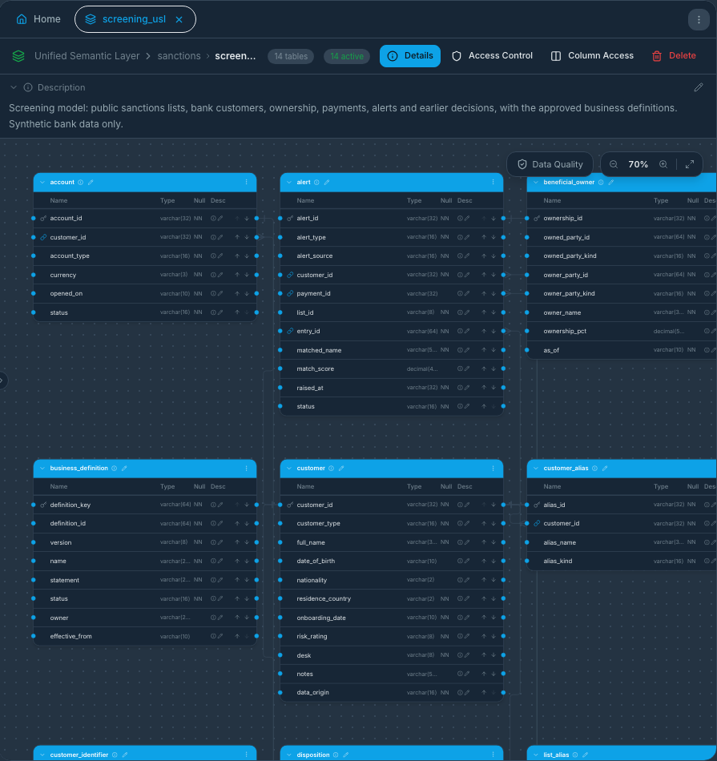
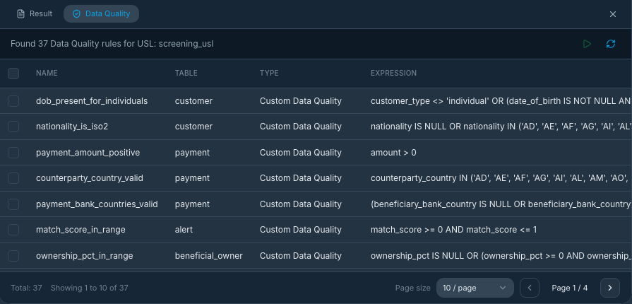
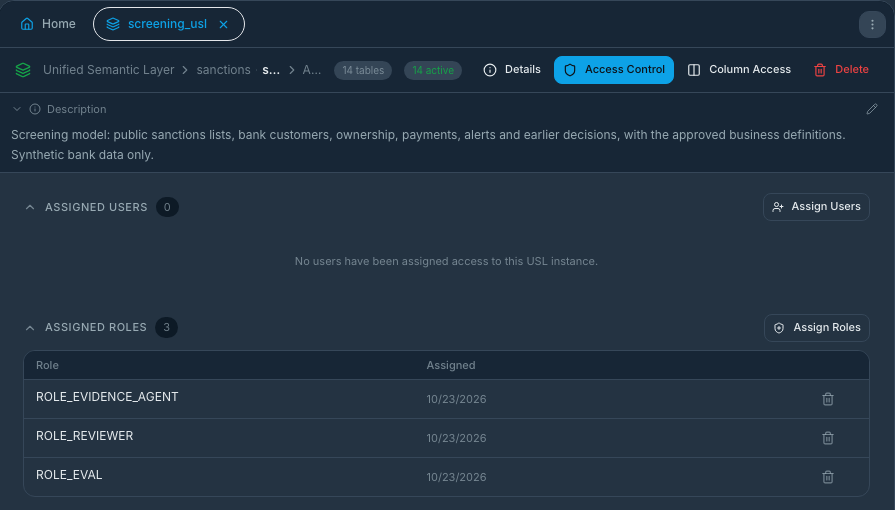
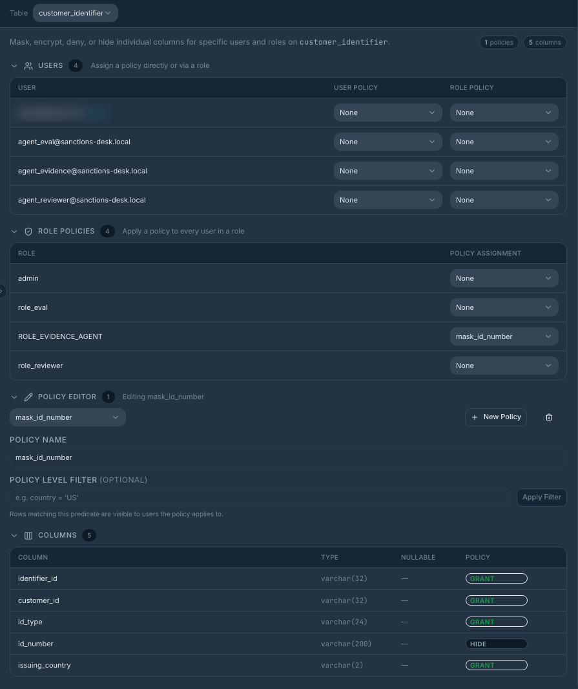

# How the desk uses Zetaris

Zetaris is the only way the application reads data. The review agents never open a data file or connect to the bank database or the payments service: they send one SQL statement at a time to the Zetaris REST API, and Zetaris answers from the semantic layer. This page follows Zetaris's own checklist (1a to 2c); every number was read from the running instance, with synthetic data only. The data counts in 1a, 1b, 1c and 2c (customers, alerts, payments, identifiers, definitions) were read live before held-out v2 to v4 were loaded; the data files hold more rows than these counts.

## Zetaris checklist

| Item | What it asks                                                                                    | Where it is proved                                                                                                                                                               | Command                        |
| ---- | ----------------------------------------------------------------------------------------------- | -------------------------------------------------------------------------------------------------------------------------------------------------------------------------------- | ------------------------------ |
| 1a   | Use case and 3+ data sources                                                                    | [1a below](#1a-use-case-and-data-sources)                                                                                                                                        |                                |
| 1b   | Each source: onboarding, a check, 2 to 3 exploratory queries with real results                  | [1b below](#1b-each-source-onboarding-check-and-exploratory-queries), queries in [zetaris/queries/](../zetaris/queries/), answers in [RESULTS.md](../zetaris/queries/RESULTS.md) | `npm run zetaris:queries`      |
| 1c   | The USL: full DDL, queries that prove it is active, data-quality rules with real output         | [1c below](#1c-the-unified-semantic-layer), [zetaris/usl/](../zetaris/usl/)                                                                                                      | `npm run zetaris:usl`          |
| 2a   | Time saved against hand-coding, **bonus**: a hand-coded equivalent with line counts             | [2a below](#2a-time-saved-against-hand-coding), [compare/hand-coded/](../compare/hand-coded/)                                                                                    | `npm run compare:hand-coded`   |
| 2b   | How the USL helps real work, **bonus**: a concrete project with a forecast                      | [2b below](#2b-how-the-usl-helps-in-real-work)                                                                                                                                   |                                |
| 2c   | A requirement for Zetaris from our pain points, **bonus**: a proposed syntax and a working mock | [2c below](#2c-a-requirement-for-zetaris), [zetaris/proposals/](../zetaris/proposals/)                                                                                           | `npm run usl:policy -- --demo` |

The live commands need Zetaris running and the admin key in `.env` (read inside the tool, never printed). They only read. `npm run zetaris:queries -- --write` refreshes the saved answers.

## 1a. Use case and data sources

**Use case.** A bank's screening system raises an alert when a customer or a payment party looks like a listed (sanctioned) party. An analyst must decide whether it is a true match, a false positive, or needs more information, and must justify the answer. The evidence for one alert sits in **three different systems** that nobody has joined: the lists, the bank's customer records, and the payments. The desk's agents need all three in one governed place, with the approved wording of "true match" and "false positive" next to them. Zetaris provides that place.

| #   | Source                                                                                                                                                                           | Kind in Zetaris                                                                                                                               | What it holds                                                                                                                                           | Why the desk needs it                                                  |
| --- | -------------------------------------------------------------------------------------------------------------------------------------------------------------------------------- | --------------------------------------------------------------------------------------------------------------------------------------------- | ------------------------------------------------------------------------------------------------------------------------------------------------------- | ---------------------------------------------------------------------- |
| 1   | **Public sanctions lists** (real OFAC and UN entries, 365, with a labelled synthetic update to 6 of them (5 edited, 1 removed); see below) and the approved business definitions | File-store (NDP) tables over JSON files: `list_entry`, `list_alias`, `list_dob`, `list_country`, `list_identifier`, `business_definition`     | Listed parties with aliases, dates of birth, countries, identifiers; seven approved definitions in versions                                             | The other side of every comparison, and the rules a decision must cite |
| 2   | **Synthetic bank database** (Postgres)                                                                                                                                           | JDBC data source, read-only login: `customer`, `customer_identifier`, `customer_alias`, `account`, `beneficial_owner`, `alert`, `disposition` | 340 customers, their identifiers, aliases, accounts, ownership register, 112 alerts, earlier decisions (read live before held-out v2 to v4 were loaded) | Who the customer is; what the alert says; what was decided before      |
| 3   | **Synthetic payments service**                                                                                                                                                   | REST table, cached: `payment`                                                                                                                 | 366 payments (read live before held-out v2 to v4 were loaded) with counterparty, countries, status                                                      | Whether money is waiting on the alert, and who is paid                 |

All three are compiled into one model, `lightning.metastore.sanctions.screening_usl` (14 tables). The agents read only that model. Nothing else is read, and no real customer data is used. The instance also holds a file copy of the bank (`sanctions_bank_files`, 8 tables), registered only as a fallback for when the database or the payments service cannot be reached, and Zetaris's own sample databases (`NY_TAXI`, `TPCDS_DB`); that is why the Zetaris home page shows 6 sources and 62 tables ([at a glance](#zetaris-at-a-glance)).

## 1b. Each source: onboarding, check and exploratory queries

The queries are plain files under [zetaris/queries/](../zetaris/queries/) (`lists/`, `bankdb/`, `payments/`, `usl/`), each with the question it answers. One command runs them all, or one folder:

```bash
npm run zetaris:queries                 # all 14
npm run zetaris:queries -- bankdb       # one source
```

The tool accepts only `SELECT`, `SHOW`, `RUN DQ`, `LIST` and `LOAD`. The answers below are from [RESULTS.md](../zetaris/queries/RESULTS.md), a live run.

### Source 1: sanctions lists (file store)

- **Onboarding.** `npm run zetaris:load-files` places the JSON files in the Zetaris file store (folder `sanctions`), then [01_lists_create.sql](../zetaris/sql/01_lists_create.sql) creates a Lightning database and one `CREATE LIGHTNING FILESTORE TABLE` per file (7 lines of SQL).
- **What the list entries are:** the 365 list entries in Zetaris are real entries from public lists: a fixed subset of 366 chosen by `npm run data:sample` from the OFAC SDN list, the OFAC consolidated list and the UN consolidated list (each list's issue date and the download are recorded in [data/sample/manifest.json](../data/sample/manifest.json)). Before they are loaded into Zetaris, a labelled synthetic update (`data/synthetic/list-delta.json`) edits 5 of them (dates of birth replaced on 3, an identifier added to 2) and removes 1, so that a list change can be shown; that is why Zetaris holds 365 entries, not 366.
- **Test cases:** The 70 exam cases and the 73 held-out cases are synthetic alerts (ALR-0001 to ALR-0082 for the exam and sample alerts; ALR-H, ALR-J, ALR-K and ALR-L for held-out v1 to v4) whose customers, accounts, owners, alerts and payments are rows of the synthetic bank written by `npm run data:synthetic`, loaded into the Postgres bank database (read by Zetaris over JDBC) and the payments service (read by Zetaris as a REST table). In a live run the review reads each case only through the Zetaris semantic layer `screening_usl` (`alert`, `customer`, `customer_identifier`, `customer_alias`, `account`, `beneficial_owner`, `payment`, `disposition`, the list tables and `business_definition`); the case files in `eval/cases/` hold only the alert id and the expected outcome, which the runner uses to choose the alert and to score the answer, and never pass to the review.
- **Check that it works.** [01_lists_select.sql](../zetaris/sql/01_lists_select.sql) counts each table: 6 definitions (7 with the ownership definition's version 2), 365 entries, 1,334 aliases, 188 dates of birth, 759 countries, 492 identifiers.
- **Exploratory queries.**

| Question                                         | SQL (shortened)                                                                                            | Real result                                                                                                          |
| ------------------------------------------------ | ---------------------------------------------------------------------------------------------------------- | -------------------------------------------------------------------------------------------------------------------- |
| How much does the source hold, and who is on it? | `SELECT list_id, party_kind, COUNT(*) FROM sanctions_lists.list_entry GROUP BY list_id, party_kind`        | OFAC: 125 individuals, 177 entities, 9 vessels, 2 aircraft; UN: 35 individuals, 17 entities                          |
| Why is name matching alone weak?                 | `... list_entry e JOIN list_alias a ON a.entry_id = e.entry_id GROUP BY ... ORDER BY aliases DESC LIMIT 3` | One bank is listed under 124 names, others under 60 and 52                                                           |
| Which approved definitions are in force?         | `SELECT definition_id, version, status FROM sanctions_lists.business_definition`                           | 6 rows, read live before held-out v2 to v4 were loaded, including `false_positive` in versions 1 and 2, all approved |

### Source 2: bank database (JDBC)

- **Onboarding.** [03_bankdb_create.sql](../zetaris/sql/03_bankdb_create.sql): one `CREATE DATASOURCE` with the Postgres driver and a **read-only** login (the password is filled from the environment when the script runs, never stored), then `REGISTER DATASOURCE TABLES` (8 lines).
- **Check.** [03_bankdb_select.sql](../zetaris/sql/03_bankdb_select.sql), read live before held-out v2 to v4 were loaded: 340 customers, 277 identifiers, 53 aliases, 369 accounts, 21 ownership rows, 112 alerts, 13 earlier decisions.
- **Exploratory queries.**

| Question                                 | SQL (shortened)                                                                                               | Real result                                                |
| ---------------------------------------- | ------------------------------------------------------------------------------------------------------------- | ---------------------------------------------------------- |
| How many customers of each type?         | `SELECT customer_type, COUNT(*) FROM sanctions_bankdb.customer GROUP BY customer_type`                        | company 71, individual 269                                 |
| What is waiting for review?              | `SELECT status, COUNT(*), MIN(match_score), MAX(match_score) FROM sanctions_bankdb.alert GROUP BY status`     | open 99 (scores 0.426 to 1.0), closed 11, escalated 2      |
| Which individuals have no date of birth? | `SELECT customer_id ... WHERE customer_type = 'individual' AND (date_of_birth IS NULL OR date_of_birth = '')` | 15 rows, for example `CUST-0020`, `CUST-0030`, `CUST-0031` |

### Source 3: payments service (REST)

- **Onboarding.** [04_payments_create.sql](../zetaris/sql/04_payments_create.sql): a Lightning database, a `CREATE LIGHTNING REST TABLE` for `GET /payments` with the `x-api-key` header filled from the environment, then `CACHE TABLE` so repeated reads do not call the service again (9 lines).
- **Check.** [04_payments_select.sql](../zetaris/sql/04_payments_select.sql): 366 payments.
- **Exploratory queries.**

| Question                            | SQL (shortened)                                                                                      | Real result                                                               |
| ----------------------------------- | ---------------------------------------------------------------------------------------------------- | ------------------------------------------------------------------------- |
| How many payments, in which status? | `SELECT status, COUNT(*) FROM sanctions_payments.payments_raw GROUP BY status`                       | pending 366                                                               |
| Where does the value go?            | `SELECT counterparty_country, COUNT(*), SUM(CAST(amount AS DOUBLE)) ... ORDER BY total DESC LIMIT 3` | GB 40 payments (5.51 million), NL 42 (4.40 million), HK 33 (3.63 million) |
| What could still be held?           | `SELECT COUNT(*), SUM(CAST(amount AS DOUBLE)) ... WHERE status = 'pending'`                          | 366 payments, 41.66 million                                               |

The REST service returns every value as a string, so each query casts explicitly (`CAST(amount AS DOUBLE)`).

## 1c. The Unified Semantic Layer

- **Full DDL.** [zetaris/usl/screening_usl.ddl](../zetaris/usl/screening_usl.ddl): 14 `CREATE TABLE` statements with keys and foreign keys (144 lines). Table and column descriptions, which the agents read with `LOAD USL`, are in [descriptions.sql](../zetaris/usl/descriptions.sql) (131 statements). Both are generated from one specification, [usl-spec.ts](../packages/zetaris/src/usl-spec.ts), and a test checks the specification against the data files table by table and column by column.
- **Data-quality rules.** [zetaris/usl/dq_rules.sql](../zetaris/usl/dq_rules.sql): eight custom rules; 37 rules are registered in all, the other 29 are the key constraints Zetaris adds itself (14 primary-key and 15 foreign-key).
- **Queries that prove it is active** ([zetaris/queries/usl/](../zetaris/queries/usl/)), each one statement across sources:

| Joins                                                        | SQL (shortened)                                                                       | Real result                                                                                    |
| ------------------------------------------------------------ | ------------------------------------------------------------------------------------- | ---------------------------------------------------------------------------------------------- |
| Alert, customer (bank) and listed party (lists)              | `alert a JOIN customer c ... JOIN list_entry e ...`                                   | ALR-0001 is CUST-0001 against listed "RENEL DESTINA" (UN); ALR-0002 against "Yongan HU" (OFAC) |
| Pending payments (payments) of customers with alerts (bank)  | `alert a JOIN payment p ON p.customer_id = a.customer_id WHERE p.status = 'pending'`  | 27 customers, 32 payments, 1,145,678.70                                                        |
| All three: payments to a country the listed party is tied to | `alert JOIN payment JOIN list_country ON entry_id AND country = counterparty_country` | RU 5, CN 1, IR 1                                                                               |
- **Data quality with real output.** `RUN DQ <rule> TABLE ...screening_usl.<table>` returns total, valid and invalid:

| Rule                           | Table            | Rows | Valid | Invalid |
| ------------------------------ | ---------------- | ---: | ----: | ------: |
| `dob_present_for_individuals`  | customer         |  340 |   325 |  **15** |
| `nationality_is_iso2`          | customer         |  340 |   339 |       1 |
| `ownership_pct_present`        | beneficial_owner |   21 |    20 |       1 |
| `ownership_pct_in_range`       | beneficial_owner |   21 |    21 |       0 |
| `counterparty_country_valid`   | payment          |  366 |   362 |       4 |
| `payment_amount_positive`      | payment          |  366 |   366 |       0 |
| `payment_bank_countries_valid` | payment          |  366 |   366 |       0 |
| `match_score_in_range`         | alert            |  112 |   112 |       0 |

`SHOW DQ ALL INVALID TABLE ...customer` returns the 15 failing records (the same ones the bank query above lists). The Evidence step reads the failing records of the customer and the payment in the case. A failing record cannot support a close, with one exception: an individual's missing date of birth, when a note that meets the documentary standard, with its document on the customer's record, supplies the date (the failing rule stays on the record as a flag): the policy guard turns it into "need more information". A missing ownership percentage is "unknown", not zero. (With only the main 70-case data loaded, three customers fail the date-of-birth rule; the others are the held-out cases.)

**One command reproduces it:** `npm run zetaris:usl` checks that the committed DDL still matches the specification, shows that the model lists its tables, counts the registered rules, and runs all eight rules. The joins run with `npm run zetaris:queries -- usl`.

**Access to the model is set in the Zetaris interface, in three steps** (a fourth hides the identifier column; the full list and the checks are under [Access control](#access-control)):
1. **Management → Permissions:** give each role (`ROLE_EVIDENCE_AGENT`, `ROLE_REVIEWER`, `ROLE_EVAL`) the **View** permission on **Unified Semantic Layer**.
2. **Data Product → Unified Semantic Layer → the namespace → Access Control:** assign the three roles.
3. **The model (`screening_usl`) → Access Control:** assign the three roles and tick `SELECT` on every table.

**A rebuild of the model creates a new id and empties steps 2 and 3**, because the access list belongs to the model's id; step 1 stays. After any rebuild, redo them and run `npm run check:roles`, which makes the evidence, reviewer and eval roles, and each step role that has a token, read the model with their own tokens and names who is refused; `npm run check:step-roles` also checks every table each step role must be refused.

## 2a. Time saved against hand-coding

This is a like-for-like comparison. [compare/hand-coded/](../compare/hand-coded/) does the same three joins and the same eight rules without Zetaris, **and gives the same guarantees our Zetaris path gives the agents**: per-role access where the evidence role cannot see `id_number`, shared definitions and table and column descriptions, a rule registry with a run history, caching of the REST source, retries and timeouts, and an audit of which identity read which table. `npm run compare:hand-coded` runs it (in a container on the same network, because the databases are not published to the host) and prints the same numbers as the Zetaris path, including RU 5 and 15 customers without a date of birth ([RESULT.txt](../compare/hand-coded/RESULT.txt)). `check.mjs` proves the guarantees: the hidden column, a refused read, the audit lines, the retry and the cache hit.

### Lines of code, per concern

Counted by `tools/count-lines.mjs` (no blank or comment-only lines, after the formatter). "Zetaris path" is what we wrote to get the same thing on the semantic layer.

| Concern                                                               |                    Hand-coded (lines of code) |                                                                  Zetaris path: SQL or DDL lines |                                                         Zetaris path: application code |
| --------------------------------------------------------------------- | --------------------------------------------: | ----------------------------------------------------------------------------------------------: | -------------------------------------------------------------------------------------: |
| Connectors (connect, authenticate, read, parse, retries and timeouts) |      50 (`connectors.mjs` 38, `retry.mjs` 12) |                                                                       23 (three source scripts) |                                                                                      0 |
| Joins (three)                                                         |                                            34 |                                                                          3 (one statement each) |                                                                                      0 |
| Data quality (8 rules, registry, run history)                         |                                            53 |                                                                           16 (2 lines per rule) |                                                                                      0 |
| Access control and masking                                            |                                            37 |           45 (3 roles and 42 table grants, generated) plus **4 steps in the Zetaris interface** | 9 (the mask in our adapter, because the platform's column policy is not enforced here) |
| Definitions and descriptions                                          |    11, plus 697 lines of descriptions as data |           144 lines of DDL and 131 description statements, all generated from one specification |                          135 (`metadata.ts`, which also checks the shape of the model) |
| Caching of the REST source                                            |                                            11 |                                                                               1 (`CACHE TABLE`) |                                                                                      0 |
| Audit (who read what)                                                 |                                            11 |                                                                                               0 |          88 (`audit.ts`, which matches our query ids with Zetaris's statement history) |
| **Total**                                                             | **207**, plus 44 of glue that runs the report | **43 hand-written** (23 + 3 + 16 + 1), and 320 generated (45 grants, 144 DDL, 131 descriptions) |                                                                                **232** |

How to read this:
- **The application-code column is large because we chose to do more**, not because Zetaris needs it: `metadata.ts` validates the model description and builds the agents' tools from it, `audit.ts` cross-checks every query id against the platform, and the mask exists only because the column policy is not enforced on this instance. A hand-coded version that wanted the same cross-check would need its own equivalent.
- **Access control is the one concern where Zetaris is not shorter.** The grants are generated SQL (45 lines), but four settings exist only in the interface and are lost on a rebuild (see "Access control" below). In the hand-coded version the same rule is 37 lines in the application, that anyone can review and test.
- **Not verified:** that Zetaris keeps a data-quality run history of its own; we rely on our own query records for it. **Verified:** the statement history is kept per user (64 of 64 statements of three live reviews found in the history of the step identity that ran them; [eval/studies](../eval/studies/README.md#the-live-step-role-reviews)).

### Time

| Step                                  | Hand-coded                                                                                                                        | Zetaris                                                                                                                                                  |
| ------------------------------------- | --------------------------------------------------------------------------------------------------------------------------------- | -------------------------------------------------------------------------------------------------------------------------------------------------------- |
| Run all of it once                    | 0.29 s wall clock, of which 0.03 to 0.06 s is the work (in memory); every run reads all rows again unless the REST cache is fresh | 0.1 to 1.0 s per query; 14 queries in about 3 s                                                                                                          |
| Onboard the three sources             | not applicable: the connector code is part of the program                                                                         | 3.0 s of statements (lists 1.8, bank database 0.4, payments and cache 0.7); placing the list files and creating the users are not in this number         |
| Compile and activate the model        | not applicable                                                                                                                    | 1.1 s (compile 0.3, activate 14 tables 0.8)                                                                                                              |
| Describe tables and columns           | a file, generated from the same specification                                                                                     | 3.9 s (131 statements)                                                                                                                                   |
| Register the rules                    | 4 lines per rule in code                                                                                                          | 2.0 s (8 rules)                                                                                                                                          |
| Roles and grants                      | the access table                                                                                                                  | 3.0 s (45 statements), then 4 interface steps that were done by hand and were not timed                                                                  |
| **All Zetaris onboarding statements** |                                                                                                                                   | **12.9 s** (`node tools/zetaris-timings.mjs`, from the setup logs of the real build; [ONBOARDING-TIMES.txt](../compare/new-source/ONBOARDING-TIMES.txt)) |

Time to write the code was not timed on either side, so no hours-saved figure is claimed. The statement times above are the latency the setup tool measured for each statement when the model was built.

### The new-source test

We brought in one more source on both paths: a synthetic internal watchlist (12 rows, [compare/new-source/](../compare/new-source/)), with its description, one rule (a valid country code; it finds 1 bad row) and read access for the evidence role.

|                                  | Hand-coded                                                                                                                                                | Zetaris path                                                                                                                                                                                                                                                                                |
| -------------------------------- | --------------------------------------------------------------------------------------------------------------------------------------------------------- | ------------------------------------------------------------------------------------------------------------------------------------------------------------------------------------------------------------------------------------------------------------------------------------------- |
| Code or definition lines written | 15 changed lines in 4 files (`access.mjs` 1, `dq.mjs` 4, `joins.mjs` 6, `run.mjs` 4), 31 lines of description data, 4 changed lines in the run script     | 14 lines (the table in the specification), 2 lines (the rule), and 2 lines of configuration that were not applied here: the evidence agent's table allow-list in the policy and the file list of `zetaris:load-files`                                                                       |
| Generated                        | none                                                                                                                                                      | 63 lines changed in 7 scripts (DDL, activation, grants, counts)                                                                                                                                                                                                                             |
| Agent code changed               | yes: the glue that reads the new table, 4 lines                                                                                                           | **0.** The evidence tools are built from the model's own description: `find_internal_watchlist` appears with no code (tools before: 8, after: 9; [RESULT.txt](../compare/new-source/RESULT.txt))                                                                                            |
| Wall clock                       | 30 s from the baseline to a passing run, including a failed first attempt; the edits were prepared in advance, so this is machine time, not thinking time | 0.66 s to render and compare the scripts. On the live instance the new table needs the model to be compiled again (the 12.9 s above, repeated) **and the four interface access steps to be done again**; we did not do this on the live model, because a rebuild empties its access control |

So adding a source is cheaper in lines for the agents on the Zetaris path, and not cheaper in effort at the platform: the model is rebuilt, and the access screens are redone. The hand-coded path pays in code that every agent shares.

### Where the gap grows, and where it does not

- **Where it is modest.** Three small sources and eight rules, one program, one team: 207 lines against 43 hand-written lines of SQL, and the hand-coded version is faster per run on 340 rows because it holds everything in memory.
- **More sources.** Each source in the hand-coded version is a connector with its own authentication, errors, paging and types; on the Zetaris path it is a few lines of SQL and a description, and every consumer sees it at once. The test above shows the agent side of that (0 lines against 4), not the cost of the platform steps.
- **More agents.** In the hand-coded version each agent that needs the data re-uses the access table and the readers, or copies them. On the Zetaris path an agent is a role and a token, and its tools come from the description.
- **More governance.** Masks, row filters, per-role grants, audit and a single set of definitions are the part that grows with the number of teams. It is also where the platform is weakest (item 2c): the controls are interface-only and a rebuild resets them.
- **What the hand-coded version cannot do.** It has no query engine: no pushdown, no joins across large tables, no plan to inspect, no other tools that can read the same layer. At 340 rows that does not matter; at millions it decides.

## 2b. How the USL helps in real work

**Where it helps a bank's compliance and KYC teams.**
- **Definitions in one place.** "True match", "false positive", "strong identifier" and the ownership threshold are rows in `business_definition`, versioned, and read by every consumer (here: every agent). A decision cites the id and version. When the wording changes, the version changes, and a test and the policy guard notice.
- **One governed read path.** The agents, the analysts' tools and the evaluation runs read the same model; each identity has a role with table grants. The application never holds a source password.
- **Audit.** Every query has an id that matches Zetaris's own statement history (in a live run all of a case's queries matched), so "what did the system read when it recommended this" has an answer that does not depend on the application's own log.
- **Data quality where the data is.** A failed rule is a fact the system can cite. Here it forces a person into the loop.

**Where it does not.** Column masking is only partly there (see 2c), a rebuild of the model resets who may read it, and everything returns as text. These are fixable, but on this build they cost manual steps and our own defences (an SQL guard, an adapter-side mask).

**One project that would benefit: periodic KYC review across core banking, CRM and a document store.** A retail bank reviews each customer on a cycle (every one, three or five years by risk). For each one, an analyst needs the core-banking account profile, the CRM relationship notes, and the identity documents, then checks them against sanctions and adverse-media lists.

Forecast, with the assumptions stated (they are assumptions, not measurements):
- 20,000 reviews a year; without the layer an analyst spends about 40 minutes per review, of which about 15 is finding and reconciling the data across the three systems (logging in, searching, copying, spotting that dates of birth disagree).
- With one semantic layer and its data-quality rules, the finding step drops to about 3 minutes (a query, plus the mismatches already flagged), saving about 12 minutes a review.
- 20,000 × 12 minutes = 4,000 hours a year, about two full-time analysts. If only half the reviews are touched in the first year, about one.
- The same layer lets an AI assistant prepare the case file for the analyst, which is what this desk does for sanctions alerts; the person still decides.
- Cost side: building and governing the layer is a project of its own (model design, definitions signed off by compliance, access review). We assume two to three months for a small team before the first review benefits, and the saving above is for the steady state.
- Sensitivity: if reconciliation is only 8 minutes per review, or the layer only removes half of it, the saving falls to about 1,300 hours a year. The case rests on how long reconciliation really takes, and that should be measured on a sample of reviews before committing.

## 2c. A requirement for Zetaris

_Written as a product manager to the Zetaris product team, from what we hit while building an agent system on the USL._

**Title: Access control as code on the Unified Semantic Layer.**

**The problem.** To let an AI agent read bank data safely, we need a role per agent, a scoped token, columns masked for that role, and rows limited when needed. On this build, the table grants and `ASSIGN USER` are SQL, but column policies, row access, the access-control lists, and token scope are screens only. A rebuild of the model creates a new internal id and **empties the access list**, so access that was set by hand stops working and every query fails until someone clicks through the screens again. A security control that cannot be reviewed in a pull request, cannot be re-applied by a script and silently disappears on rebuild does not belong in a regulated pipeline.

**User story.** As a platform engineer at a bank running AI agents on customer data, I want the roles, masks, row filters and agent tokens of a semantic layer to be declared next to its definition and applied by the same deployment, so that I can review them, version them, and know that a rebuild gives the same access as before.

**Acceptance checks.**
1. **Column masking and row filters in SQL and REST**, not only the UI. A mask can be a hide, a fixed value or a regular expression, per role, for example keep the last two characters: `********37`.
2. **Regex masking on USL tables.** On this build the only options are grant, deny or hide, and the HIDE we set on `customer_identifier.id_number` was not enforced for a `SELECT` through the role's own token on our instance.
3. **Access that survives a rebuild.** Either stable ids for the model so the access list stays attached, or grants, masks and filters declared in the DDL of the model and re-applied by the compile. After `COMPILE USL`, `check` shows the same access as before, without a manual step.
4. **`CREATE USER` in SQL**, with a role and an **agent-scoped token** (read only, one model, an expiry). On this build a user is `POST /users`, a token comes from the interface's own sign-in followed by `POST /auth/api-key`, which cannot be limited to read only.
5. **Typed values in REST results.** Numbers, dates and booleans arrive as JSON types or with a schema, not all as strings.
6. **Password change over REST.** On this build `PATCH /users/{email}` accepts the call and leaves the account unable to sign in, so we drop and recreate the user.
7. **Every one of the above is written to the statement history** with the identity that made the change.

**Why it matters for AI agents.** An agent is a user that never gets tired, never forgets a token in a file, and will read every column it is allowed to. The only defence is that "allowed" is narrow, explicit, reviewable and re-creatable. Without that, teams fall back to an admin key or to their own masking layer (which is what we did: a guard in our code and a mask in our adapter). With it, the semantic layer becomes the one place where "which agent may see what" is answered.

**Bonus: an example, with a working mock.**
- **Proposed syntax:** [zetaris/proposals/screening_usl.access.ddl](../zetaris/proposals/screening_usl.access.ddl), roles, scoped users, grants, a regex mask and a row filter, declared with the model:

```sql
CREATE USER agent_evidence ROLE role_evidence_agent TOKEN SCOPE READ_ONLY EXPIRES 90 DAYS;
GRANT SELECT ON ALL TABLES TO ROLE role_evidence_agent;
ALTER TABLE customer_identifier MASK COLUMN id_number REGEX '.(?=.{2})' REPLACE '*' FOR ROLE role_evidence_agent;
ALTER TABLE customer ROW FILTER FOR ROLE role_desk_emea WHERE desk = 'EMEA';
```

- **The mock:** `npm run usl:policy` ([access-proposal.ts](../packages/zetaris/src/access-proposal.ts), with tests) reads that file and prints, for each statement, how it is done on this build of the platform: by SQL (it prints the real `CREATE ROLE` and 14 `GRANT` statements), by REST, or only in the interface (the mask and the row filter, which it never attempts). `--apply` would run the SQL steps only, and we have not used it, because creating roles and grants needs approval and a rebuild would wipe the access screens. Of the 10 proposed statements, 6 can be done in SQL on this build and 4 cannot.
- **A result:** `npm run usl:policy -- --demo` ([RESULT.txt](../zetaris/proposals/RESULT.txt)) applies the proposal's mask and filter to real synthetic rows read through Zetaris: identifier numbers come out as `*******37` (9 characters), and a filter `desk = 'EMEA'` leaves 2 of the first 5 customers (114 of the 340 customers read live before held-out v2 to v4 were loaded are EMEA). That is what the platform would do natively; the mock does it in our code only to show the shape.

## Zetaris at a glance

Zetaris is the only data path. Three kinds of source meet in one Unified Semantic Layer (`lightning.metastore.sanctions.screening_usl`, 14 tables):
- **list files** in the Zetaris file store (OFAC and UN sample, business definitions),
- a **Postgres bank database** over JDBC with a read-only login (customers, ownership, alerts, earlier decisions),
- a **payments service** read as a REST table. The first system's runs read it live (the Zetaris cache of that table had been lost); the changed system's runs read it from the Zetaris cache, verified by stopping the service.

The Zetaris home page of this instance shows 6 sources and 62 tables: the desk's four (`sanctions_lists`, 6 tables from the file store; `sanctions_bankdb`, 8 tables over JDBC; `sanctions_payments`, 1 REST table; and `sanctions_bank_files`, an 8-table file copy of the bank kept only as a fallback for when the database or the payments service cannot be reached) plus Zetaris's own sample databases `NY_TAXI` (15 tables) and `TPCDS_DB` (24), which the desk does not use. The semantic layer takes 14 of these tables: the 6 list tables, 7 bank tables (the bank database's own `payment` table is not used) and the payments service's table as `payment`.

The agents read the model's own description at run time and build their read-only tools from it; each agent is limited by our SQL guard to its own tables and columns; failing data-quality records cannot support a close (one documented exception for a missing date of birth, in [docs/ZETARIS.md](#how-the-desk-uses-zetaris)); every query id is matched to Zetaris's own statement history. Zetaris checklist, item by item (sources and queries 1a to 1c, comparison with hand-coding 2a, benefit 2b, requirement and mock 2c): [docs/ZETARIS.md](#zetaris-checklist). Runnable proofs: `npm run zetaris:queries`, `npm run zetaris:usl`, `npm run compare:hand-coded`, `npm run usl:policy -- --demo`. Access control and the problems met: [Access control](#access-control) and [docs/KNOWN_ISSUES.md](KNOWN_ISSUES.md). Query plans: [docs/QUERY_PLANS.md](QUERY_PLANS.md).

Before a customer note counts as documentary evidence, the system checks in Zetaris that the document number it cites is on the customer's record: a count query under the document check's own read-only identity (or the evidence identity when that is not set up), the same way as the identifier match. No model sees the number; only a yes or no comes back, and a number that is not on file sends the case to "need more information" with that reason shown.

**In the Zetaris console** (read-only screenshots; the admin login is blurred):

<table>
<tr>
<td width="50%"></td>
<td width="50%"></td>
</tr>
<tr>
<td>The semantic layer <code>screening_usl</code>: 14 tables, all active</td>
<td>37 data-quality rules on it; a failing rule cannot support a close</td>
</tr>
<tr>
<td></td>
<td></td>
</tr>
<tr>
<td>The roles assigned to the semantic layer: evidence, reviewer and evaluation, and the five per-step roles</td>
<td>Column access on <code>customer_identifier</code>: <code>id_number</code> hidden for the evidence role (configured; this local edition does not enforce it, so the application masks it as well)</td>
</tr>
</table>

## Supporting detail

What follows is reference for the parts of the setup the checklist items above refer to.

## Roles, identities and tokens



The application never uses the admin account at run time. Each identity is a **non-admin** user with its own API token and its own table-level grants. Each review step that reads data has its own role, granted only the tables that step reads; the application's per-agent allow-lists stay as a second layer:

| Role                   | Identity used by                      | Tables granted                                                                                                                                                           |
| ---------------------- | ------------------------------------- | ------------------------------------------------------------------------------------------------------------------------------------------------------------------------ |
| `role_evidence_agent`  | the evidence step and the alert queue | every model table; identifier numbers masked by the application                                                                                                          |
| `role_ownership_agent` | the ownership step                    | `beneficial_owner`                                                                                                                                                       |
| `role_critic_agent`    | the critic's fact re-read             | 9 tables, and **no identifier table**: `business_definition`, `list_entry`, `list_alias`, `list_dob`, `list_country`, `customer`, `beneficial_owner`, `payment`, `alert` |
| `role_memory_agent`    | the memory step's pointer lookup      | `disposition` (the stale check compares the pointer with the `list_entry` hash the evidence step already read)                                                           |
| `role_document_agent`  | the document-on-record count          | `customer_identifier`                                                                                                                                                    |
| `role_rescreen_agent`  | the list-change re-check              | `disposition`, `list_entry`, `alert`, `payment`                                                                                                                          |
| `role_reviewer`        | people reviewing a case               | every model table in full                                                                                                                                                |
| `role_eval`            | evaluation runs                       | read-only                                                                                                                                                                |

The screener, matching, decision, challenger, policy guard and reporter read no data of their own. The per-step identities are optional: a step without its token (`ZETARIS_TOKEN_OWNERSHIP`, `_CRITIC`, `_MEMORY`, `_DOCUMENT`, `_RESCREEN`) reads as the evidence identity, and sample mode (no credential at all) always records the evidence identity, so sample answers and sealed records are the same either way. The roles and grants are in `zetaris/sql/10_step_roles_create.sql` (rollback: `10_step_roles_rollback.sql`).

**Checked against Zetaris itself** (`npm run check:step-roles -- --write`, straight to the REST API past the application's own allow-lists; result in `zetaris/step-roles-check.json`): each step identity reads every table it was granted (16 checks) and is refused every one of the 14 tables it was not granted (54 checks, each with `User '…' does not have privileges to execute 'SELECT' on USL table: …`; identifier tables are asked for `id_number` itself). Each identity also tried to write to a table it was granted with statements that touch no row even if allowed (`INSERT … SELECT … WHERE 1 = 0`, `DELETE … WHERE 1 = 0`): Zetaris refused all 10, and the row count was the same before and after (5 checks). The write refusals say the semantic-layer table does not support appends or deletes, so they show a step cannot write through Zetaris, not a permission check on writes. 85 of 85 checks passed (a narrower version of this check, with one ungranted table per step, passed 23 of 23). In three live reviews (ALR-0073, ALR-0043, ALR-L0007) every Zetaris statement in the sealed records was found in the statement history of the identity that should have run it: 64 of 64, with ownership, critic, memory and the document check each under their own identity (records, receipts and the saved check, read again from each identity's own history: [eval/studies/step-role-reviews](../eval/studies/README.md#the-live-step-role-reviews); a record's `role` field is the masking role, not the identity).

`npm run zetaris:rebuild` creates the roles and the grants and puts the three users in their roles. The users and their tokens are made by one command, which needs only the admin key:

```bash
npm run zetaris:agents                 # lists what it would do
npm run zetaris:agents -- --apply      # creates agent_evidence, agent_reviewer and agent_eval, assigns the roles, issues a token each
npm run zetaris:agents -- --steps --apply   # the five step users only; the three above are not touched
```

For each user it creates the account at the GENERAL level through `POST /users` (there is no SQL to create a user) with a random password that exists only in memory, assigns the role, signs in once through the web interface's own sign-in call, asks for an API key (`POST /auth/api-key`, valid 90 days) and writes it to `.env` as `ZETARIS_TOKEN_EVIDENCE`, `ZETARIS_TOKEN_REVIEWER` or `ZETARIS_TOKEN_EVAL`. Passwords and keys are never printed or logged. A password cannot be changed over REST (`PATCH /users/{email}` accepts the call and leaves the account unable to sign in), so a user whose password is unknown is dropped and created again.

### The note's document number: which identity reads `customer_identifier.id_number`

When a customer note meets the documentary standard and cites a document number, the evidence step runs one count:

```sql
SELECT COUNT(*) AS n FROM <namespace>.screening_usl.customer_identifier ci WHERE ci.customer_id = '<customer>' AND regexp_replace(upper(ci.id_number), '[^A-Z0-9]', '') = '<normalised number from the note>'
```

It runs under the **document** identity (`agent_document`, role `role_document_agent`, granted only `customer_identifier`) when its token is configured, as in this setup, and otherwise under the evidence identity (`agent_evidence`, role `role_evidence_agent`); either way it goes through the evidence step's scoped client (`policy.agentAccess.evidence`), the only agent scope that lists `customer_identifier` without denying `id_number`; the critic and every other step deny that column. Only the count comes back. The number is in the statement sent to Zetaris and nowhere else: the trace and the decision record keep a SHA-256 hash of the normalised number and the statement with the number replaced. Like the identifier overlap join, it names `id_number` in a condition, so if the platform starts enforcing HIDE on that column for this role, the count must move to a role that may see the column; check it then. In sample mode the count has no saved answer until `npm run sample:record` is run again against a live Zetaris; until then the check fails closed ("not verified") and the note is not treated as documentary.

Masking `customer_identifier.id_number` for `role_evidence_agent` is a setting in the Zetaris interface (access-control screens); there is no SQL or REST call for it.

Until a role has its own token, the adapter uses `ZETARIS_API_KEY` as a **labelled fallback**: every query record says `token_source: fallback`, and the decision trace shows it. The identifier numbers are masked by the adapter; the Zetaris column policy that would hide them is configured but not enforced on this local edition, so there is one layer. A customer identifier is compared with a listed one by a join **inside Zetaris**; where the evidence step reads the identifier rows, the clear value reaches only the adapter, which masks it before any agent, model, trace or record sees it, and the decision model receives the masked form (the last two characters).

## Access control

The three runtime users read the model with their own tokens. Getting there needed four settings that exist only in the Zetaris interface, and that a rebuild of the model partly undoes:
1. **Management → Permissions:** give `ROLE_EVIDENCE_AGENT`, `ROLE_REVIEWER` and `ROLE_EVAL` the **View** permission on **Unified Semantic Layer**. Without it every read fails with `User '...' does not have access to USL: metastore.sanctions.<table>`, whatever grants exist; this was the missing step.
2. **Data Product → Unified Semantic Layer → the namespace (`sanctions`) → Access Control:** assign the three roles.
3. **The model (`screening_usl`) → Access Control:** assign the three roles and tick `SELECT` on all 14 tables.
4. **`customer_identifier` → Column Access:** a policy that sets `id_number` to HIDE for `ROLE_EVIDENCE_AGENT` only. This edition offers GRANT, DENY and HIDE for columns of a model table, and no pattern mask such as `******56`.

**The five step roles** were set up the same way: `CREATE ROLE` and one `GRANT SELECT ON USL TABLE` per table in SQL; then, in the console, the **View** permission on Unified Semantic Layer and the namespace and model Access Control assignments. The console saves these with REST calls (`POST /urm/resources/roles/{id}`, `POST /access-control/assign/role/usl-namespace`, `POST /access-control/assign/role/usl`), and each was read back with the matching `GET` before the users were created. The SQL grants alone did not put the roles on the namespace or model access lists.

**A rebuild resets steps 2 and 3.** The access list belongs to the model's internal id, and rebuilding creates a new model with an empty list; the role-level permission in step 1 stays. Failures seen during setup came from access set on a model that was then rebuilt. The roles' SQL grants (`08_access_create.sql`) are re-applied by the rebuild, but the Access Control list is not.

**It cannot be scripted.** In sections 20 and 21 of the Lightning SQL command reference, `LIST ... FOR`, `ASSIGN` and `REVOKE` accept data sources, databases, data marts, pipelines and streaming sources but not a Unified Semantic Layer, and there is no REST call. `GRANT SELECT ON USL TABLE` writes a different store from the one the check reads, so it does not help. The steps above are therefore the documented procedure, and the repository checks the result instead:
- `npm run check:roles` makes the evidence, reviewer and eval identities, and each of the five step identities that has a token, read the model (a step identity reads a table it was granted), each with its own token, and exits with an error naming who is refused and the four steps above. `npm run zetaris:rebuild` runs it last.
- **The API checks at start-up.** A live run (not sample mode) with role tokens reads the model once as each of those three identities. If one is refused, the API logs the steps and does not start. Set `zetaris.requireRoleAccess` to `false` to turn this off.
- **The five step identities** (ownership, critic, memory, document on record, list change) are covered by `npm run check:step-roles` only. Neither the start-up check nor `npm run zetaris:rebuild` tests them, and the rebuild does not re-run `10_step_roles_create.sql`, so after a rebuild re-apply the step roles (`10_step_roles_create.sql` and the console steps above) and run `npm run check:step-roles`; otherwise a step identity could be refused during a review with no start-up error.
- **No admin fallback by default.** `zetaris.fallbackOnDenied` is `false`: a refused role token is an error. Setting it to `true` retries once with the admin key, visibly (`token_source: fallback`), which is useful only while access is being set up.

Do not run `npm run zetaris:agents -- --apply` after the access is set: it drops and recreates the users and discards what was assigned to them.

### Checks on the development instance

`npm run test:live` (`packages/zetaris/test/live/roles.live.test.ts`) runs raw REST calls, bypassing the application's own guard on purpose. Last result: 13 checks pass and one is an expected failure.

| Check                           | evidence                                             | reviewer | eval     |
| ------------------------------- | ---------------------------------------------------- | -------- | -------- |
| Signs in with its own token     | yes                                                  | yes      | yes      |
| Reads every table of the model  | yes                                                  | yes      | yes      |
| `CREATE`, `DROP`, `GRANT`       | refused: "User is not permitted to run this command" | refused  | refused  |
| Reads a table outside the model | refused                                              | refused  | refused  |
| `id_number` in clear            | **still returned**                                   | returned | returned |

The one gap is the column policy (configured but not enforced by this local edition): with HIDE set for the evidence role, a `SELECT id_number` through that role's token still returns the clear value on this instance. The test for it is written the way it should behave and marked as an expected failure, so it starts failing when the platform enforces the policy. Until then the application hides the number itself: the evidence step masks it in the adapter (it comes back as `******56`), a customer identifier is compared with a listed one by a join inside Zetaris so the number is never read into the application, and the interface draws it as `••••`. If the platform starts enforcing HIDE, that join (which names `id_number`) must run under a role that may see the column; check it then.

## Each agent keeps its own allow-list

Whatever credential answers, our SQL guard first limits each agent to the tables and columns the policy gives it (`agentAccess` in `config/policy.default.json`): the evidence step reads the model's tables, the ownership step only the ownership register, the critic only the tables it re-reads cited facts from, and the steps that read no data (triage, matching, decision, challenger, policy guard, reporter) get none. Except for the evidence step, no agent may name the `id_number` column. A query outside an agent's scope is blocked before anything is sent and recorded as `agent_scope`. From policy version 9 the critic's allow-list is exactly the nine tables its Zetaris role is granted, with no identifier table, so the desk never asks for a table Zetaris would refuse; a citation of an identifier table is set aside as not citable (test: `packages/agents/test/citation-feedback.test.ts`).


## The SQL guard

A second layer in front of Zetaris, in our code, runs before every request: exactly one `SELECT` (or a `SHOW`/`LOAD USL`/`LIST DQ` for this model), no semicolon, no comments, no write or session keywords, no dangerous functions, and only the model's own activated tables. Zetaris itself rejects `SELECT 1; SELECT 2` with a parse error; the guard blocks it before sending, whatever Zetaris would do.

## Audit trail and query plans

- Every query carries its own id. Zetaris keeps a history of statements; `GET /cases/:alertId/trace?audit=true` matches each query of a recommendation with that history (same id, same statement, success). The document-on-record count is kept with the document number replaced by a marker, so for that one statement the check is that Zetaris ran the kept statement with a single quoted value in place of the marker (status `matched_redacted`); the number itself is not kept and so not compared. In a live run all of a case's queries matched.
- `docs/QUERY_PLANS.md` holds the `EXPLAIN` plans of the key queries (`npm run explain`).
- Our own append-only trace (`logs/trace-<run>.jsonl`) records the same ids, statements' hashes, row counts and latencies independently.

## Setup scripts

The scripts in `zetaris/sql/` are generated from one model specification (`packages/zetaris/src/usl-spec.ts`) and a test checks that they match it and that every table and column matches the data files one to one.

```bash
npm run zetaris:rebuild                     # place files, reset our objects, create everything in order
npm run zetaris:rebuild -- --files          # bank tables from the file-store copy instead of the database
npm run zetaris:sql -- zetaris/sql/07_dq_select.sql --apply --show    # run any script; without --apply it only lists
```

Only objects with our own names are touched (`sanctions_*`, `lightning.metastore.sanctions`). The bank database password and the payments key are filled in from the environment when a script runs and are not stored in it or in its log.

<a id="the-ownership-definition-version-2-24-oct-2026"></a>

## The ownership definition, version 2

The approved definition `effective_ownership_threshold@1` described effective ownership only (shares multiplied along a chain). Because the ownership step counts OFAC's 50 percent rule as a cascade, a second approved row `effective_ownership_threshold@2` was added; version 1 was not edited or removed.
- **Dry run.** `npm run zetaris:definitions` listed the six rows the model held and the one row it would add, and wrote nothing.
- **Write.** `npm run zetaris:definitions -- --apply` placed the updated `data/sample/business_definition.json` in the file store (one file, one added line for the added row; no rebuild and no Access Control change).
- **Read back through the semantic layer.** The same command, run again, read seven approved rows from `business_definition` (`effective_ownership_threshold@1` and `@2` among them) and found nothing to add. The saved sample answer for the evidence step's definitions query was re-recorded from the live layer (seven rows), and the code implements version 2 (`packages/data/src/definitions.ts`), so every decision record cites `effective_ownership_threshold@2`.

## Behaviour worth knowing

- A column named `precision` breaks a Zetaris model (it is stored with its quotes), so the date-of-birth precision column is called `dob_precision`.
- A cached REST table outlives the database it was created in; the reset script releases it first. It is also **lost when the Zetaris engine restarts**: run `npm run zetaris:cache-check` (add `--apply` to cache it again) after a restart.
- Values come back as strings, with SQL NULL as null; the code casts explicitly.

## What this build does not offer

- **Column and row policies by SQL or REST**: not found (the OpenAPI document needs an administrator sign-in with a password, which the API key does not satisfy). Table-level grants are SQL; masking, hiding and row filters are therefore described as interface steps above, and masking is also done in the adapter.
- **Automated PII classification**: no SQL statement or endpoint for it exists in this build.
- **MCP endpoint**: none is exposed, so the adapter uses REST only.
- **Lineage**: this application does not read Zetaris lineage; evidence is linked through query ids and the platform's statement history instead.
